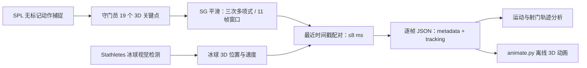
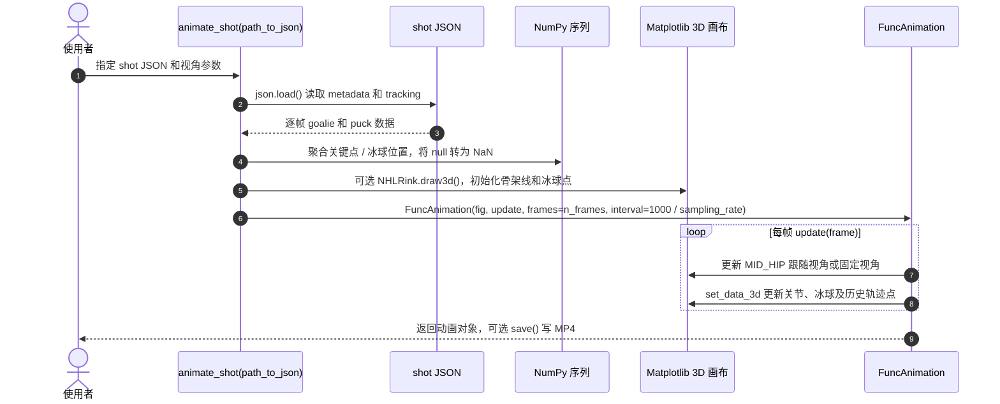

# SPL Hockey Goalie 3D：冰球守门员全身动作与冰球同步追踪

## 一句话定义

**SPL Hockey Goalie Dataset** 是 Maple Leaf Sports & Entertainment（MLSE）旗下 Sport Performance Lab（SPL）公开的冰球守门员三维运动学数据集，逐帧对齐人体 19 个关键点、冰球三维位置与速度；可用于离线运动分析及人体–物体交互轨迹研究，但**不是机器人关节动作数据集**。

## 英文缩写速查

| 缩写 | 英文全称 | 简要说明 |
|---|---|---|
| MLSE | Maple Leaf Sports & Entertainment | 枫叶体育娱乐集团，SPL 所属机构 |
| SPL | Sport Performance Lab | 无标记动作捕捉与运动表现数据团队 |
| MoCap | Motion Capture | 人体三维动作捕捉技术 |
| FPS | Frames Per Second | 此数据集帧率为 60 帧/秒 |
| JSON | JavaScript Object Notation | shot 级别的结构化逐帧存储格式 |
| SG | Savitzky–Golay | 官方文档采用的关键点时序平滑滤波方法 |

## 为什么重要

- **同步的身体与物体运动**：不只是视频或孤立人体姿态，还包括冰球位置、速度和帧级时间信息，能分析扑救时的运动反应与轨迹关系。
- **明确的物理量和质量边界**：文档公开坐标、单位、关键点、平滑与时间最近邻对齐规则，适合作为[具身数据清洗](../concepts/embodied-data-cleaning.md)的真实时间序列案例。
- **独立公开数据而非可直接控制的策略**：数据反映人类守门员运动，可用于动作理解、估计误差与缺失值研究；没有机器人动作、力矩、关节角真值，不能直接作为机器人 BC 训练数据。

## 核心信息

| 属性 | 官方数据口径 |
|---|---|
| 数据发布方 | 枫叶体育娱乐集团（MLSE）Sport Performance Lab；冰球追踪由 Stathletes 视觉检测模型提供 |
| 采集 | 2026-08-06；1 名匿名守门员 `P0001`；81 条射门 `S0001`–`S0081` |
| 人体观测 | 19 个三维姿态 keypoints（含眼、耳、鼻、颈及躯干和四肢，不等于 19 个活动关节） |
| 冰球观测 | `puck` 三维位置、`puck_velocity` 三维速度；被遮挡/出画可能为 `null` |
| 频率与同步 | 人体 60 Hz、冰球 60 Hz；以人体帧匹配 ±8 ms 范围内最近冰球测量，无插值 |
| 物理单位 | 位置英尺（ft）、冰球速度英尺/秒（ft/s）、`time` 毫秒（ms） |
| 坐标系 | 冰场中心原点，冰面 z=0；射向正 x 侧球门，球门线 x=89 ft |
| 数据 / 代码 | 81 个 JSON、`animate.py` 离线 3D 绘制代码、示意图和视频素材已公开 |
| 许可 | CC BY-NC-SA 4.0（署名、非商业、相同方式共享） |
| 赛事用途 | Stathletes [Big Data Cup 2027](https://stathletes.com/big-data-cup) 的三维守门员–冰球数据分析 |

## 核心原理

### 流程总览（据官方文档）

这里的上游捕捉/检测组件是官方 README 描述的数据来源，**不是仓库已开源的模型实现**。两路 60 Hz 测量做近邻匹配；冰球没有可用检测时存 `null`，**不会因为配对而插值得到完整轨迹**。

### 数据结构与预处理

单条文件位置如 `hockey/goalie/data/2026-08-06/P0001/HK_GL_P0001_S0001.json`：

- `metadata`：`session_date`、`participant_id`、`shot_number`、`duration__s`、`goalie_sampling_rate__hz`、`puck_sampling_rate__hz`。
- `tracking[]`：`frame`、`time`（距本 shot 起始的毫秒数）、`data.goalie`（19 个三维点）、`data.puck`、`data.puck_velocity`。
- 官方 S0001 文件包含 **438 帧**，元数据时长 **7.333 s**；本文只用单文件检查 schema，不能将此时长当成全量 81 shot 的均值。
- 守门员的 19 个命名点包含 NOSE / EYE / EAR / NECK，左右 SHOULDER、ELBOW、WRIST、HIP、KNEE、ANKLE 和 MID_HIP；原文用 robust Savitzky–Golay 过滤（三次多项式、11 帧窗口），属于轨迹后处理，而非公开训练代码。

## 源码运行时序图

官方可运行的部分是 `hockey/goalie/animate.py` 的 `animate_shot()`；已检查函数正文及 README 的调用入口。它从 JSON 回放数据，**没有运行原始运动捕捉/冰球检测模型**。

源码实际在动画显示中使用 `goalie` 和 `puck` 位置，**没有使用 `puck_velocity` 绘图**；缺失值变成 NaN，Matplotlib 不画该点。这个时序图是已公开的离线动画路径，不代表实时捕捉或训练推理链路。

## 工程实践

1. 从[官方仓库](https://github.com/Sport-Performance-Lab/SPL-Open-Data/tree/main/hockey/goalie)获取单个 shot JSON，并将工作目录切换到 `hockey/goalie/`。
2. 依 README 安装 `mplhockey`（图中冰场可选），在 Python/Jupyter 使用 `from animate import animate_shot`，再调用 `animate_shot("data/2026-08-06/P0001/HK_GL_P0001_S0001.json")`。
3. 若要保存 MP4，调用 `animate_shot(..., notebook_mode=False)` 后对返回对象执行 `anim.save("S0001.mp4", writer="ffmpeg", fps=60)`；运行环境需提供 Matplotlib、NumPy 和 ffmpeg。
4. 若用于人–物交互建模，预处理时先过滤 `null` 与不连续冰球观测，统一 ft/ms 单位到工程系统要求；需自行定义事件标签、动作映射和误差指标，不应把发布数据当成完整监督信号。
5. 用 `track_goalie=True`（默认）跟随 MID_HIP 看扑救动作，用 `track_goalie=False` 的固定镜头看冰球全路径；此选择只影响可视化，不改变源数据。

## 局限与风险

- **采样代表性小**：官方公开范围是 1 名守门员、1 次 session、81 次射门；不支持泛化到不同水平、体格或守门风格的统计结论。
- **遮挡与缺测**：冰球仅在可检测的画面中存在，缺测字段为 `null`；±8 ms 最近邻配对不是插值算法，也不是高精度同步误差的验证报告。
- **关键点≠关节状态**：19 点包含面部标记，缺少关节角、力、接触和执行器控制指令，不能无附加工序直接训练机器人执行策略。
- **采集上游没有源码**：仓库只提供结果 JSON 和离线动画脚本，不包含 SPL 内部 mocap 或 Stathletes puck detection 模型实现，也没有已知精度/延迟基准。
- **开放许可受限**：CC BY-NC-SA 4.0 包含非商业限制；“公开可下载”不等于可任意商用。
- **首创性与发布日期**：官方没有提供可证实“全球首个同类 3D 数据集”的比较证据；赛事文档仍有 “full dataset forthcoming” 字样，而官方仓库现可列出 81 个 JSON。应区分网页说明文案与实际文件可获取情况。

## 关联页面

- [Roboflow Sports](./roboflow-sports.md) — 可复用体育视觉检测/球跟踪工具，侧重算法接口；本集侧重发布的 3D 轨迹数据
- [McByte++](./mcbyte-plus-plus.md) — 体育多目标跟踪与 Re-ID 的另一种视觉任务
- [目标检测](../methods/object-detection.md) — 球体检测是冰球跟踪的上游视觉子问题，但本数据集没有发布检测模型
- [人形足球](../tasks/humanoid-soccer.md) — 体育任务中的人–球时空交互对照；其机器人感知/运动任务与本集守门员数据不等价
- [具身数据清洗](../concepts/embodied-data-cleaning.md) — 缺测、滤波、时间对齐与数据质量问题
- [具身数据纵深路线](../../roadmap/depth-embodied-data.md) — Stage 2 / Stage 3 的时序数据质量与字段 schema 案例

## 参考来源

- [SPL Hockey Goalie：官方技术说明与实测 JSON 归档](../../sources/datasets/spl-hockey-goalie-3d.md)
- [SPL Open Data：官方仓库及动画源码归档](../../sources/repos/spl-open-data.md)
- [Stathletes Big Data Cup 2027：赛事页面归档](../../sources/sites/stathletes-big-data-cup-2027.md)
- [官方原文 README（2026-11 更新）](https://github.com/Sport-Performance-Lab/SPL-Open-Data/blob/main/hockey/goalie/README.md)
- [官方动画 `animate.py`](https://github.com/Sport-Performance-Lab/SPL-Open-Data/blob/main/hockey/goalie/animate.py)

## 推荐继续阅读

- [官方原始数据目录](https://github.com/Sport-Performance-Lab/SPL-Open-Data/tree/main/hockey/goalie/data/2026-08-06/P0001) — 81 个 shot JSON
- [Big Data Cup 2027 官方数据说明](https://stathletes.com/big-data-cup/data-documentation) — 使用场景和比赛入口
- [MLSE Sport Performance Lab 官网](https://www.mlsedigital.com/innovation-initiatives/sport-performance-lab) — 机构背景
