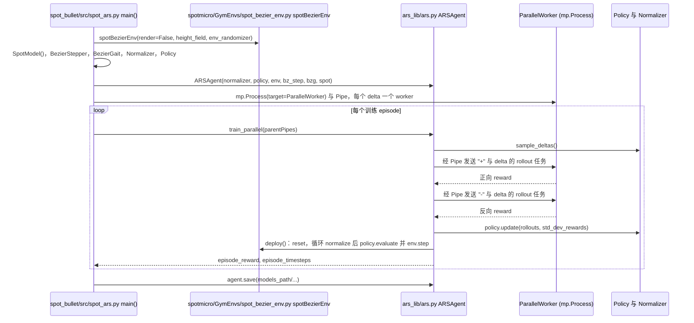
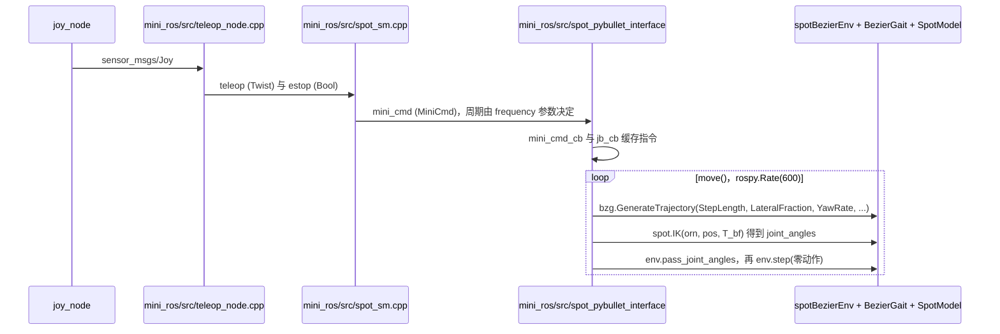

# Spot Mini Mini

**Spot Mini Mini**（[GitHub](https://github.com/OpenQuadruped/spot_mini_mini)）来自 [古月居转载的四足机器人开源项目综述](https://mp.weixin.qq.com/s/pRGoPm41qYCNyHPWR6Dl6A)，属「强化学习」组。

## 一句话定义

**Spot Mini Mini 是为 Spot Micro 社区做的 PyBullet 仿真与 OpenAI Gym 环境，用于在不损坏机器人的前提下做强化学习与控制实验。**

## 英文缩写速查

| 缩写 | 英文全称 | 简要说明 |
|------|----------|----------|
| DR | Domain Randomization | 域随机化 |
| PyBullet | Python Bullet Physics | 物理仿真库 |

## 为什么重要

- 综述把它放在「强化学习」这条技术路线下，作为可读源码的参照项目；横向对比见 [四足机器人开源项目技术地图：从极简运动学到研究级硬件（36 个 GitHub 项目）](../overview/quadruped-open-source-projects-technology-map.md)。
- 文中星标：919；分支 191（文章表述，入库日未复核）。

## 核心信息

| 项 | 内容 |
|----|------|
| **仓库** | [OpenQuadruped/spot_mini_mini](https://github.com/OpenQuadruped/spot_mini_mini) |
| **最近提交** | 2022-10-05 |
| **可达性** | `git ls-remote` 可达（2026-11-01） |
| **文章归类** | 强化学习 |

## 文章说法核对

- **文章：** 文章称其核心贡献是展示域随机化：随机化质量、质心、连杆长度、摩擦、电机延迟、传感器噪声与地形等，以提高策略鲁棒性。
- **README / 核查：** README 动机段说明作者为 Spot Micro 社区开发 PyBullet 仿真器并可作 Gym 环境；顶部声明开发因雇主 NDA 于 2020 年 11 月暂停。
- **差异与保留：** 文章列举的具体随机化项（电机延迟、齿轮间隙等）未在已读 README 段落中逐项核对。

## 源码运行时序图

入口：ARS 训练 `cd spot_bullet/src && ./spot_ars.py`；手柄仿真控制 `roslaunch mini_ros spot_move.launch`（启动 `spot_sm`、`joy_node`、`teleop_node`、`spot_pybullet_interface` 四个节点）。以下两张图分别对应这两条入口。

训练链路：

手柄控制链路：

图依据：OpenQuadruped/spot_mini_mini@c7e4905，读过 `README.md`、`spot_bullet/src/spot_ars.py`、`spot_bullet/src/ars_lib/ars.py`（`deploy`、`train_parallel`）、`mini_ros/launch/spot_move.launch`、`mini_ros/src/spot_sm.cpp`（话题声明部分）、`mini_ros/src/spot_pybullet_interface`；`teleop_node.cpp`、`ParallelWorker` 函数体、`spotmicro/` 下的环境与步态实现未读，teleop_node 的 Joy 输入与 teleop 输出话题依据 launch 文件与 `spot_sm.cpp` 订阅名推断。

## 关联页面

- [reinforcement-learning](../methods/reinforcement-learning.md)
- [domain-randomization](../concepts/domain-randomization.md)
- [quadruped-robot](../entities/quadruped-robot.md)
- [spotmicro](../entities/spotmicro.md)
- [quadruped-open-source-projects-technology-map](../overview/quadruped-open-source-projects-technology-map.md)

## 参考来源

- [spot_mini_mini.md](../../sources/repos/spot_mini_mini.md)
- [wechat_guyueju_quadruped_opensource_deep_dive_2026-11-01.md](../../sources/blogs/wechat_guyueju_quadruped_opensource_deep_dive_2026-11-01.md)
- [原文（微信公众号）](https://mp.weixin.qq.com/s/pRGoPm41qYCNyHPWR6Dl6A)
- 源码核对（2026-11-02）：OpenQuadruped/spot_mini_mini@c7e4905，读过 README.md、spot_bullet/src/spot_ars.py、spot_bullet/src/ars_lib/ars.py、mini_ros/launch/spot_move.launch、mini_ros/src/spot_sm.cpp、mini_ros/src/spot_pybullet_interface；时序图依据以上文件，未运行代码。
