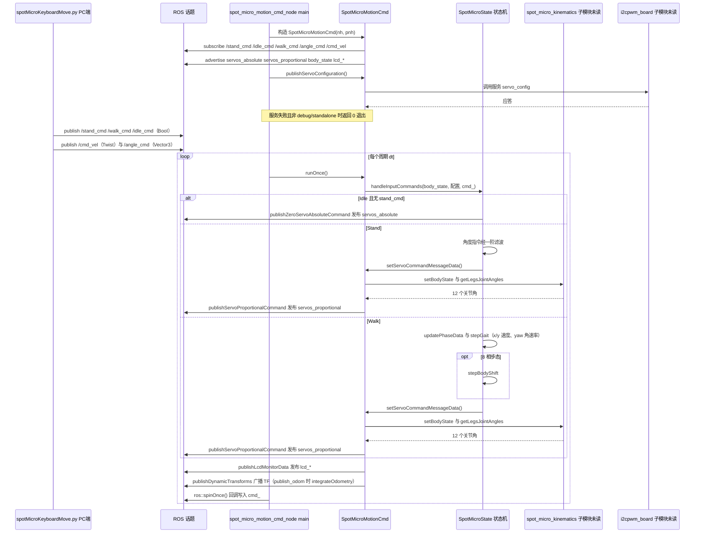

# SpotMicro（mike4192）

**SpotMicro（mike4192）**（[GitHub](https://github.com/mike4192/spotMicro)）来自 [古月居转载的四足机器人开源项目综述](https://mp.weixin.qq.com/s/pRGoPm41qYCNyHPWR6Dl6A)，属「ROS 生态」组。

## 一句话定义

**mike4192/spotMicro 是基于 ROS 的 Spot Micro 四足机器人运动控制源码：实现坐/站/姿态角/行走控制，并带 URDF、TF2 与里程计、SLAM 等配套。**

## 英文缩写速查

| 缩写 | 英文全称 | 简要说明 |
|------|----------|----------|
| ROS | Robot Operating System | 机器人中间件 |
| TF | Transform | ROS 坐标变换库 |
| IK | Inverse Kinematics | 逆运动学 |

## 为什么重要

- 综述把它放在「ROS 生态」这条技术路线下，作为可读源码的参照项目；横向对比见 [四足机器人开源项目技术地图：从极简运动学到研究级硬件（36 个 GitHub 项目）](../overview/quadruped-open-source-projects-technology-map.md)。
- 文中星标：2043；分支 484（文章表述，入库日未复核）。

## 核心信息

| 项 | 内容 |
|----|------|
| **仓库** | [mike4192/spotMicro](https://github.com/mike4192/spotMicro) |
| **最近提交** | 2021-03-20 |
| **可达性** | `git ls-remote` 可达（2026-11-01） |
| **文章归类** | ROS 生态 |

## 文章说法核对

- **文章：** 文章把它称作「开源界的波士顿动力」，强调完整 ROS 集成：`spot_micro_motion_cmd` 节点订阅 `/cmd_vel`，转成步态参数与足端轨迹，再经逆运动学发布关节角；并有完整 TF 树。
- **README / 核查：** README 目录列有 ROS 节点说明、URDF、TF2 发布与里程计、SLAM 等章节，概述称实现了 3D 打印 Spot Micro 的坐、站、姿态角与行走控制。
- **差异与保留：** 库内 `spotmicro` 节点对应的是 SpotMicroAI（GitLab 主仓库），与本仓库不同，故单独建节点。节点名 `spot_micro_motion_cmd` 与 `/cmd_vel` 流程来自文章，未在 README 前 700 字内逐项核对。

## 源码运行时序图

入口：机器人端 `roslaunch spot_micro_motion_cmd motion_cmd.launch`（启动 `i2cpwm_board` 与 `spot_micro_motion_cmd_node`）；PC 端 `roslaunch spot_micro_keyboard_command keyboard_command.launch`（启动 `spotMicroKeyboardMove.py`）。手柄入口 `spot_micro_joy/launch/everything.launch` 的话题路径相同，图中未单画。

说明：`spot_micro_kinematics`（逆运动学）与 `i2cpwm_board`（舵机驱动）是 git 子模块，本次检出中无内容，图中标为「未读」，只画它们的调用关系，不展开内部实现。

图依据：mike4192/spotMicro@2a34f5d，实际读过 `README.md`（前 120 行）、`spot_micro_launch/launch/keyboard_control_and_rviz.launch`、`spot_micro_launch/launch/motion_control_and_hector_slam.launch`、`spot_micro_motion_cmd/launch/motion_cmd.launch`、`spot_micro_keyboard_command/launch/keyboard_command.launch`、`spot_micro_joy/launch/everything.launch`、`spot_micro_motion_cmd/src/spot_micro_motion_cmd_node.cpp`、`spot_micro_motion_cmd/src/spot_micro_motion_cmd.cpp`（构造、runOnce、回调、servo 发布段）、`spot_micro_motion_cmd/src/smfsm/spot_micro_idle.cpp`、`spot_micro_stand.cpp`、`spot_micro_walk.cpp`（关键段）、`spot_micro_keyboard_command/scripts/spotMicroKeyboardMove.py`（关键段）；`spotMicroJoystickMove.py` 仅 grep 话题。未运行代码。

## 关联页面

- [quadruped-robot](../entities/quadruped-robot.md)
- [locomotion](../tasks/locomotion.md)
- [spotmicro](../entities/spotmicro.md)
- [quadruped-open-source-projects-technology-map](../overview/quadruped-open-source-projects-technology-map.md)

## 参考来源

- [spotmicro_ros_mike4192.md](../../sources/repos/spotmicro_ros_mike4192.md)
- [wechat_guyueju_quadruped_opensource_deep_dive_2026-11-01.md](../../sources/blogs/wechat_guyueju_quadruped_opensource_deep_dive_2026-11-01.md)
- [原文（微信公众号）](https://mp.weixin.qq.com/s/pRGoPm41qYCNyHPWR6Dl6A)
- 源码核对（2026-11-02）：mike4192/spotMicro@2a34f5d，读过 README.md（前 120 行）、spot_micro_launch 两个 launch、spot_micro_motion_cmd/launch/motion_cmd.launch、spot_micro_keyboard_command/launch/keyboard_command.launch、spot_micro_joy/launch/everything.launch、spot_micro_motion_cmd/src/spot_micro_motion_cmd_node.cpp、spot_micro_motion_cmd/src/spot_micro_motion_cmd.cpp（关键段）、spot_micro_motion_cmd/src/smfsm/spot_micro_idle.cpp、spot_micro_stand.cpp、spot_micro_walk.cpp（关键段）、spot_micro_keyboard_command/scripts/spotMicroKeyboardMove.py（关键段）；时序图依据以上文件，未运行代码。
