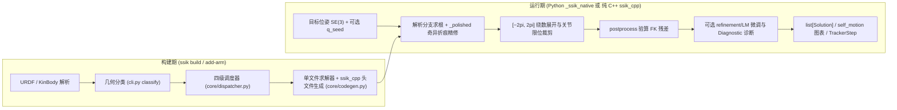
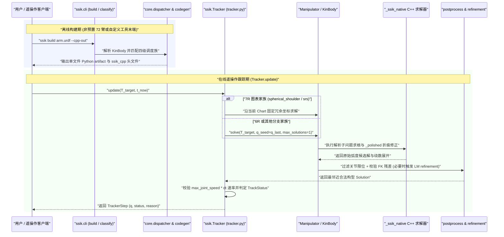

# ssik（Symbolic / Subproblem Analytic IK）

## 一句话定义

**ssik**（[personalrobotics/ssik](https://github.com/personalrobotics/ssik)，华盛顿大学 Personal Robotics Lab，BSD-3-Clause）是面向 **6R 与 7R 串联机械臂** 的解析逆运动学（IK）库：覆盖 **27 家厂商 72 款预置机械臂**（含非 Pieper 偏移腕 6R 与非 SRS 7R），在构建期将子问题分解烘焙为独立求解器或纯头文件 C++（`ssik_cpp`），运行时通过默认启用的原生 C++ 后端 **`_ssik_native`** 以微秒级延迟返回全部分支、`[−2π, 2π]` 绕数解与自运动流形图表。

## 英文缩写速查

| 缩写 | 英文全称 | 简要说明 |
|---|---|---|
| IK | Inverse Kinematics | 逆运动学：给定末端位姿求解关节角向量 |
| FK | Forward Kinematics | 正运动学：给定关节角计算末端齐次变换矩阵 |
| SRS | Spherical-Revolute-Spherical | 肩/腕球铰构型 7R 机械臂（如 iiwa 14），ssik 同时支持非 SRS 7R |
| Pieper | Pieper Criterion | 三连续轴交于一点的经典解析 IK 充分条件，ssik 可突破该限制 |
| URDF | Unified Robot Description Format | 描述机器人连杆与关节拓扑的 XML 标准，ssik 仅在构建期解析 |
| LM | Levenberg-Marquardt | 阻尼最小二乘数值精修算法，ssik 用于极低残差收敛与无解兜底 |

## 为什么重要

机器人规划、抓取合成与实时遥操作长期面临两难：**数值 IK**（如阻尼最小二乘、[Levenberg-Marquardt](../methods/levenberg-marquardt.md) 或 TracIK）依赖初值种子且通常仅收敛到单一局部解，容易在追踪轨迹时遭遇局部极小或关节构型突然翻转；**传统解析 IK**（如 IKFast、EAIK / IK-Geo）往往要求严格满足 Pieper 条件或标准 SRS 构型，面对带腕部偏移的协作臂（如部分 UR 派生臂、Franka 衍生构型或新形态机械臂）直接报错拒绝。

ssik 在研究与工程层面的核心突破在于：

- **统一突破几何受限假设：** 基于 Raghavan-Roth、Manocha-Canny、Husty-Pfurner 等代数消元与几何子问题分解，建立四级统一分派引擎，覆盖正交/斜交 Pieper 腕、通用非 Pieper 6R、球肩/SRS 7R 及通用 7R。
- **构建期编译、运行期零重依赖：** 运行期完全脱离 SymPy 与 URDF DOM 解析；既可在 Python 中通过内置 C++ 原生扩展 **`_ssik_native`** 获得比纯 Python 快 **2–100×** 的微秒级速度（6R 约 **10–460 µs**，7R SRS/球形肩约 **120–360 µs**），也可通过 CLI 一键导出**零 Python 依赖的纯头文件 C++ 源码（`ssik_cpp`）**直接嵌入实时控制环。
- **遥操作友好的 `Tracker` 与 `self_motion` 图表：** 不仅枚举全部离散解分支与 `[−2π, 2π]` 多圈绕数，还为 7R 冗余臂显式提供自运动流形（`self_motion`）与连续流式跟踪器 **`ssik.Tracker`**，从机制上避免遥操作过程中的「肘部突跳（elbow flip）」。

## 核心原理

### 四级解析分派与双阶段管线

1. **几何分类与四级调度（`core/dispatcher.py` / `core/codegen.py`）：** 构建期将每条运动链标准化为 `KinBody` 旋量参数，按几何族分配求解策略：对解析可分家族（如 6R Pieper、`seven_r.spherical_shoulder`、`seven_r.srs`）生成精确 Paden-Kahan / 代数子问题求根链；对一般耦合 6R 启用一维特征多项式 / 半切线参数降维；并在奇异折痕（fold）附近插入 `_polished` 单步 Gauss-Newton / 解析局部修正，保证数值精度。
2. **原生 C++ 后端与头文件导出（`_ssik_native` & `ssik_cpp`）：** PyPI 发行包内置编译好的 `_ssik_native` C++ 扩展（默认启用，可通过选项退回纯 Python 验证）。针对 C++ 实时控制器（如 `ros2_control`、EtherCAT 环），`ssik build` 可生成单文件、零外部依赖的 C++17 头文件（例如 `ssik::iiwa14_ik`），无需部署 Python 解释器即可完成全分支求解。
3. **绕数枚举、自运动流形与诊断：** `Manipulator.solve()` 不仅返回主区间 `[−π, π]` 内的离散分支，还支持针对大行程关节（如 `±2π`、`±360°`）自动枚举 `[−2π, 2π]` 内全部合法绕数解。对于 7R 冗余臂，API 可沿 `Chart` 计算连续 `self_motion` 零空间曲线，并输出附带 `fk_residual`、`refinement_used` 的 `Solution` 以及由 `TolerancePolicy` 驱动的 `Diagnostic` 诊断结果（区分数值误差与真正不可达）。
4. **流式遥操作跟踪器（`ssik/tracker.py`）：** `ssik.Tracker` 面向 VR 手柄、SpaceMouse 或动捕流逐帧输入设计：在 `seven_r.spherical_shoulder` 与 `seven_r.srs` 上直接锁定当前冗余坐标并在自运动图表 `Chart` 上延续追踪（支持 `Tracker.set_redundancy()` 保持末端静止而平滑滑动肘部），其余构型则按 `wrap_linf` 种子距离执行锁定分支求解；同时内置基于 `max_joint_speed * dt` 的速度钳位，并通过 `TrackStatus`（`OK`、`LIMITED`、`HELD`、`JUMPED`）显式通告分支保持或越界状态。

## 源码运行时序图

以下时序基于仓库真实源码 `src/ssik/cli.py`、`manipulator.py`、`tracker.py`、`core/dispatcher.py`、`core/codegen.py`、`postprocess.py` 与 `refinement/__init__.py`：

## 工程实践

1. **优先查询 72 款预置臂并善用 `add-arm`：** 安装 `pip install ssik` 即可直接加载 27 家厂商 72 款预置机械臂（涵盖 UR、Franka FR3/Panda、KUKA iiwa14、xArm6/7、Kinova Gen3/JACO2、PiPER、Rizon、OpenArm、Galaxea R1 Pro 等）；若加装自定义腕部相机或末端工具延长连杆，安装 `pip install 'ssik[urdf]'` 后运行 `ssik classify` / `ssik build` 生成专属求解器，再在运行时无 URDF 依赖调用。
2. **实时环部署推荐导出 `ssik_cpp`：** Python 原生扩展 `_ssik_native` 已可在 10–460 µs 完成 6R 全分支求解；若需集成到无 GIL 抖动的 C++ 底层控频环（如 1 kHz 力矩/位置伺服），直接通过 codegen 导出独立 `ssik_cpp` 头文件编译进控制器。
3. **遥操作切勿裸用 `solve()`，应使用 `Tracker`：** 在 VR/动捕输入存在连续姿态穿越奇异区风险时，`Tracker` 能保持当前运动学分支并在 7R 上固定冗余参数，当输入超速或接近奇异/限位时返回 `LIMITED` 或 `HELD` 状态，避免直接裸跑 `solve()` 选近解导致的构型瞬间翻转。
4. **注意 joint-lock 7R 的计算预算：** 7R SRS/球肩构型耗时通常在 120–360 µs，而退化至通用 joint-lock 数值离散采样的 7R 机械臂耗时为 **1.1–12 ms**，在高频遥操作环中应提前用真实目标轨迹基准实测预算。

## 局限与风险

- **无内置环境自碰撞检测与动力学约束：** ssik 纯聚焦单链串联运动学求解与自限位裁剪，不处理连杆自碰撞、外部障碍物避障或关节力矩极限，真实系统常需与 [cuRobo](./curobo.md)、[MoveIt 2](./moveit2.md) 或 [Pinocchio](./pinocchio.md) 配合。
- **奇异连续流形处的自由度模糊：** 在严格奇异点上，部分关节角形成一维连续解而非孤立点（`solve()` 会择取距种子最近点）；在接近折叠点时依赖 `_polished` 与 LM 精修来恢复机器浮点极限下的 FK 闭合精度。
- **非所有任意 7R 均有闭式图表：** 只有 `seven_r.spherical_shoulder` 与 `seven_r.srs` 具备连续 `self_motion` 图表；通用无球铰 7R 仍需借助锁定某一冗余关节的扫描策略，延迟显著高于闭式家族。

## 与其他页面的关联

- 核心任务与方法：[Manipulation](../tasks/manipulation.md)、[Teleoperation](../tasks/teleoperation.md)、[Trajectory Optimization](../methods/trajectory-optimization.md)、[Levenberg-Marquardt](../methods/levenberg-marquardt.md)
- 相邻运动学与规划栈：[MoveIt 2](./moveit2.md)、[cuRobo](./curobo.md)、[Pinocchio](./pinocchio.md)、[Dynibo](./dynibo.md)、[Pinocchio 快速上手](../queries/pinocchio-quick-start.md)
- 遥操作工程上下文：[Isaac Teleop](./isaac-teleop.md)、[xpad](./xpad.md)

## 参考来源

- 官方仓库与源码深读归档：[ssik.md](../../sources/repos/ssik.md)（通读 `README.md`、`docs/`、`cli.py`、`manipulator.py`、`tracker.py`、`core/dispatcher.py`、`core/codegen.py`、`postprocess.py`、`refinement/__init__.py`）
- 开源仓库：<https://github.com/personalrobotics/ssik>
- 官方文档站：<https://personalrobotics.github.io/ssik/>

## 推荐继续阅读

- 遥操作映射与延迟路线：[Teleoperation Depth Roadmap](../../roadmap/depth-teleoperation.md)（Stage 2：映射与延迟 / `ssik.Tracker` 分支保持）
- 运动学与动力学基石：[Pinocchio 快速上手](../queries/pinocchio-quick-start.md)、[Dexterous Kinematics](../concepts/dexterous-kinematics.md)
