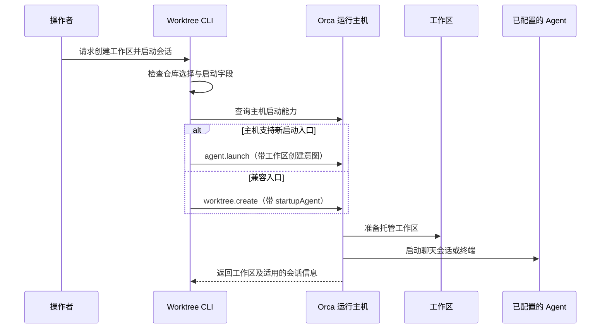

# Orca：并行编码智能体工作台 / Orca for Parallel Coding Agents

## 一句话定义

Orca 是把多个编码智能体、终端、Git worktree 与审查界面放进同一套工作台的开源项目；它负责组织工作，而不是提供一个新模型或替用户购买其算力。

## 英文缩写速查

| 缩写 | 英文全称 | 含义 |
|---|---|---|
| IDE | Integrated Development Environment | 开发与审查界面 |
| CLI | Command-Line Interface | 代理或 Orca 的命令行入口 |
| SSH | Secure Shell | 到已配置远程主机的连接方式 |
| PR | Pull Request | 用于审查并合并改动的请求 |
| VM | Virtual Machine | 可选的独立工作区执行环境 |

## 为什么重要

多 Agent 真正容易出问题的是改动撞在同一目录、终端失去上下文、远程执行无法追踪，以及自动生成的结果没有经独立复核。Orca 把工作区、会话与差异链接起来，但审查门禁仍需由仓库与团队配置。

## 核心原理与流程

| 运行模式 | 代码和进程位置 | 使用边界 |
|---|---|---|
| 本地桌面 | 本机 | 桌面与执行同机，设备离线时不能当作常驻主机 |
| SSH worktree | 配置的 SSH 主机 | 远程运行 Git 和 Agent，桌面负责操作和审查 |
| Remote Orca Server | 用户控制的常驻机器 | 运行主机掌握工作区及会话，可由配对的桌面、网页或手机接续 |
| 每工作区环境 | 自带云账户的 VM／沙箱，或本地容器 | 由仓库 `orca.yaml` 和生命周期脚本描述；云资源与账单仍属用户，不是 Orca 提供的托管 VPS |

**工作区不等于隔离边界。** 同一机器上的 Git worktree 分开检出目录和分支，不隔离环境变量、挂载、宿主进程或凭据。需要更强隔离时，应选独立执行环境并限制联网与授权，而非把 worktree 当作安全沙箱。

## 工程实践：CLI 启动的静态源码时序

以下限定固定提交的「创建 worktree 并启动已配置 Agent」路径，非实测、非所有 Bot 路径。

在机器人仓库中，先把文档、测试和仿真回归分到各自分支，指定测试场景及产物，再人工核对 diff 与运行日志。不要把获得一个 Agent 会话当成已有可合并改动，更不等于已完成真机验收。

## 局限与风险

- README 将 Claude Code、Codex、Grok、Antigravity 等列为 CLI 示例；终端可运行不等于它们均有相同的原生聊天、Bot 支持或会话恢复能力。
- 订阅由上游独立管理，执行端仍需自己的登录或配置，遵守服务条款、订阅额度和组织权限。MIT 是 Orca 仓库许可，不授予模型权重、上游额度或无偿远程算力。
- 手机是配对后的交互端，不是默认的执行主机。远程会话是否持续取决于运行端存活与配置。
- 本次未安装或验证平台、付费额度、远程连通性或第三方操作权限。

## 关联页面

- [编码智能体编排与人工监督](../concepts/coding-agent-orchestration-and-cognitive-oversight.md)
- [Agent-first 软件工厂](../concepts/agentic-software-factory-harness.md)
- [编码 Agent 的验证闭环](../methods/coding-agent-verification-loops.md) · [ENPIRE](../methods/enpire.md)

## 参考来源

- [固定源码、许可和工作区调用链归档](../../sources/repos/stablyai_orca.md)
- [官方执行模式](https://orca.dev/docs/ways-to-run) · [官方 Bot 文档](https://orca.dev/docs/bots)

## 继续阅读

- [官方 worktree 使用说明](https://orca.dev/docs/model/worktrees)
- [编码 Agent 的验证闭环](../methods/coding-agent-verification-loops.md)
