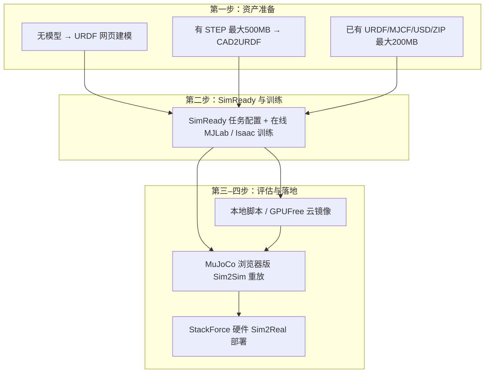

# StackForce

## 一句话定义

**StackForce** 是集成堆叠式模块化硬件套件（[stackforce.cc](https://stackforce.cc/)）与浏览器端工作台向导（[`workbench.stackforce.cc`](https://workbench.stackforce.cc/) + [`cad2urdf.stackforce.cc`](https://cad2urdf.stackforce.cc/upload)）的轻量级机器人开发生态，打通从 **CAD/URDF 准备 → SimReady 配置 → 在线 MJLab/Isaac 训练 → MuJoCo Sim2Sim 验证 → 实物部署** 的教学与工程入门链路。

## 英文缩写速查

| 缩写 | 英文全称 | 简要说明 |
|------|----------|----------|
| CAD | Computer-Aided Design | 机械结构三维设计，常见输出 STEP/STP |
| URDF | Unified Robot Description Format | ROS/Isaac 生态统一的连杆–关节描述格式 |
| STEP | Standard for the Exchange of Product model data | 工业 B-rep 零件/装配交换格式 |
| RL | Reinforcement Learning | 通过与仿真环境交互学习控制策略 |
| USD | Universal Scene Description | Omniverse/Isaac Sim 场景与机器人资产格式 |
| SimReady | Simulation-Ready Asset | StackForce 侧对「可导入 Isaac 训练管线」工程/资产的命名 |
| FOC | Field-Oriented Control | 磁场定向控制，StackForce 电机驱动模块常用技术 |

## 为什么重要

- **降低「我有 CAD，但不知道从哪开始训 RL」的摩擦：** [工作台](https://workbench.stackforce.cc/) 用 **三步状态分岔**（无模型 / 有 STP / 已有 URDF·USD）把读者放进正确入口，而不是要求先读完 Isaac Lab 全文档。
- **补齐国内教育向硬件 + 云工具闭环：** 主站硬件（ESP32 主控、FOC 电机板、舵机板等）与 Seeed [小轮足开源教程](https://wiki.seeedstudio.com/cn/stackforce_mini_wheeled_legged_robot/) 形成 **桌面级整机**；Web 侧再接到 **Isaac 训练工程**，适合课程、毕设与自研小整机。同属 Seeed 开源硬件线的桌面六轴臂见 [reBot-DevArm](./rebot-devarm.md)。
- **CAD→仿真资产有明确分工：** [CAD2URDF](https://cad2urdf.stackforce.cc/upload) 强调 **STEP 本地解析、原始 CAD 不上传**，但 **Link/Joint 需人工配置**——与全自动几何推断的 [step2urdf](./step2urdf.md) 形成对照，读者可按模型复杂度选型。
- **训练入口不只本地：** 工作台第三步显式列出 **本地 conda/脚本** 与 **[GPUFree](./gpufree.md) 云镜像**，与 [Isaac Lab](./isaac-lab.md) 对 RT 核心与桌面仿真的要求对齐。

## 核心结构

### 1. 硬件平台（stackforce.cc）

- **堆叠式模块：** 主控板 + 执行器（无刷 FOC、舵机）+ 传感器（IMU、测距等）+ 通信（CAN、RS485、人机交互）
- **开发面：** Arduino IDE、PlatformIO、**Simulink 无线实时**、**Python 库** 与 **ROS** 接入；配套 **StackForce Studio** 上位机调试
- **代表整机：** Seeed [Stackforce_Mini_Wheeled_Legged_Robot](https://github.com/Seeed-Projects/Stackforce_Mini_Wheeled_Legged_Robot)（轮足、B 站系列教程）

### 2. 强化学习工作台（workbench.stackforce.cc）

| 读者状态 | 引导动作 |
|----------|----------|
| 没有机器人 3D 模型 | StackForce **URDF 网页版（机器人 3D 建模）** 直接从零或模板构建 |
| 有 `\*.stp` | 跳转 **CAD2URDF** 网页转换器 |
| 有 `URDF / USD` | **直接输入** 到 **SimReady** 配置任务 |

工作台主流程（2026-11 页面核对）：**第一步（建模/转换/输入 URDF） → 第二步（在 SimReady 配置并发起在线 MJLab 强化学习训练） → 第三步（在 StackForce MuJoCo 浏览器版做 Sim2Sim 重放评估） → 第四步（StackForce Sim2Real 实物部署）**（亦保留本地脚本 / [GPUFree](./gpufree.md) 云训练对接路径）。

### 3. CAD2URDF（cad2urdf.stackforce.cc）

- **三步：** 1. 导入模型或资源包 → 2. 配置 Link/关节 → 3. 测试和导出
- **格式与大小上限：** 支持 **STEP（最大 500MB）** 与 **URDF / MJCF / USD / 资源 ZIP（最大 200MB）**；引用外部网格时打包为 ZIP，已有 URDF/MJCF/USD 会预填 Link 和关节结构。
- **缓存：** 浏览器本地解析与 job 缓存；支持导入/导出 StackForce `.cad2urdf` 工程文件。
- **局限：** 仅导入几何或既有结构，**Link/关节拓扑、坐标朝向与惯量仍需人工复核配置**。

## 流程总览

## 源码运行时序图

**不适用（核心 Web 工作台与云端工具链未开源）：** `workbench.stackforce.cc`、`cad2urdf.stackforce.cc` 与在线 MJLab/SimReady 服务均以闭源在线 Web 应用形态运行，官方未公开前后端转换及训练调度的源代码仓库（唯一公开仓库为 Seeed 联合发布的硬件/课程代码 `Seeed-Projects/Stackforce_Mini_Wheeled_Legged_Robot`，含 CAD 模型、BOM 与 PlatformIO 嵌入式固件）。

## 工程实践

- **涉密 CAD 处理：** 虽宣称 STEP/资源在浏览器本地解析，但对敏感或涉密整机设计，仍建议自托管开源替代方案（[FreeCAD](./freecad.md) + [step2urdf](./step2urdf.md)）并在浏览器 Network 面板确认无外部请求。
- **ZIP 资源与单位对齐：** 向 `cad2urdf` 提交含 mesh 引用的包时须将 URDF/MJCF 与网格一并打为 `<= 200MB` ZIP，并核对导出的关节轴正方向、质量分配与碰撞简化，不要跳过第三步测试直接开训。

## 与相近工具的对照

| 工具 | 起点 | 强项 | 局限 |
|------|------|------|------|
| **StackForce CAD2URDF** | STEP(≤500MB) / URDF·MJCF·USD·ZIP(≤200MB) | 国内访问、一键串联 SimReady → 在线 MJLab / MuJoCo 重放 | Link/Joint 配置偏人工；**工具源码未开源** |
| [step2urdf](./step2urdf.md) | STEP | OpenCascade.js **几何驱动关节推断**、MIT 开源可自托管 | 关节类型偏 revolute/prismatic；无云端训练集成 |
| [URDF-Studio](./urdf-studio.md) | 设计阶段 / 已有 URDF·MJCF·USD | 统一工作站、BOM/PDF 报告、AI 辅助、Apache-2.0 开源 | 侧重建模编辑与多格式导出，不提供硬件商城与 MJLab 托管 |
| [FreeCAD](./freecad.md) | 参数化 CAD | 制造级 B-rep、Robot 工作台与 ROS 插件 | 需桌面安装；导出 STEP 后可进 CAD2URDF 或 step2urdf |

**推荐衔接：** FreeCAD/厂商 STEP → **CAD2URDF 或 step2urdf** → URDF → **工作台 SimReady / Isaac Lab / MJLab** → MuJoCo Sim2Sim 重放 → Sim2Real（见 [Sim2Real](../concepts/sim2real.md)）。

## 局限与常见误区

- **「STEP 转完就能训」：** CAD2URDF 只保证几何导入；**关节轴、限位、惯量、碰撞** 不检查清楚会在 Isaac 里表现为爆炸或学不动。
- **「工作台 = 又一个仿真器」：** StackForce Web 侧核心是 **向导 + 工程导出**；物理仿真与 RL 算法仍在 **Isaac** 生态完成。
- **「云训练随便选卡」：** 工作台推荐 GPUFree 时，仍须遵守 **RT 核心 + Vulkan 桌面镜像**（见 [GPUFree](./gpufree.md)），否则图形仿真无法实时显示。

## 关联页面

- [策略优化](../methods/policy-optimization.md) — 延伸阅读，理解策略训练的优化目标。
- [step2urdf](./step2urdf.md) — 浏览器 STEP→URDF，几何关节推断
- [URDF-Studio](./urdf-studio.md) — Web URDF/MJCF 设计与 BOM
- [Isaac Lab](./isaac-lab.md) — SimReady 导出目标的官方 RL 框架
- [GPUFree](./gpufree.md) — 工作台列出的云训练入口之一
- [URDF（统一机器人描述格式）](../concepts/urdf-robot-description.md) — 描述格式背景
- [强化学习](../methods/reinforcement-learning.md) — 训练范式
- [FreeCAD](./freecad.md) — STEP 上游 CAD
- [reBot-DevArm](./rebot-devarm.md) — Seeed 全栈开源桌面六轴臂（B601）
- [轮腿双足](../concepts/wheel-legged-biped.md) — 研究级双轮足 RL 栈（TITA / Flamingo），对照桌面小轮足

## 推荐继续阅读

- [Isaac Lab — Importing a New Asset](https://isaac-sim.github.io/IsaacLab/main/source/how-to/import_new_asset.html) — URDF→USD 与训练资产注册
- [Seeed StackForce 小轮足 Wiki](https://wiki.seeedstudio.com/cn/stackforce_mini_wheeled_legged_robot/) — 硬件组装与 URDF/STL 资源包

## 参考来源

- [StackForce 工作台站点归档](../../sources/sites/stackforce-workbench.md)
- [StackForce CAD2URDF 站点归档](../../sources/sites/stackforce-cad2urdf.md)
- [StackForce 主站](https://stackforce.cc/)
- [工作台](https://workbench.stackforce.cc/) / [CAD2URDF](https://cad2urdf.stackforce.cc/upload)
