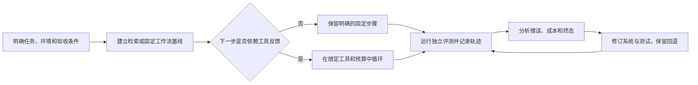
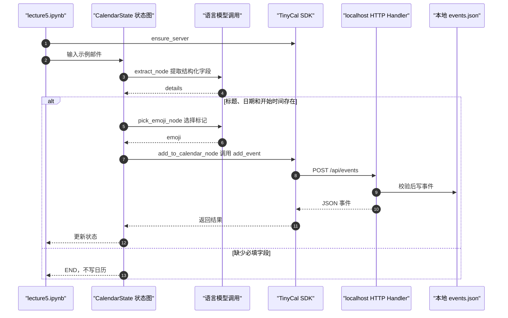

# CS 329Z: Engineering AI Agents · 斯坦福大学 AI 智能体工程

## 一句话定义

斯坦福大学 2026 年秋季的 AI 智能体工程课：先独立搭建检索、工具调用和反馈循环，再比较框架设计、数据、评测和安全边界。

## 英文缩写速查

| 缩写 | 英文全称 | 简要说明 |
|---|---|---|
| LLM | Large Language Model | 流程中用于判断或生成的模型 |
| RAG | Retrieval-Augmented Generation | 检索证据后再生成回答 |
| MCP | Model Context Protocol | 接入工具与资源的一种协议 |
| HW | Homework | 课程作业，此处为 HW1 与 HW2 |
| SDK | Software Development Kit | TinyCal 提供给框架的 Python 工具接口 |

## 为什么重要

课程把“用工具的模型”“谁决定下一步”和“怎样确认任务做完”分开。步骤已知时，固定工作流通常更容易测试；当下一步取决于执行反馈时，可引入受资源和权限限制的决策循环。复杂度提高后，需要独立的终止条件与结果检查，不宜靠模型自报成功。

## 核心信息

| 项 | 内容 |
|---|---|
| 机构 | 斯坦福大学（Stanford University） |
| 学期与教师 | 2026 年秋季；Diyi Yang、Michael Ryan、John Yang |
| 课程主页 | [课表、课件与已公开视频](https://cs329z.stanford.edu/) |
| 第 1 讲 | [Stanford Online：What Are AI Agents?](https://www.youtube.com/watch?v=DGI4vucR71w) |
| 代码入口 | [课程组织](https://github.com/cs329z)、[Lecture 5](https://github.com/cs329z/lecture5-frameworks)、[HW1](https://github.com/cs329z/assignment1-harness)、[HW2](https://github.com/cs329z/assignment2-evals) |

## 核心机制与流程总览

| 建议学习次序 | 可交验的产物 |
|---|---|
| 基础组件：模型、检索、工具接口 | 一条简单基线，以及工具输入和状态输出契约 |
| 运行框架：工作流、智能体循环、记忆与多智能体 | HW1 从流水线过渡到手写运行框架；再用 Lecture 5 比较 DSPy 组件、LangGraph 状态转移和 Temporal 活动 |
| 评测与优化：数据选择、评估器、轨迹检查 | 用请求、环境、停止条件、评分器四元组写一项任务；HW2 先验证参考解能通过同一评分器，再记录多次试验的差异 |
| 权限与验证：安全课、期末项目 | 先定义允许的动作与失败行为，再提交基线对比、错误分析和可复现入口 |

这是按课程材料归纳的学习流程，并非每次作业的唯一解法。

## 源码运行时序图

下图只对应 Lecture 5 Notebook 的 LangGraph 条件工作流与 TinyCal，不把 Temporal、DSPy 或尚待实现的作业拼成一条链。

离线用公开 SDK 和本地服务验证了 7 项读写与错误处理；没有运行 Notebook 模型调用或外部日历。

## 工程实践

先用虚构工单做 5–10 条可重放样本，包含成功、信息不足、超时、重复请求和应拒绝的输入。为工具写清参数和副作用，给每次试验记录模型、版本和预算，评分优先检查最终环境状态。迁移到机器人任务时，日历案例只提供编排与评测思路；真机另需状态检查、权限、急停与独立控制保护。

## 局限与风险

- 学期课表为动态页面。公开第一讲与课表上已有的播放链接可以使用，不等于全部录像均公开。
- 两个作业仓库是起步材料。HW1 的 adapter 留空是作业设计，不能把它当可直接部署的成品；HW2 的示例也不代表评测已完成。
- Lecture 5 的完整演示涉及外部模型和额外依赖。本次未调用 provider，也未运行 Temporal 或 Harbor；不以 TinyCal 的通过结果证明整个系统可靠。

## 关联页面

- [机器人智能体运行框架](../methods/robot-agent-harness.md)
- [智能体工具接口](../methods/agent-tool-use-interface.md)
- [AI 基准评测](../methods/ai-benchmark-evaluation.md)
- [Agent 工程小书](./little-book-agent-engineering.md)
- [Stanford CS146S：现代软件开发者](./cs146s-modern-software-developer.md)

## 参考来源

- [Stanford CS 329Z 官方课程核对](../../sources/courses/cs329z-engineering-ai-agents.md)
- [公开示例与作业代码核对](../../sources/repos/cs329z-course-code.md)

## 推荐继续阅读

- [Stanford CS 329Z 项目成功条件与可复现性要求](https://cs329z.stanford.edu/project.html)
- [课程首页与各课次材料](https://cs329z.stanford.edu/)
