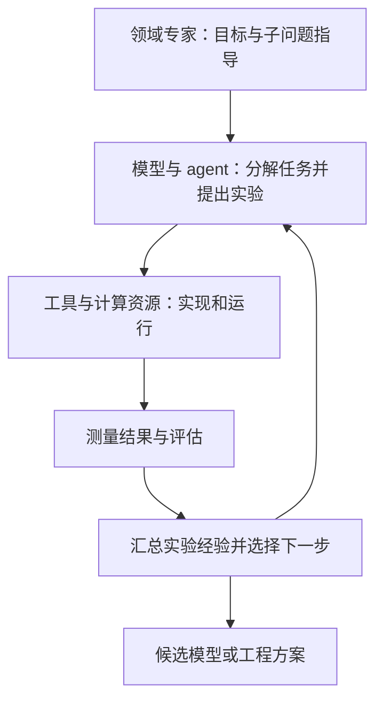

# HAI Closing Fireside: Discovery Loop / HAI 闭幕对谈：科研实验闭环与递归自改进

## 一句话定义

这是 Jeff Dean 的科研自动化演讲及其与李飞飞的闭幕对谈，核心是让模型与 agent 通过工具执行、实验评估和经验反馈推进研究，同时辨明任务改进与递归自改进的边界。

## 英文缩写速查

| 缩写 | 英文全称 | 简要说明 |
|---|---|---|
| HAI | Human-Centered Artificial Intelligence | 本次大会的斯坦福主办研究院 |
| ML | Machine Learning | 演讲中最先推进自动实验闭环的领域 |
| RSI | Recursive Self-Improvement | 本场指进一步改进产生改进提案的基础系统 |
| MRI | Magnetic Resonance Imaging | 对谈用于解释任务模型自改进的示例 |
| MoE | Mixture of Experts | 回顾模型架构发展时讨论的专家混合机制 |

## 为什么重要

对机器人研究，值得借鉴的是降低**完整实验迭代**的时间，而非只提高代码生成速度。Dean 明确区分数字域与需要物理过程的研究：真实采样、复位和硬件测试不会因 agent 增多而自动消失。下文的机器人建议属于本库工程推论，不是本场报告的机器人实验。

## 核心原理

### 核心信息

| 项目 | 核对结果 |
|---|---|
| 大会 | Confronting Our AI Future: Hope, Fear, and the Choices Ahead |
| 机构 | 斯坦福大学以人为本人工智能研究院（Stanford HAI） |
| 活动 / 录像发布 | 2026-10-28 / 2026-11-04 |
| 原始录像 | `ooGKNwJWdb8`；48:22，英文自动字幕至 48:15 |
| 材料性质 | 官方演讲与对谈；不属于带完整实验协议的论文或开源实现 |
| 通读方式 | 通读完整英文自动字幕与官方议程、录像索引；未逐帧观看全部视频 |

### 从单次实验到研究编排

1. **提出、运行、测量、再决策**（1:55–2:41）：每轮评估应改进下一轮实验提案；需同时优化质量、数量与迭代耗时。
2. **模型之外还需工具与经验**（9:48–10:45）：基础模型本身不足以完成复杂任务；agent 调工具执行并使用历史实验结果。
3. **分解也可以调整**（10:48–13:06）：大项目的子任务划分、协调和资源配置本身就是优化对象；领域专家可以指导重要子问题，不能直接推断人类已退出。
4. **先做数字闭环**（28:48–30:14）：当时聚焦机器学习研究、机器学习工程和硬件设计；需要真实物理过程的领域存在额外时延。

### 流程总览

下图依据 1:55–2:41、9:48–13:06 的公开机制绘制，表示演讲提出的实验数据流，**不代表已公开源码的模块架构**。

### 自我改进与 RSI 的区别

| 维度 | 任务自我改进 | 本场定义的 RSI |
|---|---|---|
| 被改进对象 | 给定目标下的任务模型或方案 | 负责产生改进提案的基础系统 |
| 对谈例子 | 搜索更好地解释 MRI 数据的模型 | 让提出下一步方案的系统本身变强 |
| 应有证据 | 指标随实验改善 | 除任务收益，还需验证改进提案系统本身的能力变化 |

19:55–22:42 的定义用于厘清层级；它不等于其他文献对“完全自主设计后继模型”的更强 RSI 定义。23:08–25:07 强调计算、训练、数据存储及评估仍需时间，不能把减少人类等待外推成无限快的迭代。

### 其余对谈线索

- **理论与实验**（30:18–33:16）：讨论从数据寻找理论与跨领域经验复用的可能性，未给出系统验证。
- **数学**（33:17–37:02）：机器可检查的长证明与能启发后续问题的简洁技巧是不同价值；具体数学结果须另查原论文。
- **技术回顾**（37:07–42:40）：Transformer、蒸馏、MoE 与代码能力；对更不规则架构的预期仍未充分实现。
- **人本目标**（42:45–48:15）：社会收益依赖政策、就业适应和人的目标；建议学生主动使用新工具服务自身兴趣。

## 工程实践

**机器人研究迁移建议（本库推论）：** 把仿真实验的配置、随机种子、训练预算、评测集和失败原因写入可追踪记录；单独统计提案、运行、评估、排队及真机复位耗时。先验证固定预算下是否得到更多可靠改进，再考虑扩大 agent 数量。可运行最小对照见 [autoresearch](./karpathy-autoresearch.md)。

| 开放与复现项 | 状态 |
|---|---|
| 官方视频、议程 | 公开可访问 |
| 本场闭环源码、权重、数据 | 所读官方页面和视频说明未列下载入口 |
| 源码运行时序图 | **不适用**：本材料为演讲与对谈，未提供可核实的运行入口或调用路径 |
| 对照实验与复现协议 | 本次材料未给出 |

## 局限与风险

- **目标与结果分开**：15:00–15:18 的 20–50 倍专家生产率是目标；约 20 个改进环（14:13 起）是讲者自报运行状态，缺少独立评测和公开日志。
- **机制不等于实现**：上述图仅表达演讲描述；不得据此编写虚构 API、调度器或源码时序图。
- **材料范围有限**：本次收录的是指定闭幕视频及活动身份页面，不代表已通读大会所有场次，也不证明公司其他资源没有开放。
- **字幕有限制**：英文自动字幕存在姓名、术语和断句误识别；未把招聘履历、历史轶事或随口提及的数学成果转成已核验技术结论。
- **机器人外推有限**：未报告真实机器人部署、成功率或安全验证；物理环节的耗时和失败成本需另行测量。

## 关联页面

- [学术研究自动化](../concepts/ai-auto-research.md)：把该对谈放回探索、执行与验证的完整流程。
- [递归自改进](../concepts/recursive-self-improvement.md)：对照不同强度的 RSI 定义与证据要求。
- [autoresearch](./karpathy-autoresearch.md)：固定预算实验循环的公开实现对照。

## 参考来源

- [官方视频完整字幕阅读记录](../../sources/videos/stanford-hai-discovery-loop-2026.md)
- [官方议程与录像索引核对](../../sources/sites/stanford-hai-confronting-ai-future-2026.md)

## 推荐继续阅读

- [官方完整录像](https://www.youtube.com/watch?v=ooGKNwJWdb8)：演讲约 1:32 起，对谈约 15:46 起，RSI 定义约 19:55 起。
- [大会官方录像索引](https://hai.stanford.edu/events/confronting-our-ai-future-hope-fear-and-the-choices-ahead?section=watch-event-recordings)：其余场次作为后续阅读入口。
