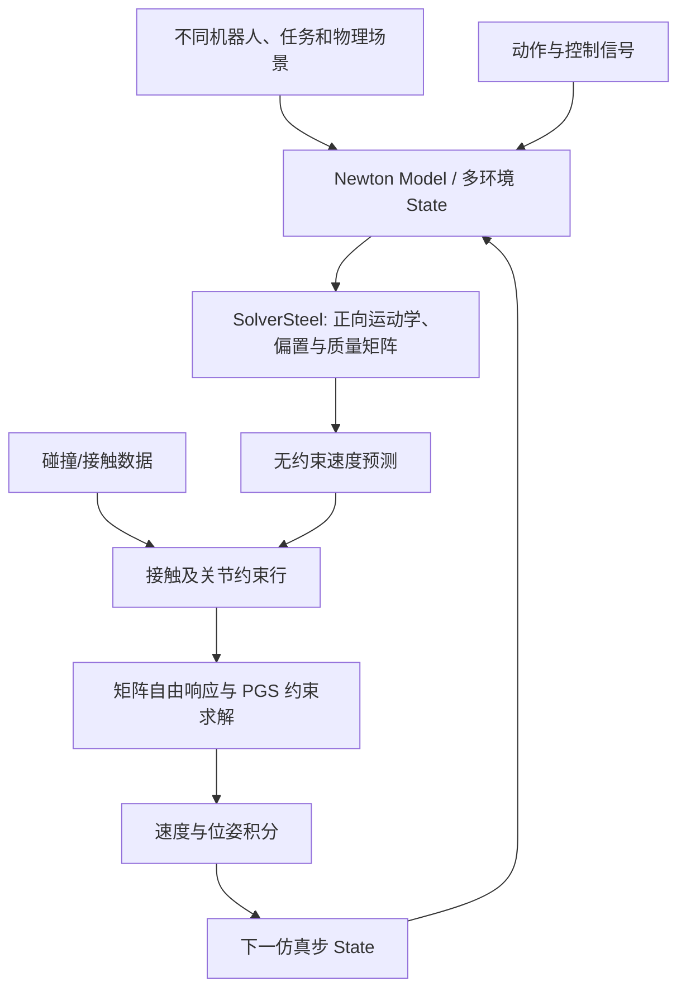
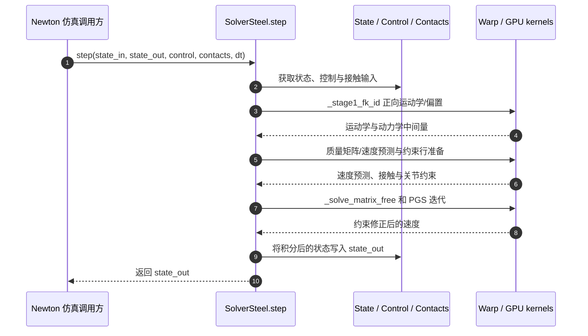

# Steel：跨机器人、任务与世界的 GPU 刚体仿真 / Scaling Simulation Across Robots, Tasks, and Worlds

## 一句话定义

**Steel 是 Newton Physics Engine 内的 GPU 刚体约束求解器 `SolverSteel`，面向多本体、多任务、异构环境并行仿真，而非策略网络或整套训练框架。**

## 英文缩写速查

| 缩写 | 英文全称 | 简要说明 |
|------|----------|----------|
| GPU | Graphics Processing Unit | 并行物理计算设备 |
| PGS | Projected Gauss-Seidel | Steel 使用的约束迭代求解方式 |
| CRBA | Composite Rigid Body Algorithm | 关节空间质量矩阵计算 |
| FK | Forward Kinematics | 运动学正解 |
| VBD | Vertex Block Descent | Newton 耦合演示中的软体求解方法 |

## 核心信息

| 字段 | 内容 |
|------|------|
| 机构 | Skild AI 与英伟达（NVIDIA） |
| 公告 | [Skild AI 官方技术博客](https://skild.ai/blogs/steel)（2026-11） |
| 源码 | [Newton 中的 SolverSteel](https://github.com/newton-physics/newton/tree/main/newton/_src/solvers/steel) |
| 代码状态 | **已开源**，Newton 内实现与另行发布的 WebGPU 移植，Apache-2.0 |
| 适用场景 | Isaac Lab/Newton 刚体机器人学习、异构机器人/任务批次、接触密集操作 |

## 为什么重要

传统通过复制大量相同机器人环境提高仿真效率；通用机器人学习还需要**异构本体、任务、场景**在同一批次里高吞吐运行。Steel 解决的是动力学求解吞吐和 GPU 内存瓶颈，尤其适用于训练时混合不同机器人的经验分布。它不直接解决策略数据质量或 Sim2Real 可靠性。

## 核心原理

- **Reduced-coordinate articulated dynamics：** 在关节坐标中计算运动学、逆动力学偏置与质量矩阵。
- **约束行：** 将接触、关节位置/速度限位等构造成约束，使用矩阵自由响应与 PGS 迭代求解。
- **批次调度：** 对不同本体/规模的 articulation 分组，使用 Warp/CUDA 内核计算并写回状态；源码包含 colored、serial 等求解模式与接触配置。
- **耦合能力：** Newton 展示刚体—软体/颗粒等耦合和实验性可微接触；这些是集成演示，不能等同所有接触模型已证明精度和稳定性。

### 流程总览

**图示来源：** 官方博客对 Newton 接口的描述及 `solver_steel.py` 的 `step`、阶段函数与类文档。未将场景多样性自动推演为策略泛化结果。

## 源码运行时序图

代码定位：[Newton `steel/__init__.py`](https://github.com/newton-physics/newton/blob/main/newton/_src/solvers/steel/__init__.py)、[`SolverSteel.step` / `_stage1_fk_id` / `_solve_matrix_free`](https://github.com/newton-physics/newton/blob/main/newton/_src/solvers/steel/solver_steel.py)。时序描述运行过程，不表示本次实际执行了仿真。

## 实验与评测

| 对照 | 作者报告 | 测量条件 |
|------|----------|----------|
| 20 项单任务 | **3.8×** PhysX | 两引擎分别选择各自测得最佳 batch；几何平均；19/20 更快 |
| 异构批次 | **峰值最高 13.0×** PhysX | 混合 5/10/15/20 种任务，比较各自峰值 |
| 同批次异构 | **12.0× 吞吐，节约 62% 显存** | 20 种任务、61,440 环境的 matched batch |
| 硬件 | 一张 RTX PRO 6000 Blackwell | **仅仿真 throughput**，非策略训练 FPS |

## 结论

**Steel 的贡献是扩大机器人学习在模拟环境中的并行规模与本体多样性，不是直接增加真机策略成功率。**

1. 对照 PhysX 时先统一任务组合、接触设置、随机化、GPU、batch 口径。
2. 19/20 任务更快不代表全部任务一致加速。
3. 报告吞吐要明确 3.8× 几何均值与最高 13× 异构峰值的区别。
4. 将仿真引擎性能与 policy rollout、学习更新耗时、Sim2Real 指标分开记录。

## 工程实践

- 公共接口 `newton.solvers.SolverSteel`；具体实现由 Newton 源码提供，不是 [skild-ai/steel](https://github.com/skild-ai/steel) README 自身。
- 官网 benchmark 使用 `reuse_kinematics=True`（Newton 1.8 opt-in），对照时需确保开关一致。
- [WebGPU 移植](https://github.com/skild-ai/steel-webgpu) 可在浏览器实验但不是 Newton Python/CUDA 的同一执行入口。
- 建议评测吞吐、显存、接触稳定性、求解精度、不同任务组合下的极值与分布；本次未独立运行。

## 局限与风险

- 13× 仅在作者测得异构配置峰值出现；不可推广到所有 GPU / Isaac Lab 环境。
- 刚体为核心；软体/颗粒耦合和可微功能需分别验证适用边界与数值精度。
- 仿真更快不等于真实机器人迁移成功率更高，也不证明完整 RL 训练墙钟同比提升。
- 未执行本地基准，性能结论均为 Skild/NVIDIA 的作者报告。

## 关联页面

- [GR00T 2：世界与动作联合预测](paper-gr00t-2.md)
- [Agentic Robotics 对照研究](paper-agentic-robotics-controlled-study.md)
- [ToolDex：工具操作示范数据](paper-tooldex.md)

## 参考来源

- [官方博客核验归档](../../sources/sites/steel-skild-ai.md)
- [Newton 源码阅读记录](../../sources/repos/steel-newton.md)

## 推荐继续阅读

- [Skild AI Steel 官方发布](https://skild.ai/blogs/steel)
- [Newton SolverSteel 目录](https://github.com/newton-physics/newton/tree/main/newton/_src/solvers/steel)
