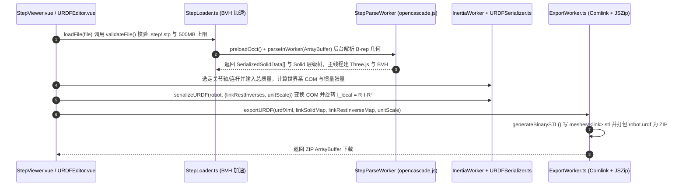

# step2urdf

## 一句话定义

**step2urdf**（原 URDFlyS2U）是 [Democratizing-Dexterous/step2urdf](https://github.com/Democratizing-Dexterous/step2urdf) 以 MIT 许可开源的浏览器端 **STEP → URDF** 工具（在线版 [step2urdf.top](https://step2urdf.top/)），完全在本机 Web Worker 内通过 **OpenCascade.js (WASM)** 解析 CAD 实体、交互配置旋转/移动关节并输出单位校准的 URDF + 二进制 STL 包。

## 英文缩写速查

| 缩写 | 英文全称 | 简要说明 |
|------|----------|----------|
| STEP | Standard for the Exchange of Product model data | 工业 B-rep 零件/装配交换格式 |
| URDF | Unified Robot Description Format | ROS 生态统一的机器人连杆/关节描述格式 |
| COM | Center of Mass | 质心，动力学与平衡分析的关键参数 |
| CAD | Computer-Aided Design | 计算机辅助设计，硬件结构建模 |
| ROS | Robot Operating System | 机器人中间件与工具链（含 ROS2） |
| WASM | WebAssembly | 浏览器内运行原生级代码的虚拟机格式 |

## 为什么重要

- **缩短 CAD→仿真 gap：** 许多开源整机与夹具以 **STEP** 分发，而 RL/MPC/WBC 栈通常需要 **URDF/MJCF**。step2urdf 把「手工写 link/joint/inertial」压缩为 **几何导入 + 少量人工确认**。
- **本地隐私友好：** 官方强调 STEP **仅在用户本机**处理（OpenCascade.js + Worker），不上传服务器——对未公开机械设计更友好；敏感项目仍建议 **自托管 Release** 而非公共在线实例。
- **生态入口：** [BotWorld](./botworld.md) 插件中心将 step2urdf 列为推荐工具，便于 **CAD→URDF→广场发布** 的上下游衔接。
- **与桌面 CAD 衔接：** [FreeCAD](./freecad.md) 等 OpenCASCADE 系工具导出的 **STEP** 是 step2urdf 的典型输入——在桌面 CAD 完成装配与公差后再做浏览器端 URDF 推断。
- **几何优先的关节推断：** 从 STEP 中识别 **圆弧/直线段** 以定义 **revolute/prismatic**，比纯手动点选轴心更贴近 CAD 语义，但仍需导出前 **交互滑动关节** 做 sanity check。

## 核心能力

| 模块 | 作用 |
|------|------|
| **STEP 导入与 solid 树** | 层级浏览、隐藏/选择组件，组织 link 划分 |
| **关节识别** | 几何特征 → revolute / prismatic；支持 XYZ **轴偏移微调** |
| **惯量与质心** | 输入整机总质量，自动分配各 link 惯量/COM，可逐 link 改 |
| **交互可视化** | Three.js 场景内测试关节角/位移，导出前验证 |
| **URDF 导出** | 生成 ROS/ROS2 可用的机器人描述包 |

技术栈：**Vue 3 + Vite + Three.js + opencascade.js（WASM）+ Comlink Worker**；MIT 许可，pnpm 构建。

## 流程总览

## 源码运行时序图

以 `Democratizing-Dexterous/step2urdf` `main` 分支前端加载、序列化与 Worker 导出管线（`StepLoader.ts`、`URDFSerializer.ts`、`ExportWorker.ts`）为核对入口：

图依据：`Democratizing-Dexterous/step2urdf` `main` 分支 `StepLoader.ts`、`URDFSerializer.ts`（第 304–342 行 `rotateInertiaTensor`）与 `ExportWorker.ts`（2026-11-28 通读源码）。

## 工程实践

- **单位系数与坐标系前置检查：** 工程机械 CAD 常以毫米输出 STEP；导出设置中需正确指定 `unitScale`（mm → m 为 `0.001`）与 `baseLinkOrientation`，确保 `URDFSerializer` 将 `InertiaWorker` 计算的惯量按 $I_{\text{local}} = R \cdot I \cdot R^\top$ 正确旋回 Link 局部轴系。
- **内网与私有模型自托管：** 官方站点 `step2urdf.top` 为客户端 Vue 3 SPA，但涉密硬件仍建议直接拉取仓库运行 `pnpm install && pnpm build` 或用 `python3 -m http.server` 托管 Release 静态包。
- **导出前逐关节滑块测试：** 利用内置 `JointSlider` 与 `FrameVisualizer` 逐一验证旋转轴正方向是否符合右手定则及相邻连杆网格零位不干涉，再送下游仿真。

## 与相近工具的对照

| 工具 | 起点 | 强项 | 局限 |
|------|------|------|------|
| **step2urdf** | 已有 **STEP** | 浏览器即用、几何驱动关节、本地处理 | 关节类型限于 revolute/prismatic；复杂闭链/柔性体需人工后处理 |
| [StackForce CAD2URDF](./stackforce.md) | STEP/STP / URDF·USD | 国内访问、本地解析、与工作台 **SimReady→MJLab** 一条龙 | Link/Joint 配置偏人工；非开源仓可查 |
| [URDF-Studio](./urdf-studio.md) | 设计阶段 / 已有 URDF·MJCF·USD | 统一编辑器、MJCF/USD/BOM 导出、AI 辅助 | 不是 STEP 专用转换器；与本工具互补 |
| [CAD Skills](./cad-skills.md) | 自然语言 → **build123d** | Agent CLI、`gen_urdf()` 与制造链 skill | 依赖 Python/OCP 环境，非「拖 STEP 即转」 |
| [robot-viewer](./robot-viewer.md) | 已有 URDF/MJCF | 多格式预览、MuJoCo WASM 轻仿真 | 不负责从 STEP 生成模型 |

**推荐衔接：** STEP → **step2urdf** → URDF → [robot-viewer](./robot-viewer.md) / [MoveIt2](./moveit2.md) / 仿真引擎（必要时再转 MJCF）。

## 局限与常见误区

- **「在线版 = 文件上传云端」：** 项目 README 与源码 `StepLoader` 证明几何解析全在本地 Comlink Worker 运行，文件上限 500MB；合规要求严苛场景建议 F12 验证网络或内网自托管。
- **「自动关节 = 无需人工」：** 复杂装配、轴系不一致或 CAD 简化不当时，必须 **交互验证 + 轴向微调**。
- **「URDF 惯量可直接上真机」：** 按总质量均一密度分配体积估算惯量不含电机转子 `armature`、线束与内部空腔差异，Sim2Real 前应对照 CAD 材质分布、称重或系统辨识复核（参见 [Sim2Real](../concepts/sim2real.md)）。
- **网格复杂度未经碰撞化减：** 直接导出的三角化二进制 STL 往往顶点数过高，进物理仿真器前建议抽稀或生成凸包碰撞代理。

## 关联页面

- [URDF-Studio](./urdf-studio.md) — Web 端 URDF/MJCF 设计与 BOM 工作站
- [CAD Skills](./cad-skills.md) — build123d/STEP/URDF Agent Skills CLI 路线
- [robot-viewer](./robot-viewer.md) — URDF 预览与 MuJoCo WASM
- [robot-explorer](./robot-explorer.md) — 运动学/可操作度分析
- [MoveIt2](./moveit2.md) — URDF/SRDF 下游运动规划
- [文字生成 CAD（Text-to-CAD）](../concepts/text-to-cad.md) — STEP 上游生成路线
- [BotWorld](./botworld.md) — 插件中心外链入口与资产发布广场
- [StackForce](./stackforce.md) — 工作台向导 + CAD2URDF，可导出 Isaac RL 工程

## 推荐继续阅读

- [OCP / OpenCascade 生态](https://dev.opencascade.org/) — STEP/B-rep 内核背景
- [step2urdf Bilibili 教程](https://www.bilibili.com/video/BV168PjzrErB) — 官方视频 walkthrough

## 参考来源

- [step2urdf 源码归档](../../sources/repos/step2urdf.md)
- [step2urdf.top 站点归档](../../sources/sites/step2urdf-top.md)
- [step2urdf GitHub](https://github.com/Democratizing-Dexterous/step2urdf)
