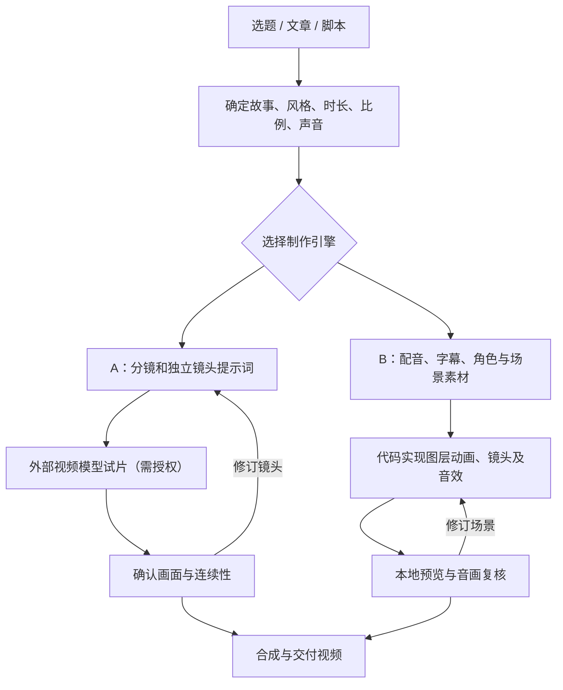
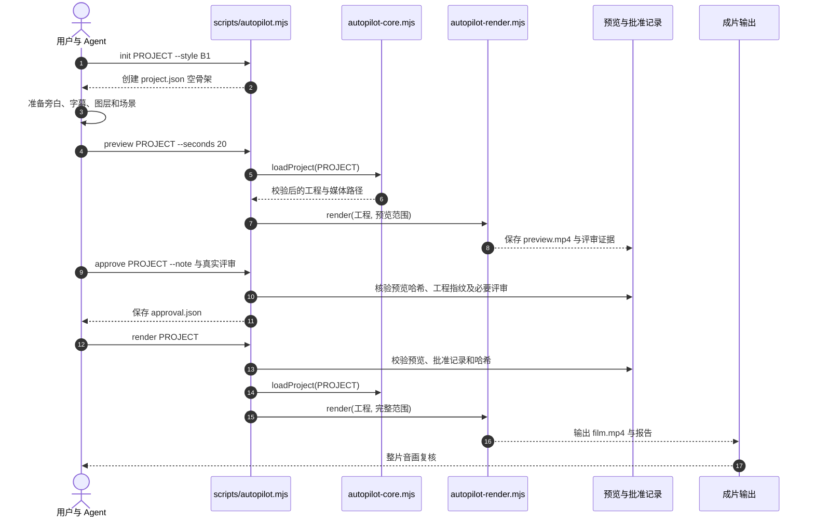

# Stickman Video Director｜火柴人视频导演

**Stickman Video Director** 是 [kaomei/stickman-video-director](https://github.com/kaomei/stickman-video-director) 的开源 Agent Skill：把选题、文章或脚本转成火柴人解说/短剧视频的分镜、视觉、配音、字幕与音效制作流程。

## 一句话定义

以 **A · Model Engine（模型引擎）** 和 **B · Code Engine（代码引擎）** 分离「视频模型生成镜头」和「可复用图层 + 代码动画 + 本地渲染」，用风格规约、样片确认与音画复核组织端到端视频制作。

## 英文缩写速查

| 缩写 | 英文全称 | 简要说明 |
|------|----------|----------|
| AI | Artificial Intelligence | 负责脚本、分镜及素材/动画编排的智能体能力 |
| CLI | Command-Line Interface | B1–B4 的 `autopilot.mjs` 本地执行入口 |
| TTS | Text-to-Speech | 将旁白文本生成为有实际时间戳的配音音轨 |
| SFX | Sound Effects | 按动作与语义节拍配置的音效 |
| MP4 | MPEG-4 Part 14 | 本地渲染成片常用的视频容器 |

## 为什么重要

- **多模态内容交付案例：** 不是只有提示词，而是把故事 → 分镜 → 视觉资产 → 时间线 → 声音 → 成片检查写成 Agent 可遵守的生产约束。
- **机器人/科研传播：** 可用于讲解控制系统、仿真工作流、知识库节点的故事化视频，但其火柴人动作是**视觉叙事动画**，不等于可执行机器人轨迹。
- **与现有工具分工：** [video-shotcraft](./video-shotcraft.md) 更聚焦产品宣传片镜头配方，[Remotion](./remotion.md) 与 [HyperFrames](./hyperframes.md) 更接近通用可编程视频渲染层；本项目重点是火柴人角色风格与制作规约。

## 核心原理

| 维度 | A · Model Engine | B · Code Engine |
|---|---|---|
| 画面来源 | 分镜 + 参考图/提示词驱动视频生成模型 | 生成/绘制分层角色、场景、道具，代码控制逐帧/时间线动画 |
| 工作流 | 确认脚本/风格/比例 → 分镜 → 独立镜头提示词 → 授权试片 → 授权完整制作 | 检查依赖 → 旁白与脚本 → 首段音画预览 → 确认 → 制作场景并本地渲染 → 音画终检 |
| 主要优势 | 可表现丰富自然运动与镜头效果 | 角色资产复用、时序与修改范围可控 |
| 主要成本 | 外部视频模型额度、重试与平台访问 | Agent 编程额度、生成图片/配音工具、本地计算 |
| 风格集 | A1–A7：黑白、Modern Pop、洞穴、温馨、历史、Amber Noir、橡皮管动画 | B1–B7：极简线稿、彩色手绘、复古电视、求生短剧、角色解说、动态 Meme、像素剧场 |

官方 README 将 A8/B8 仍标为 **Coming soon**；后续 Channel Autopilot 和桌面 Studio 也属于规划，不应算作当前已交付功能。A 的提示词交付可以是独立终点，不应误写为必然自动登录并支付第三方视频平台；B 的不同风格也并不共用全部执行入口。

## 流程总览

依据官方 [README](https://github.com/kaomei/stickman-video-director/blob/main/README.md)、[SKILL.md](https://github.com/kaomei/stickman-video-director/blob/main/skills/directing-stickman-videos/SKILL.md) 和 [模式边界](https://github.com/kaomei/stickman-video-director/blob/main/skills/directing-stickman-videos/references/mode-execution-boundaries.md) 编译。此图是**媒体制作数据流**，不是机器人控制闭环。

## 源码运行时序图

**核对范围：B1–B4**。官方 [`scripts/autopilot.mjs`](https://github.com/kaomei/stickman-video-director/blob/main/skills/directing-stickman-videos/scripts/autopilot.mjs) 的命令分发实际调用 `autopilot-core.mjs` 的 `loadProject`，按 `validate` / `preview` / `render` 分支动态加载 `autopilot-render.mjs` 的 `painter` / `render`，并要求在正式 `render` 前核验预览报告与批准记录。

B5 使用 `scripts/character-explainer.mjs`，B6 使用独立的 `b6-dynamic-meme.mjs` 路径，B7 有专门的 Pixel Theater 规则；**上图不代表这些风格共享 B1–B4 命令**，也不表示仅凭代码通过技术检查就达到了样片审美标准。

## 工程实践

1. 安装官方 [Skill](https://github.com/kaomei/stickman-video-director/tree/main/skills/directing-stickman-videos) 并阅读 `SKILL.md`；先选 A/B 模式、具体风格、16:9 或 9:16、语言与输出时长。
2. **A 模式：** 先审核分镜，再获取可独立使用的逐镜头提示词；只有授权并具备服务访问和额度后才执行外部视频生成。连续性、人物一致性和声音须复核实际片段。
3. **B1–B4 示例：** 在 Skill 目录执行 `node scripts/autopilot.mjs doctor`；然后 `node scripts/autopilot.mjs init /absolute/project --style B1 --ratio 16:9`。将旁白、字幕时间戳、分镜和素材写入工程。
4. 先 `validate` 和 `preview PROJECT --seconds 20`，按风格进行**真实样片**的视觉/字幕/声音检查；用户批准后，带必要评审文件运行 `approve`，再运行 `render PROJECT`。不可用“脚本执行成功”冒充审核通过。
5. **适配场景：** 选 B1 做机器人概念讲解，选 B5 做固定讲解员叙事；真实机器人运动论文的实验对比仍需展示真正的实验数据、仿真录像和定量指标，不能用卡通表演替代。

| 检查项 | 核实结果 |
|---|---|
| 开源状态 | **已开源**：GitHub 提供 Skill、分模式规则、本地工具、测试/样例资源 |
| License | MIT；分发需保留许可，第三方素材另审 |
| B1–B4 本地依赖 | Node.js ≥20、`@napi-rs/canvas`、`sharp`，及实际媒体处理所需 FFmpeg / FFprobe / 字体 |
| 代码验收 | 只读核对了命令入口、项目加载与文档；**未在本次环境真正执行渲染或播放核验** |

## 局限与风险

- **模型生成非确定性：** A 模式镜头角色一致性、动作细节与平台输出受参考图、预算和模型影响，需逐镜头复核。
- **代码驱动也非“自动达标”：** B 模式需要具体风格的素材、音频、同步与审美检查；B5/B6/B7 路线和 B1–B4 存在架构差异。
- **费用和版权：** MIT 仅覆盖项目软件；AI Agent 订阅、TTS、图像/视频 API、音乐/音效许可与平台发布准则独立适用。
- **边界：** 不输出机器人可执行动作/控制器，也不解决仿真、逆动力学或真机部署质量验证。

## 关联页面

- [Coding Agent 验证闭环](../methods/coding-agent-verification-loops.md) — 对照预览回放、独立视听审查与终片验收的证据要求；技术检查不能替代实际体验验收
- [Claude Code 动态多 Agent 工作流](../methods/claude-code-dynamic-workflows.md) — 对照将脚本、分镜、生成、渲染和验收组织为分阶段任务的 Agent 编排方法；本 Skill 不必然采用多个子 Agent

- [video-shotcraft](./video-shotcraft.md) — 产品镜头配方与 Remotion 风格的 Agent 视频制片
- [HyperFrames](./hyperframes.md) — HTML/CSS/动画编排的视频工程运行时
- [Remotion](./remotion.md) — 通用 React 程序化视频合成
- [ffmpeg-skill](./ffmpeg-skill.md) — 视频剪辑、编码与成片技术交付
- [Manim](./manim.md) — 适合数学和机器人原理讲解的程序化动画

## 参考来源

- [官方 GitHub 仓库一手材料归档](../../sources/repos/stickman-video-director.md)
- [README 和演示](https://github.com/kaomei/stickman-video-director/blob/main/README.md)
- [SKILL.md](https://github.com/kaomei/stickman-video-director/blob/main/skills/directing-stickman-videos/SKILL.md)
- [官方 B 运行时实现](https://github.com/kaomei/stickman-video-director/blob/main/skills/directing-stickman-videos/scripts/autopilot.mjs)
- [官方 MIT 许可](https://github.com/kaomei/stickman-video-director/blob/main/LICENSE)

## 推荐继续阅读

- [官方 B 模式运行时和命令说明](https://github.com/kaomei/stickman-video-director/blob/main/skills/directing-stickman-videos/references/autopilot-runtime.md)
- [A/B 模式执行与授权边界](https://github.com/kaomei/stickman-video-director/blob/main/skills/directing-stickman-videos/references/mode-execution-boundaries.md)
- [B1–B6 本地制作工作流](https://github.com/kaomei/stickman-video-director/blob/main/skills/directing-stickman-videos/references/b-style-installed-workflow.md)
