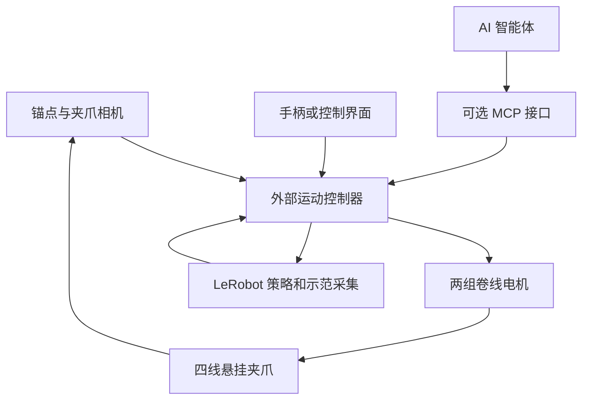
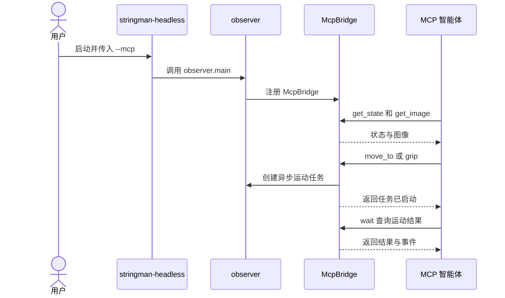

# Stringman：房间尺度绳索机器人

Stringman 是悬挂在房间上方的四线绳索驱动并联机器人，用于遥操作、模仿学习和抓取搬运实验。

## 英文缩写速查

| 缩写 | 英文全称 | 简要说明 |
|------|----------|----------|
| CDPR | Cable-Driven Parallel Robot | 多根绳索共同驱动末端的并联机器人 |
| MCP | Model Context Protocol | 使智能体发现与调用工具的接口协议 |
| IMU | Inertial Measurement Unit | 测量末端惯性信息 |
| IL | Imitation Learning | 用示范数据训练策略 |

## 流程总览

两组主动锚点分别收放两根绳，另两个角使用被动导环；相机跟踪标记，夹爪有压力传感、IMU 和测距。系统通过目标识别、抓取模型与放置流程组合完成指定任务。

## 源码运行时序图

以下是已核实的 MCP 入口与运动任务交互，设备内部控制细节仍待逐函数核实。

## 工程实践与局限

- **范围与负载：** 官方标称动态负载 2 kg，取决于位置和速度。产品页对最大房间尺寸存在不同口径，应结合房间与安装条件核实。
- **自主能力：** 预设流程结合目标识别与抓取，并将物品放到指定位置；官方明确称仍为原型，尚不具备家电级可靠性。家具可能挡住绳索，当前没有自动避障。
- **MCP：** 可读取状态、图像，发起运动、抓取和停止；代码执行工具需单独启用。工具启动动作后需等待结果，不能把接口接通等同于已解决自主整理。
- **成本：** 2026-11-01 产品页显示成品 795 美元，安装、外部主机、运费与税费等需另行确认。本地 AI 推理需要加速硬件。
- **开源：** 官方控制软件仓库公开且声明 Apache-2.0；打印与构建文档公开，硬件各部分许可应单独核对。

## 核对状态

本页依据产品页、使用指南及控制器、MCP 桥接源码编写；完整硬件与系统架构文档及设备侧低层调用链尚未通读核实，未在真机运行。此条目暂为草稿。

## 关联页面

- [LeRobot](./lerobot.md)
- [Manipulation](../tasks/manipulation.md)
- [Teleoperation](../tasks/teleoperation.md)

## 参考来源

- [官方资料归档](../../sources/sites/stringman.md)
- [官方代码归档与版本](../../sources/repos/stringman.md)

## 推荐继续阅读

- [MCP 操作指南](https://github.com/nhnifong/cranebot3-firmware/blob/79f2b695f885e2b09a0a7d1e0fac3546431e9bc1/src/nf_robot/host/mcp_bridge/GUIDE.md)
