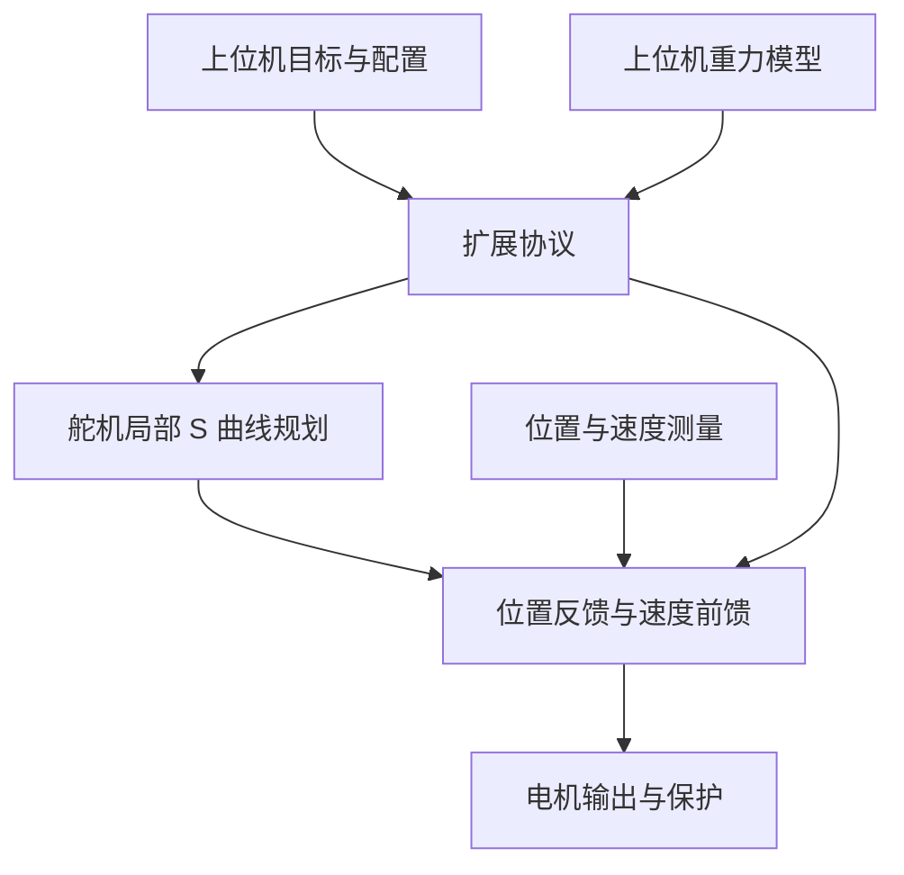
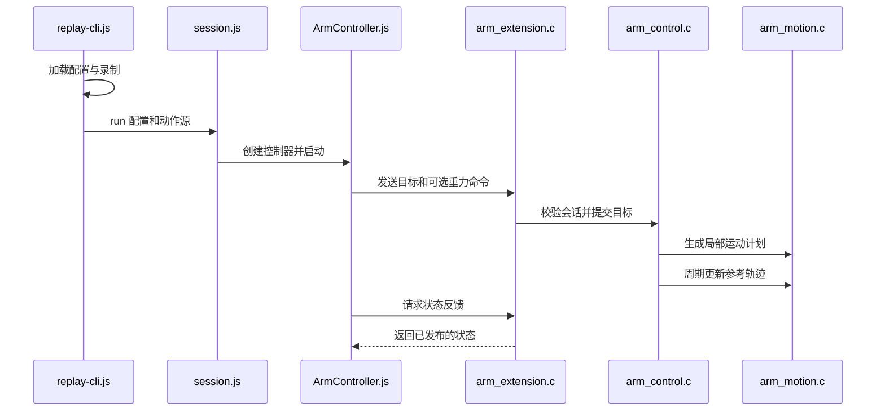

# STS32XX Firmware：Feetech 伺服自定义固件

STS32XX Firmware 是面向 GD32F130 的 STS3215 伺服固件，可用于 SO-ARM 机械臂的局部运动控制。

## 英文缩写速查

| 缩写 | 英文全称 | 简要说明 |
|------|----------|----------|
| PID | Proportional Integral Derivative | 位置误差反馈控制器 |
| TTL | Transistor-Transistor Logic | 舵机总线的逻辑电平接口 |
| PWM | Pulse Width Modulation | 电机驱动输出的调制方式 |

## 为什么重要

重复定位一致并不意味着末端接近绝对目标。原项目希望通过可调反馈、轨迹与补偿改善特定场景的控制表现，但控制器无法消除机械齿隙和机架变形。

## 流程总览

## 核心原理

- **运动规划：** 每个舵机根据目标、速度及加速度限制在本地规划 S 曲线；同时发送目标不保证各轴同时到达。
- **控制：** PID 使用位置反馈及估计速度；速度前馈根据规划速度计算。重力补偿由上位机根据模型计算，舵机执行并限制变化速率。
- **通信：** legacy 模式提供标准 STS 命令；扩展模式采用协议 v9，配置在复位或断电后需要重新发送。控制通常每 1 ms 更新；传感数据过期或控制间隔过长会关闭输出。

## 源码运行时序图

以下为 `npm run replay -- CONFIG.json RECORDING --run` 的控制主干；可选重力模型单独生成补偿值。

固件中实际的周期调用由 `runtime.c` 驱动 `arm_control_step`；上图合并呈现控制与反馈，不表示控制器主动推送反馈。

## 工程实践

源码公开，包含固件、Node.js 驱动和录制回放工具。快速上手先备份参数、刷写、标定，再以力矩关闭状态检查通信和预览，确认配置后进行小范围运动。上位机重力模型必须与机械臂及标定匹配。扩展反馈可检查位置、速度、输出、控制状态与接收序号。

## 局限与风险

- 官方视频展示 SO-101 和 SO-102 的前后效果，但文档明确称示例数值不保证整个工作空间的精度；用户提供的具体毫米数尚未独立核验。
- 通信中断时固件保留最后目标及重力补偿，继续保持；Ctrl+C 不是急停。应依据实际硬件设计断电和保护方案。
- 刷写可能损坏舵机或擦除标定；负载、增益和电流限制需要在实际机构上验证。

## 关联页面

- [遥操作](../tasks/teleoperation.md)
- [Sim2Real](../concepts/sim2real.md)

## 参考来源

- [源码与官方文档归档](../../sources/repos/sts32xx-firmware.md)

## 推荐继续阅读

- [官方详细文档](https://github.com/roboninecom/STS32XX-Firmware/blob/444f775c05e637c3743ec12ade6c1f9ae174177e/DETAILED_DOCUMENTATION.md)
