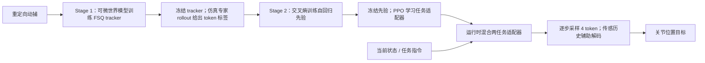
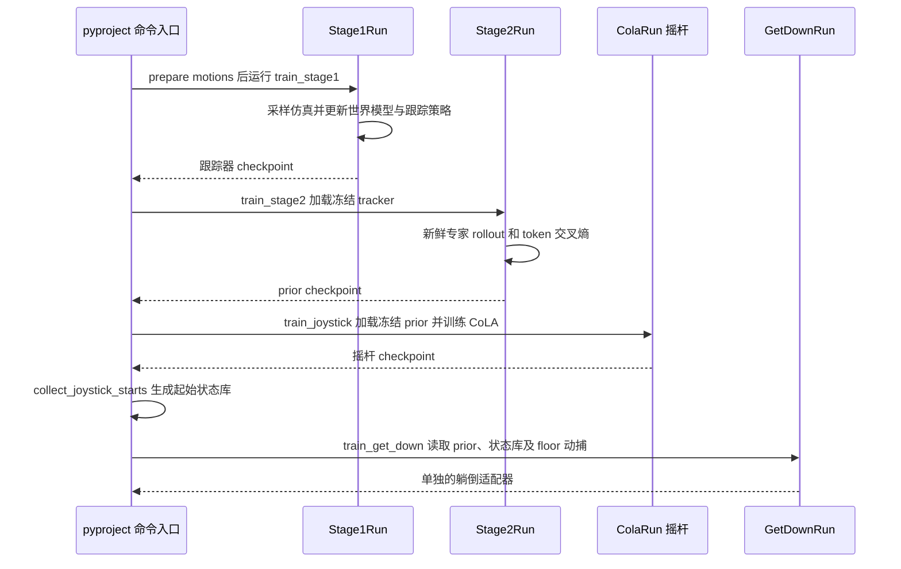

# SuperGPC: Single-GPU Training for a Humanoid Autoregressive Motion Policy | 单卡训练人形自回归运动策略

## 一句话定义

SuperGPC 是 Dollhouse Robotics 对 [GPC](./paper-gpc-generative-pretrained-controllers.md) 的 G1 工程实现：先用 SuperMimic 式训练得到动作跟踪器和离散编码，再把动作规律学成自回归先验，最后用小型任务适配器驱动行为。

## 英文缩写速查

| 缩写 | 英文全称 | 用途 |
|---|---|---|
| GPC | Generative Pretrained Controllers | 预训练离散动作先验，再适配任务 |
| FSQ | Finite Scalar Quantization | 把连续投影量化为离散运动码 |
| RLFT | Reinforcement Learning Fine-Tuning | 用任务奖励训练适配器 |
| AMP | Adversarial Motion Priors | 在躺倒任务中引导动作风格 |

## 为什么重要

昂贵的动作预训练不需要为每个任务重新做一遍。作者展示同一冻结先验上切换摇杆和躺倒 CoLA，并在每次切换用一秒混合两套适配器；既不是切换整个策略网络，也不是一次性把预录关节轨迹直接送给机器人。真机片段是示例，不是安全验收。

## 核心原理

1. **Stage 1**：MJLab / MuJoCo Warp 采集跟踪经验并拟合可微动力学模型，在想象 rollout 上优化 tracker。参考编码的 FSQ 瓶颈为 16 个七级标量，解码器结合传感历史输出关节目标。
2. **Stage 2**：冻结 tracker，收集新的仿真专家 rollout，按组预测 FSQ token，用交叉熵训练先验。每个 20 ms 控制步生成 4 个 token；自回归发生在该步的 token 内，而非跨控制步保留 GPT 上下文。
3. **任务后训练**：在冻结先验上用 PPO 训练带任务条件的适配器；公开代码的摇杆实现使用 DoRA 与 FiLM。躺倒训练另有落地冲击惩罚及 AMP 风格奖励，和约 30 小时的摇杆计时是两回事。

## 实验与评测

| 阶段 | 作者旧流程 | 单 RTX 5090 新流程 |
|---|---:|---:|
| 跟踪器 | 132 h，4 GPU、PPO | 16.8 h |
| 自回归先验 | 65 h，4× RTX 5090 | 12.2 h |
| 摇杆 CoLA | 6.1 h，1× RTX 5090 | 46 min |
| 合计 | 约 203 h（8.5 天） | 约 29.7 h |

整体约 6.8× 是作者两套流水线的**墙钟时间**之比；Stage 2 的约 21× 是 GPU 小时之比，而非墙钟比（约 5.3×）。该对比训练到指标趋稳，排除停机空档，不是同数据、同硬件受控实验。模型卡报告跟踪器训练集成功率 99.8%、1,079 个窗口接触质量检查通过 94.3%，仅为仿真结果、没有留出划分。

## 工程实践：源码运行时序图

下图基于公开的训练入口与 checkpoint 依赖，不把博客中的真机混合控制器当成已核对源码。

## 与其他工作对比

- 原始 GPC 提供先验与轻量任务适配的设计；SuperGPC 用单卡 G1 工程实例重做训练流水线，不能用该用时宣称在相同任务、数据或质量阈值下超过原论文。
- SuperMimic 主要是可微世界模型训练 tracker，本项目只在 Stage 1 采用该路线；Stage 2 仍做仿真专家数据的交叉熵监督，另用 CUDA Graph、异步采集等优化吞吐。

## 局限与风险

模型卡的 ONNX 闭环控制 25 个身体关节，训练配置还含两轴头部，并非标准 29 轴 G1 的直接替换。躺倒任务还需要骨盆高度与速度估计。发布的 `.pt` 来自更早内部代码、使用原 27 关节布局及动作掩码；公开代码需要私有重定向语料，不能仅凭开放权重推断可重现整套训练。文章的真机混合演示不是安全认证，本次未运行仿真、训练或真机。

## 结论

复用同一先验的任务适配值得作为分层控制的工程对照。应分别记录跟踪收敛、token 先验训练、单任务微调和真机切换，而不是用“约 30 小时”替代这些不同的验收指标。

## 关联页面

- [GPC 原始论文](./paper-gpc-generative-pretrained-controllers.md) · [SuperMimic](./paper-supermimic.md)
- [基于模型的强化学习](../methods/model-based-rl.md) · [强化学习](../methods/reinforcement-learning.md)
- [BFM 纵深路线 Stage 4](../../roadmap/depth-bfm.md#stage-4-适应与整合微调层次化与双栈)

## 推荐继续阅读

- [原始 GPC 项目](https://yi-shi94.github.io/gpc-page/) 对照原始动作先验；[BONES-SEED T-pose 裁剪清单](https://github.com/DollhouseRobotics/bones-seed-tpose-trims) 对照数据清洗，清单并不分发动作数据。

## 参考来源

- [官方全文与核对记录](../../sources/blogs/dollhouse-supergpc-2026-11-25.md)
- [固定版本训练入口与工程规格](https://github.com/DollhouseRobotics/super-gpc/tree/22b9a9d80f1431c9b7e161bcfc8c65f8b5ea0e8b)
- [25-DoF G1 官方模型卡](https://huggingface.co/dollhouserobotics/G1-25-DOF-GPC)
