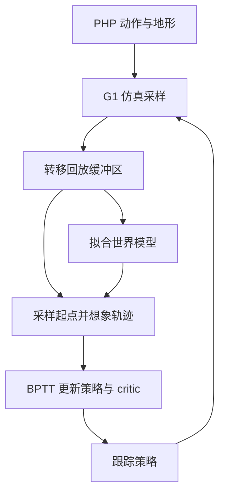
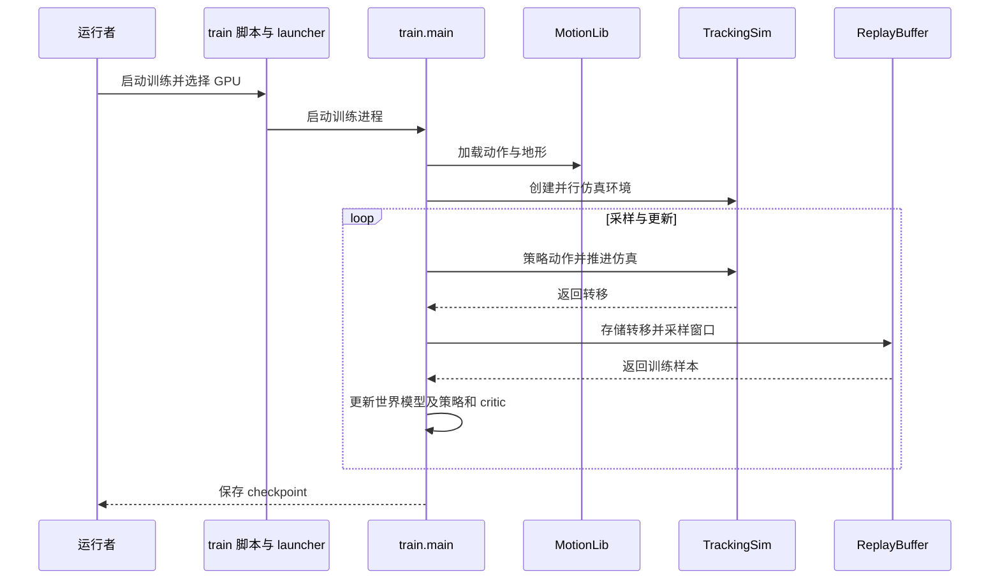

# SuperMimic Parkour：跑酷动作跟踪

**SuperMimic Parkour** 是受 SuperMimic 启发的社区实现，使用 PHP 跑酷动作与地形训练 G1 动作跟踪策略；它不是原论文官方实现。

## 英文缩写速查

| 缩写 | 英文全称 | 简要说明 |
|---|---|---|
| PHP | Perceptive Humanoid Parkour | 跑酷参考动作及地形数据的来源项目 |
| BPTT | Backpropagation Through Time | 沿世界模型想象轨迹反传策略梯度 |
| GPU | Graphics Processing Unit | 作者报告训练所用的计算设备 |
| PPO | Proximal Policy Optimization | README 中作为训练耗时背景的强化学习方法 |

## 流程总览

训练默认包括 Low-Step、High-Step、Low-Climb、High-Climb、Ultra-Climb 五类；`train.py` 默认每个 worker 4096 个环境、想象 horizon 32。世界模型根据缓冲区窗口拟合状态变化与终止信号；策略通过想象轨迹优化，critic 使用想象转移更新。

## 源码运行时序图

入口为 `scripts/train_php_supermimic.py` → `launcher.py` → `train.py`；回放通过 `scripts/play_php_supermimic.py` 加载 checkpoint 与数据，并用浏览器展示参考动作对照。

## 结果与局限

- README 自报单 GPU 略超四小时训练出跨越 130 cm 障碍的策略；GPU 型号、成功率和评测条件未在 README 中给出，尚未独立复现。
- 代码和 checkpoint 公开，PHP 动作数据需另行获取；环境要求及依赖见仓库 `pyproject.toml`。
- 本次未运行训练或回放，也未完成奖励、地形和评测源码的完整核验；真机效果不能由仿真演示推断。

## 关联页面

- [SuperMimic](./paper-supermimic.md)：原方法及其他社区复现。
- [BPTT](../concepts/bptt.md)：想象轨迹反向传播背景。

## 参考来源

- [仓库及核查范围](../../sources/repos/supermimic-parkour.md)

## 推荐继续阅读

- [项目源码和运行说明](https://github.com/yhx1203/supermimic_parkour)
