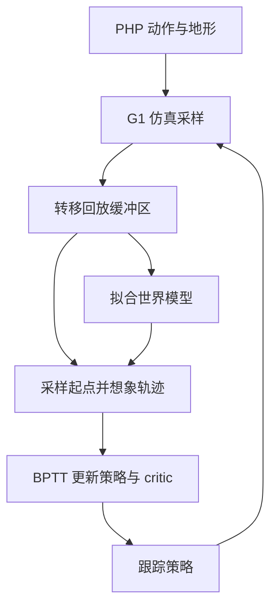
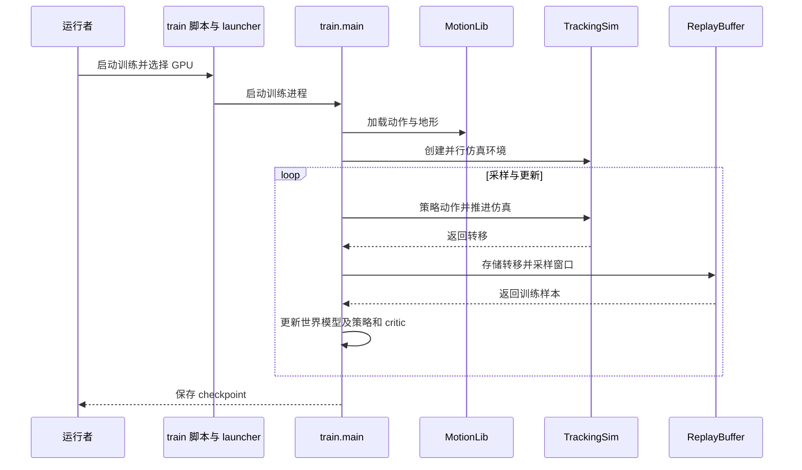

# SuperMimic Parkour：跑酷动作跟踪

**SuperMimic Parkour** 是受 SuperMimic 启发的社区实现，使用 PHP 跑酷动作与地形训练 G1 动作跟踪策略；它不是原论文官方实现。

## 一句话定义

**SuperMimic Parkour（社区复现）**：将 PHP 跑酷动作及地形数据接入基于缓冲区转移拟合的可微世界模型，再以 imagine horizon=32 与 BPTT 在单张 GPU 上训练出可跨越 130 cm 高台障碍的 Unitree G1 跑酷跟踪策略。

## 英文缩写速查

| 缩写 | 英文全称 | 简要说明 |
|---|---|---|
| PHP | Perceptive Humanoid Parkour | 跑酷参考动作及地形数据的来源项目 |
| BPTT | Backpropagation Through Time | 沿世界模型想象轨迹反传策略梯度 |
| GPU | Graphics Processing Unit | 作者报告训练所用的计算设备 |
| PPO | Proximal Policy Optimization | README 中作为训练耗时背景的强化学习方法 |

## 为什么重要

- **展示可微世界模型对极端探索的加速潜力**：传统无模型 PPO 在 130 cm 级高障碍攀爬探索上极易耗尽样本预算；利用过渡数据拟合可微动力学并通过想象轨迹反向传播梯度，可在单卡数小时内越过稀疏奖励瓶颈。
- **清晰界定社区复现与原论文边界**：本仓是受 SuperMimic 启发并结合 PHP 公开跑酷数据的独立社区实现，对原论文方法迁移至真实 `mjlab` / G1 栈具有重要工程参考价值。

## 流程总览

训练默认包括 Low-Step、High-Step、Low-Climb、High-Climb、Ultra-Climb 五类；`train.py` 默认每个 worker 4096 个环境、想象 horizon 32。世界模型根据缓冲区窗口拟合状态变化与终止信号；策略通过想象轨迹优化，critic 使用想象转移更新。

## 源码运行时序图

入口为 `scripts/train_php_supermimic.py` → `launcher.py` → `train.py`；回放通过 `scripts/play_php_supermimic.py` 加载 checkpoint 与数据，并用浏览器展示参考动作对照。

## 工程实践

- **外部数据组织**：仓库本身不含动作数据，需从 `amazon-far/php_parkour` 获取 5 类跑酷数据包（Low/High-Step, Low/High-Climb-76, Ultra-Climb-130），按 `data/php_motion/<tier>/*_{motion.npz,terrain.npy}` 组织后运行 `scripts/train_php_supermimic.py`。
- **回放与核查入口**：通过 `scripts/play_php_supermimic.py --port 8082` 启动本地可视化对照策略与参考动作。

## 局限与风险

- README 自报单 GPU 略超四小时训练出跨越 130 cm 障碍的策略；GPU 型号、成功率和评测条件未在 README 中给出，尚未独立复现。
- 代码和 checkpoint 公开，PHP 动作数据需另行获取；环境要求及依赖见仓库 `pyproject.toml`。
- 本次未运行训练或回放，也未完成奖励、地形和评测源码的完整核验；真机效果不能由仿真演示推断。

## 关联页面

- [Model-Based RL（基于模型的强化学习）](../methods/model-based-rl.md) — 可微世界模型为跟踪训练提供短时动态展开，模型误差仍需在实际仿真闭环检查。
- [楼梯与障碍 Locomotion（感知 / 盲走中心节点）](../tasks/stair-obstacle-perceptive-locomotion.md) — PHP 跑酷参考必须与障碍几何、接触和落地条件匹配，不能只按动作外观验收。

- [SuperMimic](./paper-supermimic.md)：原方法及其他社区复现。
- [ACP、SuperMimic 与 PHP 对照](../comparisons/acp-supermimic-php.md)：区分接触规划、世界模型训练与跑酷数据来源。
- [BPTT](../concepts/bptt.md)：想象轨迹反向传播背景。

## 参考来源

- [仓库及核查范围](../../sources/repos/supermimic-parkour.md)

## 推荐继续阅读

- [项目源码和运行说明](https://github.com/yhx1203/supermimic_parkour)
