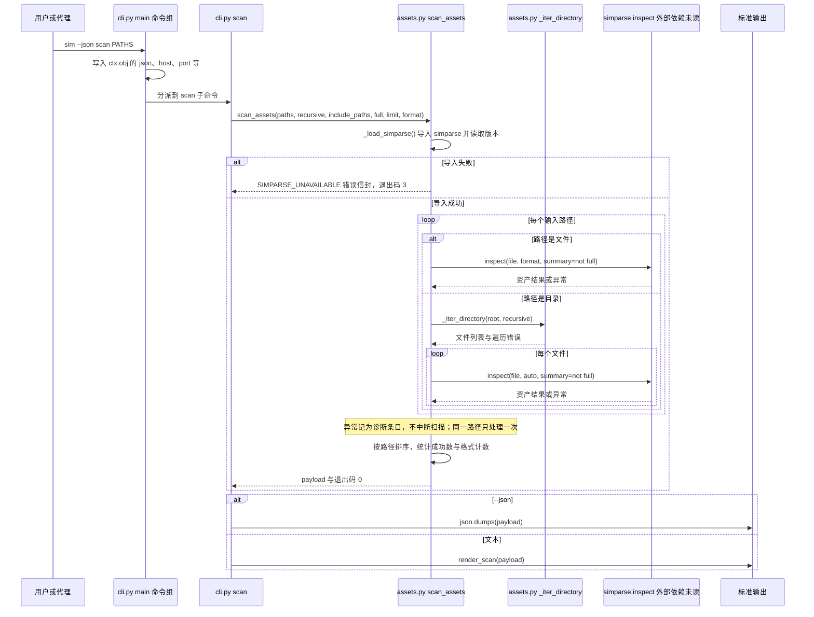

# sim-cli（svd-ai-lab/sim-cli）

## 一句话定义

sim-cli（svd-ai-lab/sim-cli）是不直接启动求解器，而是将既有 `.mph`、`.inp`、`.cas.h5`、`.aedt`、`.mechdb`、`.tzr` 文件解析为结构化文本，提取材料、边界、网格和求解设置，并支持 lint、版本检测及会话功能。

## 英文缩写速查

| 缩写 | 英文全称 | 简要说明 |
|------|----------|----------|
| MCP | Model Context Protocol | 代理与工程软件工具的交互协议 |
| CAE | Computer-Aided Engineering | 计算机辅助工程软件与分析 |
| API | Application Programming Interface | 软件可供自动化调用的接口 |

## 为什么重要

对 CAE 自动化而言，代理能否稳定完成任务，取决于工程步骤是否清楚、工具边界是否明确、结果是否保留可审查证据。不直接启动求解器，而是将既有 `.mph`、`.inp`、`.cas.h5`、`.aedt`、`.mechdb`、`.tzr` 文件解析为结构化文本，提取材料、边界、网格和求解设置，并支持 lint、版本检测及会话功能。

## 核心原理

**项目自身范围：** CLI for extracting structured information from CAE project files.

**工作流：** 读取现有工程文件并输出可供代理检查的结构化信息；也可运行 lint 或识别本机软件版本。

## 工程实践

1. 从目标问题识别所需的 Skill、MCP、CLI 或软件接口，不把指导文件当成求解器。
2. 依照仓库 README 检查安装前提、软件/许可证、输入文件和输出证据。
3. 小规模运行并逐项核对几何、网格、边界、求解状态和物理量，再决定是否扩大任务。

文章所述的项目特征：不直接启动求解器，而是将既有 `.mph`、`.inp`、`.cas.h5`、`.aedt`、`.mechdb`、`.tzr` 文件解析为结构化文本，提取材料、边界、网格和求解设置，并支持 lint、版本检测及会话功能。

## 局限与风险

读取工程文件不等于求解或验证；文件格式版本、解析覆盖范围和私有格式变化需留意。

源码状态核验：该 GitHub 仓库于 2026-10-07 可公开访问。仓库 API 报告许可证为 Apache-2.0。 

## 源码运行时序图

入口：`uv run sim --json scan ./historical-cases`（控制台脚本 `sim = sim.cli:main`，见 `pyproject.toml`；`python -m sim` 等价）。

说明：下图只覆盖 README 首推的只读解析路径 `scan`。解析由依赖包 `simparse`（`simparse>=0.4,<0.5`）完成，该包不在本仓库内，图中标为「未读」。scan 不启动求解器。

图依据：svd-ai-lab/sim-cli@a6d139a，实际读过 `README.md`（前 90 行）、`pyproject.toml`（前 60 行）、`src/sim/__main__.py`、`src/sim/cli.py`（main 与 scan 段）、`src/sim/assets.py`（scan_assets、_iter_directory、_load_simparse 段）。未运行代码。

## 关联页面

- [CAE / CFD 代理工具项目总览](../overview/cae-cfd-agent-skills-landscape.md)
- [CAD CAE Copilot](./armpro24-blip-cad-cae-copilot.md)

## 参考来源

- [公众号文章原始资料归档](../../sources/blogs/wechat_cae_cfd_agent_skills_2026-10-07.md)
- [GitHub 仓库资料归档](../../sources/repos/svd-ai-lab-sim-cli.md)
- [svd-ai-lab/sim-cli 官方仓库](<https://github.com/svd-ai-lab/sim-cli>)
- 源码核对（2026-11-02）：svd-ai-lab/sim-cli@a6d139a，读过 README.md（前 90 行）、pyproject.toml（前 60 行）、src/sim/__main__.py、src/sim/cli.py（main 与 scan 段）、src/sim/assets.py（scan_assets、_iter_directory、_load_simparse 段）；时序图依据以上文件，未运行代码。

## 推荐继续阅读

- [项目 README](<https://github.com/svd-ai-lab/sim-cli/blob/main/README.md>)