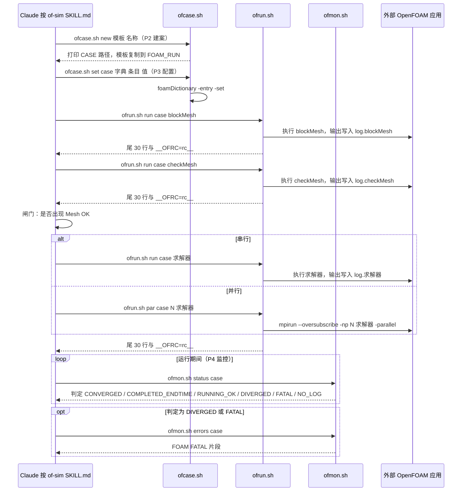

# OpenFOAM Claude Suite（swtbkim/openfoam-claude-suite）

## 一句话定义

OpenFOAM Claude Suite（swtbkim/openfoam-claude-suite）是拆分为 of-sim、of-post、of-doctor、of-setup：覆盖算例规划/运行、残差与力系数/y+后处理、FATAL 错误诊断，以及新机器环境探测。

## 英文缩写速查

| 缩写 | 英文全称 | 简要说明 |
|------|----------|----------|
| CFD | Computational Fluid Dynamics | 计算流体力学计算流程 |
| MCP | Model Context Protocol | 让代理发现并调用外部工具的协议 |
| y+ | Dimensionless Wall Distance | 壁面网格分辨率相关的无量纲距离 |

## 为什么重要

对 CAE 自动化而言，代理能否稳定完成任务，取决于工程步骤是否清楚、工具边界是否明确、结果是否保留可审查证据。拆分为 of-sim、of-post、of-doctor、of-setup：覆盖算例规划/运行、残差与力系数/y+后处理、FATAL 错误诊断，以及新机器环境探测。每阶段设置 mesh、字典 dry-run、连续性和场有限性检查。

## 核心原理

**项目自身范围：** OpenFOAM CFD automation skills for simulation, post-processing, diagnosis, and setup.

**工作流：** 描述问题后由 of-sim 选择求解器、模板、网格并运行；of-post 形成诊断视图；失败时 of-doctor 归类原因并给最小字典修订；闸门未通过则有限补救或报告失败。

## 工程实践

1. 从目标问题识别所需的 Skill、MCP、CLI 或软件接口，不把指导文件当成求解器。
2. 依照仓库 README 检查安装前提、软件/许可证、输入文件和输出证据。
3. 小规模运行并逐项核对几何、网格、边界、求解状态和物理量，再决定是否扩大任务。

文章所述的项目特征：拆分为 of-sim、of-post、of-doctor、of-setup：覆盖算例规划/运行、残差与力系数/y+后处理、FATAL 错误诊断，以及新机器环境探测。每阶段设置 mesh、字典 dry-run、连续性和场有限性检查。

## 局限与风险

流程闸门不能替代物理合理性判断；需检查网格、边界、守恒量和软件版本。

源码状态核验：该 GitHub 仓库于 2026-10-07 可公开访问。仓库 API 报告许可证为 MIT。 

## 源码运行时序图

入口：由 Claude 按 `skills/of-sim/SKILL.md` 的阶段调用 `skills/of-sim/scripts/` 下的 shell 包装器，原生 Linux 形式为 `bash <scripts>/ofrun.sh run <caseAbsPath> blockMesh`。仓库本身没有常驻程序入口；求解器与 `blockMesh`、`checkMesh` 等为外部 OpenFOAM v2412 应用，未在本仓库内，图中标为「外部」。

图依据：swtbkim/openfoam-claude-suite@3863d6d，实际读过 `README.md`（前 80 行）、`skills/of-sim/SKILL.md`（前 150 行）、`skills/of-sim/scripts/ofrun.sh`（完整）、`skills/of-sim/scripts/ofcase.sh`（前 60 行与子命令结构）、`skills/of-sim/scripts/ofmon.sh`（子命令与判定段）。未运行代码。

## 关联页面

- [CAE / CFD 代理工具项目总览](../overview/cae-cfd-agent-skills-landscape.md)
- [OpenFOAM Simulation](./ezrajay2333-openfoam-simulation.md)

## 参考来源

- [公众号文章原始资料归档](../../sources/blogs/wechat_cae_cfd_agent_skills_2026-10-07.md)
- [GitHub 仓库资料归档](../../sources/repos/swtbkim-openfoam-claude-suite.md)
- [swtbkim/openfoam-claude-suite 官方仓库](<https://github.com/swtbkim/openfoam-claude-suite>)
- 源码核对（2026-11-02）：swtbkim/openfoam-claude-suite@3863d6d，读过 README.md（前 80 行）、skills/of-sim/SKILL.md（前 150 行）、skills/of-sim/scripts/ofrun.sh、ofcase.sh（前 60 行与子命令结构）、ofmon.sh（子命令与判定段）；时序图依据以上文件，未运行代码。

## 推荐继续阅读

- [项目 README](<https://github.com/swtbkim/openfoam-claude-suite/blob/main/README.md>)