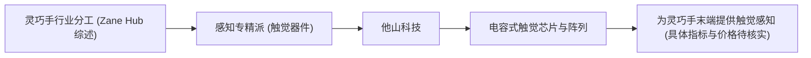

# 他山科技 电容式触觉芯片

**他山科技 电容式触觉芯片** 属于 [Zane Hub 灵巧手行业综述](https://mp.weixin.qq.com/s/GgZdcerpXldZ0C_KvwFBoA) 的「感知专精（触觉器件）」。本页只整理文章表述；指标与价格未独立核实。

## 一句话定义

**他山科技在文中被描述为做电容式触觉芯片与阵列的企业（文章仅一句话）。**

## 英文缩写速查

| 缩写 | 英文全称 | 简要说明 |
|------|----------|----------|
| DoF | Degrees of Freedom | 自由度；文章强调应看「有效自由度」而非参数表自由度 |

## 为什么重要

- 在综述的行业分工里，它代表「感知专精（触觉器件）」这一类；横向对比见 [灵巧手行业核心企业与工程约束（Zane Hub 综述）](../concepts/dexterous-hand-industry-core-players.md)。

## 文章所述要点

- 文章只在「感知专精派」中以一句话提及：电容式触觉芯片和阵列。

## 优势与边界（作者表述）

文章没有给出具体指标；本节点只有这一句话，其余信息未核实。

## 核对

- 未访问企业官网或其他来源，文中数字均为作者表述，未核实。

## 机制与架构图

## 关联页面

- [tactile-sensing](../concepts/tactile-sensing.md)
- [humanoid-hardware-101-sensing-end-effectors](../overview/humanoid-hardware-101-sensing-end-effectors.md)
- [dexterous-hand-industry-core-players](../concepts/dexterous-hand-industry-core-players.md)
- [Tactile Impedance Control（基于触觉反馈的阻抗控制）](../methods/tactile-impedance-control.md)：电容式触觉芯片与阵列采集的接触力觉反馈，是灵巧手执行精细抓取时实现基于触觉的阻抗控制的重要硬件基础。
- [Robot Sensor Interface and Integration · 机器人传感器接口与集成](../methods/robot-sensor-integration.md)：作为灵巧手行业分工中的触觉感知器件，其硬件阵列需经传感器接口接入、时间同步与标定才能融入机器人控制系统。

## 参考来源

- [wechat_zane_hub_dexterous_hand_core_players_2026-11-03.md](../../sources/blogs/wechat_zane_hub_dexterous_hand_core_players_2026-11-03.md)
- [原文（微信公众号）](https://mp.weixin.qq.com/s/GgZdcerpXldZ0C_KvwFBoA)
