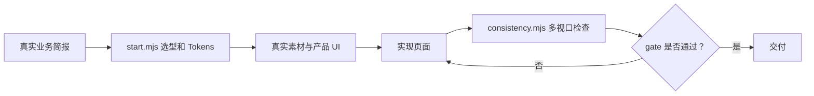
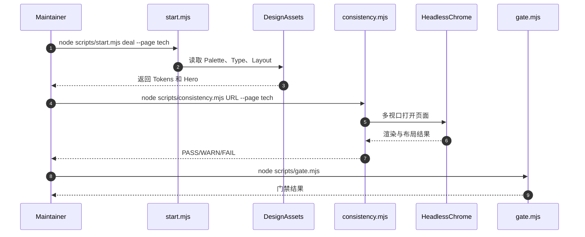

# Taste Skill

**Taste Skill**（[Leonxlnx/taste-skill](https://github.com/Leonxlnx/taste-skill)，[tasteskill.dev](https://tasteskill.dev)）是开源 **Agent Skill 包**，目标是在 Cursor、Claude Code、Codex 等工具生成前端时 **压低「AI 模板味」**：先读 brief 推断设计方向，再用 **三旋钮** 与 **硬规则** 约束布局、动效与密度，最后通过 **pre-flight** 才允许交付代码。

## 一句话定义

当前 `tasteskill 2.5.1` 根据业务类型选择配色、字体和 Hero，要求真实照片与产品 UI，再用实际浏览器一致性检查和 finish gate 验收；三旋钮是已分拆旧版规则。

## 英文缩写速查

| 缩写 | 英文全称 | 简要说明 |
|------|----------|----------|
| UI | User Interface | 技能主要约束 React/HTML/CSS 产出 |
| GSAP | GreenSock Animation Platform | v2 提供 canonical 动效 skeleton，与 MOTION 旋钮联动 |
| MIT | Massachusetts Institute of Technology License | 仓库协议 |
| LLM | Large Language Model | 执行 SKILL 的 coding agent |
| UX | User Experience | brief 推断含受众、行业、情绪与布局家族 |

## 为什么重要（对本知识库读者）

- **本站静态站：** agent 改 `docs/` 时易产出统一圆角卡片与 cream 配色；Taste Skill 与 [frontend-design](anthropic-frontend-design-skill.md) 同属 **审美约束**，但更强调 **旋钮化** 与 **redesign audit-first**（改现有页时先审计再动刀）。
- **与 GSAP skill：** [GSAP AI Skills](gsap-skills.md) 教 **API**；Taste Skill 管 **动多少、何时 scroll/magnetic**（`MOTION_INTENSITY`）。
- **与 Impeccable：** Taste 偏 **生成前/生成中 SKILL 规约**；Impeccable 偏 **命令动词 + 61 条 detector 闭环** — 可叠加（见 [对比](../comparisons/skillry-taste-skill-impeccable.md)）。

## 核心原理

| 模块 | 最新官方 README / SKILL 证据 |
|---|---|
| 业务分类 | `software`、`gaming`、`tech`、`product`、`service`、`place` |
| Design deal | `scripts/start.mjs` 生成颜色、字体、Hero 布局方案 |
| 页面素材 | 真实照片、品牌 icon、实产品 UI 和明确素材来源 |
| Motion 分层 | 仅 tech/software/gaming 可用 shader 与 scroll scene；非技术场所偏摄影 |
| 验收 | `scripts/consistency.mjs` 在多视口检查；`scripts/gate.mjs` 作 finish gate |

## 流程总览

## 源码运行时序图

README 已公布以下命令及对应脚本职责，未假定存在单独后端服务。

## 工程实践

- 安装：`npx skills add https://github.com/Leonxlnx/taste-skill --skill "design-taste-frontend"`；Node 22+、Chrome/Edge/Chromium 必需，ffmpeg 可选。
- 对机器人硬件技术官网选 `tech`，Web 应用选 `software`，并使用可信实物图与产品 UI，而不是虚构实证。
- `DESIGN_VARIANCE / MOTION_INTENSITY / VISUAL_DENSITY` 与 `industrial-brutalist-ui`、`minimalist-ui` 等已在 [Taste Skill Classics](taste-skill-classics.md) 作为旧版单独维护。

## 常见误区或局限

- **误区：当前主仓仍是三旋钮 experimental。** 2.5.1 采用脚本发牌与浏览器门禁；旧版 dial-driven Skills 在 Classics。
- **误区：自动门禁替代真实验收。** 功能、品牌与访问性仍需项目级评审。
- **局限：** 技能正文偏 **Web 前端**；机器人栈 UI（RViz、自定义 teleop）需自行改写 brief 与 design-system map。
- **局限：** 高 star 不等于安全审计 — 仍应读 SKILL 变更日志再升级。

## 关联页面

- [Taste Skill Classics](taste-skill-classics.md) — 历史版三旋钮、极简与工业风格
- [Claude Code Frontend Skills](claude-code-frontend-skills.md) — 多 Skill 冲突裁决

- [Impeccable](impeccable.md) — 命令 + detector
- [Skillry](skillry.md) — 商业交付物市场
- [frontend-design（Anthropic）](anthropic-frontend-design-skill.md) — 官方基线
- [GSAP AI Skills](gsap-skills.md) — 动效实现
- [find-skills](find-skills-skill.md) — CLI 发现其它 skill
- [选型对比](../comparisons/skillry-taste-skill-impeccable.md)

## 参考来源

- [taste-skill 仓库归档（本站）](../../sources/repos/leonxlnx-taste-skill.md)
- [tasteskill.dev 核查](../../sources/sites/tasteskill-dev.md)
- [SKILL 仓库（GitHub）](https://github.com/Leonxlnx/taste-skill)

## 推荐继续阅读

- [Taste Skill Changelog](https://www.tasteskill.dev/changelog) — v2 规则演进
- [Impeccable README](https://github.com/pbakaus/impeccable) — detector 与命令面对照
