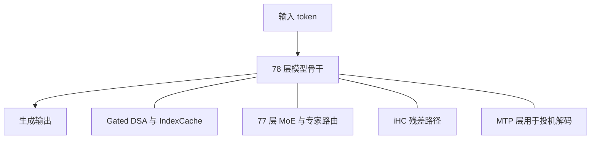
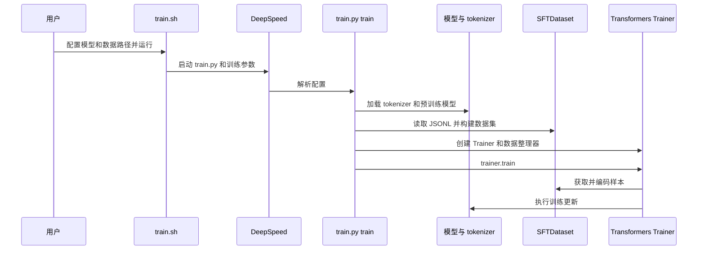

# Tencent Hy4（腾讯混元 Hy4）

## 一句话定义

Hy4 是腾讯混元面向长程智能体和生产力任务的模型系列；正式版和公开权重的 preview 应分别阅读。

## 英文缩写速查

| 缩写 | 英文全称 | 简要说明 |
|------|----------|----------|
| MoE | Mixture of Experts | 每个 token 路由到部分专家 |
| DSA | DeepSeek Sparse Attention | 预览版注意力模块采用的稀疏注意力 |
| MTP | Multi-Token Prediction | 预览版用于投机解码的额外预测层 |
| SFT | Supervised Fine-Tuning | 使用示范数据的监督微调 |

## 核心信息与版本边界

| 项目 | 信息 |
|------|------|
| 机构 | 腾讯混元团队 |
| 预览版 | 2026-08-28；主干 770B 参数、每 token 激活 49B；1M 上下文，以上不含额外 MTP 层 |
| 正式版 | 2026-11-04 发布；腾讯云介绍称首次加入视觉理解，并加强长程任务、指令遵循与深度研究 |
| 开放状态 | preview 权重、FP8 权重及微调脚本公开；正式版权重地址本次未核实 |

预览版包含 78 层：首层 dense FFN，其余 77 层为 MoE，每层 256 个路由专家和 1 个共享专家，每 token 选 8 个路由专家及共享专家。注意力采用 Gated DSA 与 IndexCache，残差路径使用 iHC。MTP 另有 10B 总参数、0.7B 激活参数。以上均仅据 preview README，不外推至正式版。

## 项目流程图

下图仅表达 preview README 明确描述的骨干模块及生成路径，不代表正式版内部实现。

图中无向连线仅表示组件归属，不表示计算顺序；层内数据路径仍需进一步核对。

## 源码运行时序图

依据 preview 仓库 `509799be8cc7bfeb63353e7322b2daddf7f73a28` 的 `finetune/deepspeed_support/train.sh`、`train.py`；图为监督微调路径，非推理服务内部源码。

README 指出 LoRA 微调最低配置为 8 机 64 卡，每卡至少 96 GB 显存；这是其测试配置，不代表所有部署需求。官方推理示例使用 vLLM 或 SGLang 的 FP8 权重与 8 路张量并行，本次没有实测。

## 评测与局限

腾讯 preview README 报告内部盲测：163 位专家、203 项工程任务，平均得分 2.99/4；对比模型分别为 GLM 5.3 的 2.92 和 Kimi K3 的 2.94。这是特定内部任务集，不能直接推广到机器人控制或任意评测。官方同时指出 preview 可能过度推理和反复验证。

**待完成：** 正式版发布原文当前无法获取正文；须通读后核验正式版架构、评测和权重，再决定是否补全正式版流程。预览版骨干详细计算图还需对照其模型实现核实。当前未对微调或部署进行运行验证。

## 关联页面

- [LLM 推理显存估算](../concepts/llm-inference-vram-estimation.md)
- [AI Agent 评测](../concepts/ai-agent-evaluation.md)

## 参考来源

- [预览版仓库归档](../../sources/repos/tencent-hy4-preview.md)
- [正式版与预览版官方资料](../../sources/sites/tencent-hy4.md)
- [预览版 README](https://github.com/Tencent-Hunyuan/Hy4-preview/blob/509799be8cc7bfeb63353e7322b2daddf7f73a28/README.md)

## 推荐继续阅读

- [预览版微调说明](https://github.com/Tencent-Hunyuan/Hy4-preview/blob/509799be8cc7bfeb63353e7322b2daddf7f73a28/finetune/README.md)
