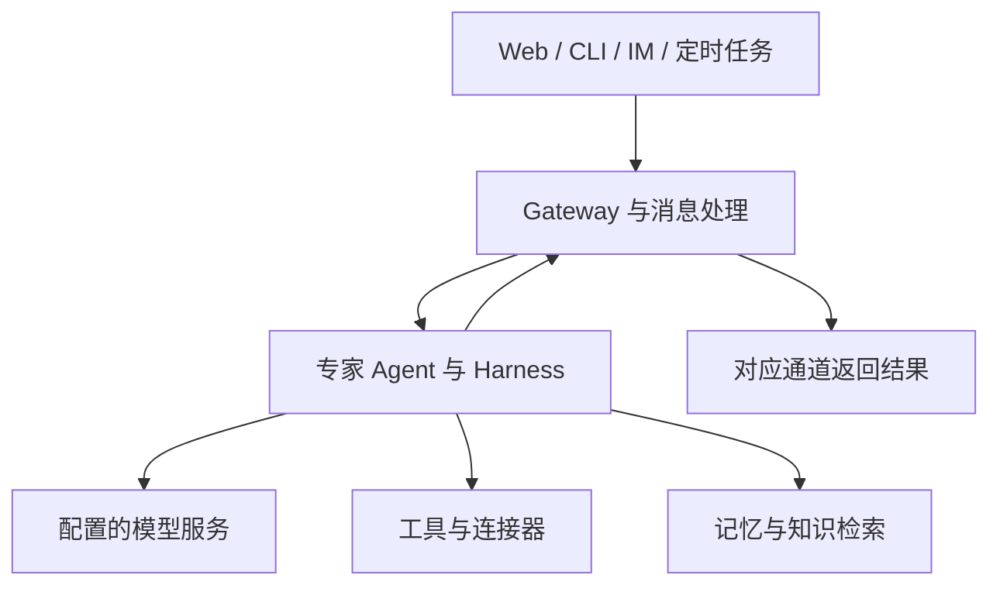
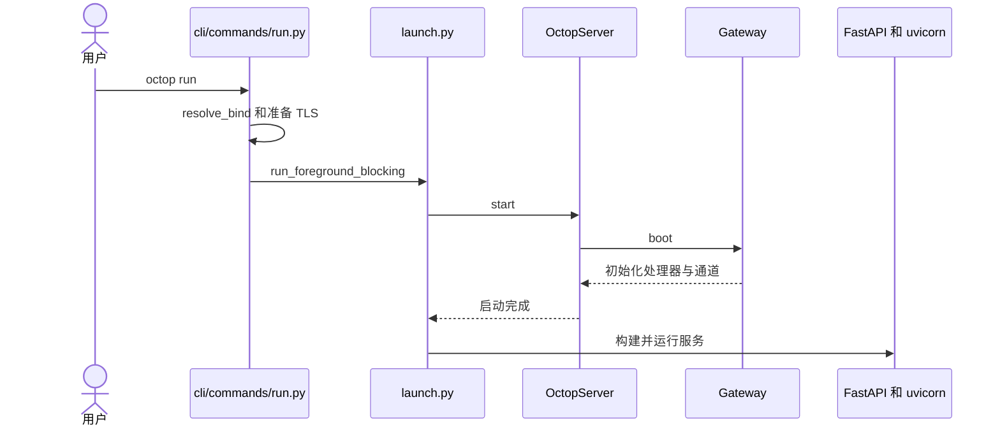

# Octop：Self-hosted Multi-user AI Assistant（自托管多用户 AI 助手）

## 一句话定义

Octop 是腾讯云开源的自托管助手平台，在单个服务进程中组合专家 Agent、消息通道、定时任务和 Web 控制台。

## 英文缩写速查

| 缩写 | 英文全称 | 简要说明 |
|---|---|---|
| IM | Instant Messaging | 即时通讯通道 |
| RAG | Retrieval-Augmented Generation | 文档检索增强生成 |
| ACP | Agent Client Protocol | 与外部编码 Agent 的连接协议 |
| JWT | JSON Web Token | 用户认证令牌 |

## 核心信息

| 项目 | 内容 |
|---|---|
| 机构 | 腾讯（Tencent） |
| 开源许可 | MIT |

## 主要机制

- **统一入口：** Web、CLI、即时通讯和定时触发经网关与处理器接入 Agent；各用户可配置多个专家。AgentTeams 在核查版本中标记为 Beta。
- **运行组件：** Octop Harness 管理模型路由、工具和会话状态；Gateway 接入消息通道；Memory 提供记忆检索。知识库支持文档 RAG，ACP 支持接入外部编码 Agent。
- **存储分层：** 控制面默认 SQLite，可选 PostgreSQL；Agent 工作区默认本地文件，也可配置其他后端。控制面数据库与工作区是不同存储概念。

## 流程总览

## 源码运行时序图

该图只展示已核查的启动主路径；首次安装或设置未完成时可能进入其他分支。代码版本与入口详见来源归档。

## 工程实践与局限

- README 给出 `octop init`、`octop run` 和 Docker Compose 入口；Python 包要求 3.12 以上。模型可配置为本地或外部供应商，部署服务本身不代表推理数据必定留在本机。
- JWT、工具审批及命令防护由项目文档描述；实际安全性取决于配置、权限和所接入服务，尚未做独立安全审计。
- 源码以 MIT 许可发布，本文未实机部署，也未核验所有集成与故障恢复路径。作为通用 Agent 平台，其定位不是机器人实时控制。

## 关联页面

- [Agent Autoloop](./agent-autoloop.md)：以事件和回执驱动命令行 Agent。
- [LangGraph](./langgraph.md)：有状态 Agent 和工作流运行框架。

## 参考来源

- [Octop 仓库归档](../../sources/repos/tencent-octop.md)
- [固定版本架构文档](https://github.com/TencentCloud/Octop/blob/4811eb45996169e86006db1b6451264ff4758223/docs/architecture.md)

## 推荐继续阅读

- [Octop 官方 README](https://github.com/TencentCloud/Octop/blob/4811eb45996169e86006db1b6451264ff4758223/README.md)
