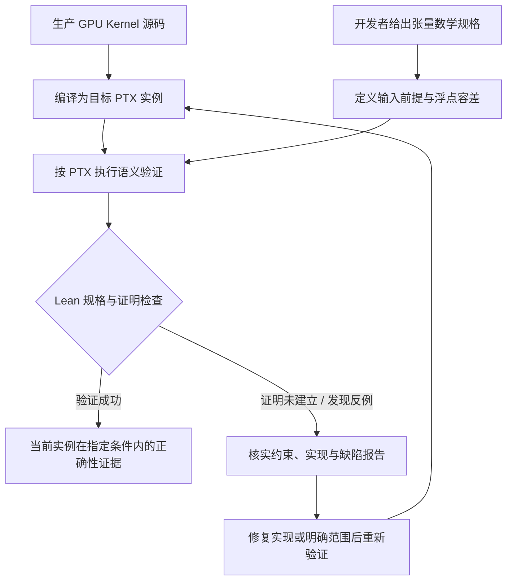

# TensorLean：生产级 GPU 算子的 PTX 形式化验证（Formal Verification of Production GPU Kernels）

## 一句话定义

**TensorLean** 是哥伦比亚大学与 CertiK 于 **2026-11-20** 公布的生产级 GPU Kernel 形式化验证研究框架：把算子编译后的 **NVIDIA PTX** 实现与开发者定义的**张量级正确性规格**对照，利用 **Lean** 证明在指定前提及数值容差内的功能正确性、终止性和无数据竞争。

## 英文缩写速查

| 缩写 | 英文全称 | 简要说明 |
|---|---|---|
| GPU | Graphics Processing Unit | 执行高度并行算子计算的硬件 |
| PTX | Parallel Thread Execution | NVIDIA GPU 的虚拟指令集 / 中间汇编表示 |
| ISA | Instruction Set Architecture | 定义指令及执行语义的架构接口 |
| GEMM | General Matrix Multiplication | 通用矩阵乘法；DeepGEMM 优化对象 |
| CTA | Cooperative Thread Array | CUDA 线程块；跨块写入需考虑竞争 |
| FP8 | 8-bit Floating Point | 低精度浮点格式，涉及数值误差约束 |

## 为什么重要

- LLM / VLA 的训练和推理高度依赖 GPU Kernel，包括 GEMM、Attention；工程团队通常优化**吞吐与延迟**，但随机测试不能穷尽极端 tensor shape、并发交错与浮点行为。
- TensorLean 关注的是**代码算得对不对**，不是模型回答是否正确。对机器人模型部署而言，这属于上游算子可靠性，不能替代机载实时性与物理安全验证。
- 生产算子使用复杂的数据布局、跨 warp/CTA 协同和低精度计算，正是高性能与验证难度同时上升的环节。

## 核心信息与原文范围

| 项目 | 依据一手资料确认的信息 |
|---|---|
| 研究机构 | 哥伦比亚大学（Columbia University）、CertiK |
| 公开日期 | 2026-11-20 |
| 公开入口 | [研究方正式公告](https://www.certik.com/blog/tensorlean-certik-and-columbia-university-researchers-formally-verified-production-ai-kernels-from-deepseek-and-flashattention) · [项目官网](https://tensorlean.ai/) · [官方仓库](https://github.com/TensorLean/TensorLean) |
| 被验证的上游组件 | FlashAttention、DeepSeek DeepGEMM 等开源 GPU Kernel |
| 验证对象 | **编译后的 PTX Kernel 实例**，不是整个模型、所有 GPU 或整个 DeepSeek / FlashAttention 产品 |
| 公开代码状态 | 官方 README 表示论文、框架、PTX 语义、规格及证明**后续发布**；当前仓库只有 README 和 assets |
| 本页原文核对 | 已通读 **CertiK 公告全文与官方 GitHub README 全文**；未读未公开论文、未运行证明；项目主页在本次环境无法直接读取 |

## 核心原理与流程总览

团队首先把预期张量计算、适用条件和允许误差写成数学规格；再针对**实际编译的 PTX** 证明：在满足规格前提的输入和执行下，Kernel 无数据竞争、能够终止，且实际输出符合规格（在允许的浮点误差内）。证明用 Lean 开发并由机器检查。

以下仅是公告与 README **可直接支持的概念流程**，不是未公开验证器的源码调用图。

**证据解释：** 对已证明实例，结论随规格前提、浮点容差、PTX 语义与编译目标而成立；对未完成证明的实例，不能直接判为“必有 bug”。性能 benchmark、单元测试、形式化验证和线上异常监控是互补手段。

## 报告结果与典型缺陷

| 口径 | 数字 | 含义 |
|---|---:|---|
| 已检查 Kernel 实例 | **149** | 一次具体编译/配置实例的验证单元 |
| FlashAttention 实例 | **102** | 149 的子集，来自官方 README |
| 完成满足 Lean 规格的证明 | **83** | 官方公告与 README 一致 |
| 官方公告所报缺陷（2026-11-20） | **38** | 跨六个库，其中 DeepGEMM 2、FlashAttention 23 |
| 当前仓库列出的缺陷（2026-11-23） | **39** | README 后续列表快照，与公告时间不同 |

- **FlashAttention-4 数据竞争：** [上游 #3195](https://github.com/Dao-AILab/flash-attention/issues/3195) 描述 compute_block_sparsity 的 reduction_buffer 重用时缺少正确同步，可能错误跳过本不该屏蔽的 key；该 Issue 明确区分正常运行未复现与加入延迟后的复现条件。
- **DeepGEMM 跨组写入：** [上游 #514](https://github.com/deepseek-ai/DeepGEMM/issues/514) 描述 SM90 grouped masked GEMM 在 M 非 BLOCK_M 整数倍时可能把 partial M block 写到下一组，造成竞争及错误结果。
- **FP8 算法实现差错：** [DeepGEMM #476](https://github.com/deepseek-ai/DeepGEMM/issues/476) 指定 einsum 路径遗漏输入 c，说明“无崩溃、速度快”不代表数学契约正确。

**统计不能混淆：** 149 - 83 = 66 是未在这一实验中获得证明的实例数，**不是 66 个已确认独立缺陷**；38 是 11 月 20 日公告口径，39 是 11 月 23 日仓库 README 列表口径。

## 源码运行时序图

**不适用（尚未公开实现）**：官方 TensorLean 仓库当前仅 README.md 与 assets/，承诺后续发布完整框架及 Lean/PTX 语义和证明，因此找不到真实 CLI、运行脚本或源码模块边界。上面的 Mermaid 图为**研究方法概念流程**，不冒充可执行源码时序图。

## 工程实践

1. 在 GPU 算子上线前，固定源代码 commit、编译器版本、GPU 架构、PTX 编译产物及算子 shape/stride/dtype 范围。
2. 分别定义**张量数学契约、内存写入边界、并发安全、允许数值误差、前置条件**；不能将特定参数族证明外推到任意 tensor。
3. 结合随机回归测试与极端边界用例（非整块维度、可变长序列、超大索引、并发交错）验证；对上游 Issue 检查所用 commit、架构及修复 PR 状态。
4. 待源码与证明公布后再评估是否能在机器人 Transformer / VLA 推理链和 CI 中落地。当前**没有可执行 TensorLean 操作命令可核实**。
5. 性能指标（延迟/吞吐）、算子正确性、策略控制稳定性分别验收；PTX 层证明不覆盖传感器、控制时序或整机物理故障。

## 局限与风险

- **开放与复现：** 截至 2026-11-23，框架论文、PTX 模型、规格、证明尚未公布；仅能验证公开公告、README 与上游 Issue，不得宣称已独立审计证明或运行框架。
- **证明边界：** 正确性结论与开发者提供的规格和前提绑定；如果规格本身不完整，形式化证明仍不能说明实际产品在所有场景安全。
- **口径差异：** 公告 38 / README 39 是不同时间的缺陷清单；未能核实每一项最终合并状态。研究方使用“world's first”属于**自述**，不能视为独立先发性证明。
- **领域迁移：** GPU Kernel 性质证明 ≠ 端到端模型语义可靠性 ≠ 机器人功能安全认证。
- **阅读覆盖：** 本页健康度“原文已读”仅指已公开、已归档的 CertiK 公告与官方 README，不表示尚未发布的论文与验证器代码已经读完。

## 关联页面

- [FlashProve：大模型可证明推理](./flashprove.md) — 证明**推理结果与权重承诺的一致性**，而 TensorLean 针对**GPU Kernel 执行正确性**；保证对象不同。
- [hello-gpu：Profiling 与算子优化](./hello-gpu.md) — 从算子测速与优化走向正确性证据。
- [FlashInfer](./flashinfer.md) — 推理算子加速与工程实现的对照。
- [多头注意力](../concepts/multi-head-attention.md) — FlashAttention 相关的 Attention 数学对象。

## 参考来源

- [CertiK 官方技术公告通读记录](../../sources/sites/tensorlean-certik-announcement.md)
- [TensorLean 官方 GitHub README 全文与 Issue 追踪](../../sources/repos/tensorlean.md)
- [FlashAttention-4 竞争问题 #3195](https://github.com/Dao-AILab/flash-attention/issues/3195)
- [DeepGEMM grouped GEMM 缺陷 #514](https://github.com/deepseek-ai/DeepGEMM/issues/514)

## 推荐继续阅读

- [TensorLean 官方仓库和持续维护的缺陷清单](https://github.com/TensorLean/TensorLean)
- [研究方公布成果的技术公告（2026-11-20）](https://www.certik.com/blog/tensorlean-certik-and-columbia-university-researchers-formally-verified-production-ai-kernels-from-deepseek-and-flashattention)
- [DeepGEMM 上游问题与修复记录](https://github.com/deepseek-ai/DeepGEMM/issues/514)
