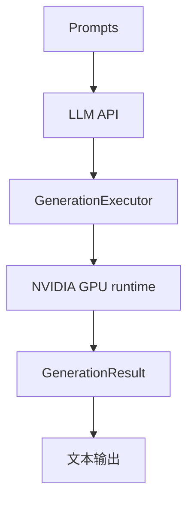
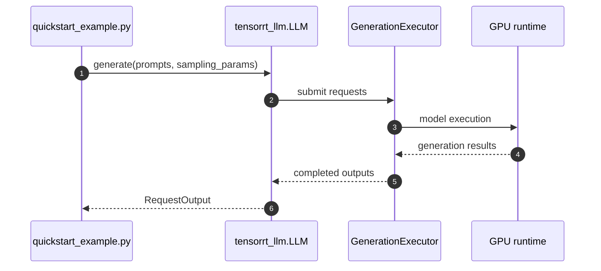

# TensorRT-LLM｜NVIDIA 大模型推理运行时与 LLM API

## 一句话定义

TensorRT-LLM 提供面向 NVIDIA GPU 的 LLM / Visual Gen 专用 kernel、运行时与 Python API；它不同于通用 TensorRT SDK，也不能与另一个策展条目 `TensorRT-LLM for Edge` 混为一个独立源码仓。
**身份边界**：本页是 `NVIDIA/TensorRT-LLM` 的主项目；[TensorRT](./tensorrt.md) 是通用 SDK；[TensorRT-LLM for Edge](./painode-102-tensorrtllmforedge.md) 是另一个面向端侧产品文章的策展入口，三者不可混同。

## 英文缩写速查

| 缩写 | 英文全称 | 简要说明 |
|---|---|---|
| LLM | Large Language Model | 本页服务的自回归语言模型类型 |
| KV | Key-Value Cache | 用于增量推理的历史注意力键值缓存 |
| GPU | Graphics Processing Unit | 计算和 kernel 执行的硬件 |
| CI | Continuous Integration | 贡献审核时运行的自动验证 |
| PR | Pull Request | 提交测试、代码变更、性能证据的上游审查单 |

## 为什么重要

TensorRT-LLM 提供面向 NVIDIA GPU 的 LLM / Visual Gen 专用 kernel、运行时与 Python API；它不同于通用 TensorRT SDK，也不能与另一个策展条目 `TensorRT-LLM for Edge` 混为一个独立源码仓。

## 核心原理

官方 `examples/llm-api/quickstart_example.py` 以 `from tensorrt_llm import LLM, SamplingParams` 创建模型、调用 `llm.generate`；`tensorrt_llm/llmapi/llm.py` 使用 GenerationExecutor、tokenizer / postprocessor 组件组织请求与输出。其贡献指南规定 Issue、review、CI、DCO 签署。

### 流程总览

## 源码运行时序图

**已核对执行入口：** 运行 `examples/llm-api/quickstart_example.py`：`LLM(model='TinyLlama/TinyLlama-1.1B-Chat-v1.0')` + `SamplingParams` + `llm.generate`；入口依赖 `tensorrt_llm/llmapi/llm.py` 内的 executor 组件。 此图仅覆盖所列实际入口的主干路径，不代表全部异步/多卡细节。

## 工程实践

- **可执行入口：** 运行 `examples/llm-api/quickstart_example.py`：`LLM(model='TinyLlama/TinyLlama-1.1B-Chat-v1.0')` + `SamplingParams` + `llm.generate`；入口依赖 `tensorrt_llm/llmapi/llm.py` 内的 executor 组件。
- **贡献切口：** 先按 `CONTRIBUTING.md` 创建 Issue；从单文件 accuracy test、API stability、performance regression 小改动开始，遵守项目 pre-commit 与 DCO sign-off，记录具体 GPU 与版本。
- **回归要求：** 说明 GPU/驱动/依赖、模型版本、输入与输出 token 长度分布、预热次数与 batch/并发；保留正确性对拍，再报告 tokens/s、TTFT 或 TPOT（按服务模式选择）。
- **开源状态：** 官方 [GitHub 仓库](https://github.com/NVIDIA/TensorRT-LLM) 与 README/源码可访问；对特殊 GPU kernel、训练与数据等子组件是否完全开放，不能从主页自动推断。

## 局限与风险

README 标注 CUDA/PyTorch/发行版本会变化；部分模型与高性能路径依赖特定 NVIDIA GPU。TensorRT（通用网络 builder/runtime）和 TensorRT-LLM（LLM API/serving）不可当作同一技术页。

- **视频事实界限：** “学生 / 1–2 年 / 资深”是用户提供的视频观点，不是上游官方招聘标准；未验证作者或 Discord 时间。别把开源贡献与 PR 合并结果视为确定承诺。

## 关联页面

- [LLM 推理显存估算](../concepts/llm-inference-vram-estimation.md)
- [vLLM｜生产级大模型推理与持续批处理](./painode-103-vllm.md)
- [SGLang｜大规模语言与多模态模型推理服务框架](./sglang.md)
- [FlashInfer｜跨框架 GPU 推理 Kernel 库](./flashinfer.md)

## 参考来源

- [TensorRT-LLM｜NVIDIA 大模型推理运行时与 LLM API：一手文档和代码核验归档](../../sources/repos/tensorrt-llm-official.md)
- [六项目对照与原视频证据边界](../../sources/repos/llm-inference-open-source-contribution-primary-docs-2026-11.md)
- [官方 README](https://github.com/NVIDIA/TensorRT-LLM/blob/main/README.md)

## 推荐继续阅读

- [官方仓库与最新文档](https://github.com/NVIDIA/TensorRT-LLM)
