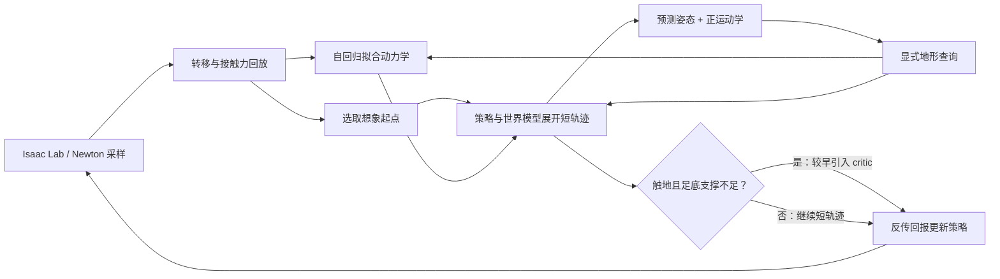
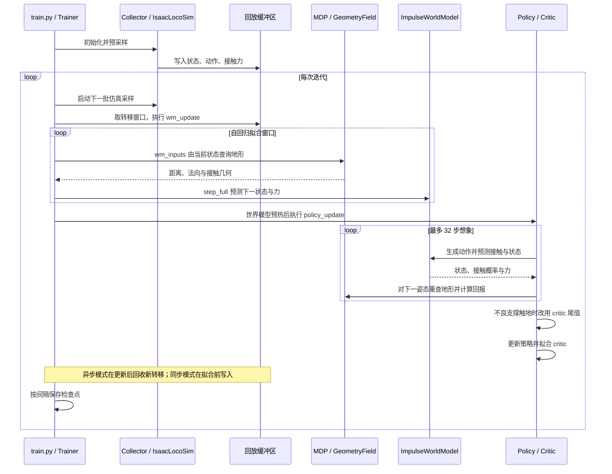

# 地形约束下的想象训练｜Terrain-Grounded Imagination（TGI）

## 一句话定义

**Terrain-Grounded Imagination** 是 ETH Zürich 的 Matthias Heyrman 与 Marco Hutter 发布的足式移动训练方法：用仿真转移拟合机器人动力学和接触力，保留显式地形几何，在短想象轨迹中反传策略梯度。官方源码同时提供 Unitree G1 的 2D 高度图分支与 ANYmal-D 的 3D 接触分支。

## 英文缩写速查

| 缩写 | 英文全称 | 用途 |
|---|---|---|
| TGI | Terrain-Grounded Imagination | 用显式地形约束世界模型中的想象 |
| FPM | Foothold Prediction Model | 预测落脚位置，按位置读取地形局部块 |
| BPTT | Backpropagation Through Time | 沿想象状态序列反传策略梯度 |
| PPO | Proximal Policy Optimization | 以模拟器直接采样更新策略的对照范式 |
| SHAC | Short-Horizon Actor-Critic | 用短轨迹和 critic 引导尾部回报的策略优化思路 |

## 为什么重要

踏脚石边缘与墙壁接触处，几厘米的位置误差就可能改变承重足、碰撞方向或落地冲击。TGI 不要求神经网络重新生成这些几何边界：地形从仿真读取，网络学习机器人如何运动及与表面交换力。它也说明「策略完全在想象中训练」不等于「不需要仿真」：仿真仍提供训练世界模型的状态转移、力标签以及想象起点。

## 核心机制

1. **用真实的模拟器转移监督自回归动力学。** 回放窗口记录当前/下一状态、动作及接触力；网络逐步从自己的预测继续，并用仿真状态、承重信号和力向量监督。
2. **每步按预测姿态重新查询地形。** G1 主要查骨盆与脚底下的高程；ANYmal-D 先做正运动学，再以高度栅格柱体近似三维表面，查询四足和膝、胫、大腿、躯干等碰撞球的距离与法向。列选择不反传，选中柱体后对位置重算距离，法向也不带梯度。可反映台阶侧壁，但不是任意三维网格的精确 SDF。
3. **让几何条件进入接触动力学。** ANYmal-D 的 `ImpulseWorldModel.step_full` 用点到表面的距离作门控，预测法向与受限切向力，再经接触雅可比转为广义力，和自由运动项合成下一状态。角色配置区分允许、容忍和禁止接触；不是把膝碰与躯干碰一律判为失败。
4. **把不可靠的长梯度截在接触事件。** 默认想象 32 步（0.64 秒）。若检测到预测触地且对应足底缺乏支撑，策略回报改由该步后的 critic 估值引导，而不再依赖更远处的模型轨迹。这不是让模拟器提前结束整回合。ANYmal-D 奖励惩罚超出 600 N 的预测足端冲击，G1 的对应阈值为 450 N。

## 源码运行时序图

ANYmal-D 分支的训练主路径；使用 [固定版本入口](https://github.com/leggedrobotics/terrain-grounded-imagination/blob/a64911fea91848189f4863af8ae004c2e376836c/tgi_anymal/scripts/train.py)、[Trainer](https://github.com/leggedrobotics/terrain-grounded-imagination/blob/a64911fea91848189f4863af8ae004c2e376836c/tgi_anymal/src/tgi_anymal/training/trainer.py) 与 [GeometryField](https://github.com/leggedrobotics/terrain-grounded-imagination/blob/a64911fea91848189f4863af8ae004c2e376836c/tgi_anymal/src/tgi_anymal/mdp/field.py) 核对。

## 实验与评测

| 设置 | 官方默认配方 | 可核验边界 |
|---|---|---|
| ANYmal-D / 3D | 4,096 并行环境、30,000 迭代；官方报告 RTX PRO 6000 约 5.6 小时 | 任务是 8 秒回合内到达目标；评测脚本按地形与等级分组，回合末距目标小于默认 0.5 m 才计为成功，并记录膝、胫、躯干触地及终止构成。 |
| Unitree G1 / 2D | 8,192 环境、40,000 迭代；同款 GPU 约 7.5 小时 | 是另一机器人、任务和预算，不能用两行耗时互算加速；仓库提供导出与 MuJoCo 仿真迁移入口。 |
| ANYmal-D「约 6 倍」 | 作者发布帖对模拟 PPO 收敛速度的表述 | 核查版本未提供同条件曲线、阈值、随机种子和单位，不能判定它指墙钟、环境步数或迭代，也不能推广到 G1、真机或其他地形。 |

## 与相关工作对比

- [SuperMimic](paper-supermimic.md) 提供「仿真采样 → 学习动力学 → 想象轨迹反传」思路，目标为参考动作跟踪；TGI 优化速度跟踪或到达目标，并在想象中反复查询环境几何。[Watch Your Step](paper-watch-your-step.md) 则是 FPM 局部感知与 G1 测试环境的来源，不是 3D 接触动力学模型。
- [PPO](../methods/ppo.md) 的策略更新依赖模拟器直接采样，不穿过学习动力学反传；TGI 属于[基于模型的强化学习](../methods/model-based-rl.md)。严格比较应固定环境、奖励、课程、网络容量及评估成功阈值，把环境交互量与墙钟分开报告。
- [楼梯与障碍感知行走](../tasks/stair-obstacle-perceptive-locomotion.md) 关注步态、感知与安全；TGI 给的是训练路径，不代替真机地图、状态估计和冲击保护。

## 工程实践

- 在 `tgi_anymal/` 使用 `python scripts/train.py --log_dir logs/anymal_tgi`，再运行 `python scripts/anymal_term_level.py logs/anymal_tgi/ckpt_030000.pt`。官方环境为 Linux、Isaac Lab 3.0.0、Isaac Sim 6.1、Newton 1.6.1、PyTorch 2.11。
- 复现时按墙侧接触、石沿与软地面分别记录模型/模拟器力误差及非足部承重召回率。先对齐几何分辨率、碰撞球覆盖、执行器、终止和采样预算，才比较目标成功率；不要用总误差掩盖稀有碰撞。

## 局限

- 柱体来自向下射线扫描，不能一般性表示悬空层、同一 XY 上多层表面或真实可变形地面；体积和接触力预测还受碰撞球近似及训练数据覆盖约束。
- 演示或训练回放不能替代真机测试。本次仅核对开发者发布的代码及评测定义，未重训、未复现加速或真机效果。

## 结论

TGI 值得借鉴的不是一个未经复现的倍率，而是把已知地形几何留在计算图里，只学习难以写死的接触动力学，并在想象不可靠的位置缩短信用分配路径。

## 关联页面

- [ANYmal](anymal.md) 与 [Unitree G1](unitree-g1.md)：3D 与 2D 分支的机器人平台。
- [Newton](newton-physics.md)：仿真采样所用物理引擎。
- [感知越障纵深路线 · Stage 2](../../roadmap/depth-perceptive-locomotion.md#stage-2-感知策略训练teacher-student--地形课程)：把可微想象与常见感知策略训练方案对照。

## 参考来源

- [官方 README（固定版本）](https://github.com/leggedrobotics/terrain-grounded-imagination/blob/a64911fea91848189f4863af8ae004c2e376836c/README.md)
- [源码归档与核查范围](../../sources/repos/terrain-grounded-imagination.md)

## 推荐继续阅读

- [SuperMimic](paper-supermimic.md)：先读仿真数据如何进入短想象训练。
- [Watch Your Step](paper-watch-your-step.md)：再读策略如何根据预测落点选择局部地形。
