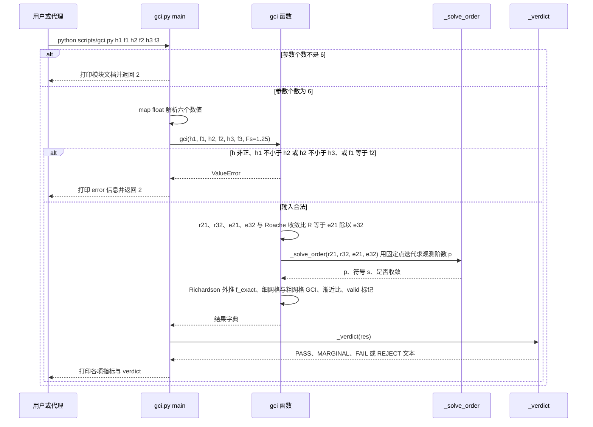

# FEMIS Skill（test1card/femis-skill）

## 一句话定义

FEMIS Skill（test1card/femis-skill）是FEM + Themis 命名的跨求解器治理层，不直接驱动求解器。

## 英文缩写速查

| 缩写 | 英文全称 | 简要说明 |
|------|----------|----------|
| FEA | Finite Element Analysis | 有限元分析工作流 |
| FEM | Finite Element Method | 有限元离散求解方法 |
| V&V | Verification and Validation | 数值验证与模型确认 |

## 为什么重要

对 CAE 自动化而言，代理能否稳定完成任务，取决于工程步骤是否清楚、工具边界是否明确、结果是否保留可审查证据。FEM + Themis 命名的跨求解器治理层，不直接驱动求解器；关注网格无关性、Verification & Validation，以及哪些步骤可无人值守、哪些必须人工决策。

## 核心原理

**项目自身范围：** Text-portable agent skill for FEM/CAE governance.

**工作流：** 在执行方案前规定证据要求和自动化边界，再通过网格无关性及验证/确认检查判断结论是否有工程依据。

## 工程实践

1. 从目标问题识别所需的 Skill、MCP、CLI 或软件接口，不把指导文件当成求解器。
2. 依照仓库 README 检查安装前提、软件/许可证、输入文件和输出证据。
3. 小规模运行并逐项核对几何、网格、边界、求解状态和物理量，再决定是否扩大任务。

文章所述的项目特征：FEM + Themis 命名的跨求解器治理层，不直接驱动求解器；关注网格无关性、Verification & Validation，以及哪些步骤可无人值守、哪些必须人工决策。

## 局限与风险

它是治理/流程层，不能独立计算；跨 Ansys、Abaqus、Nastran、OpenFOAM、COMSOL、LS-DYNA 等的能力映射须回到各软件验证。

源码状态核验：该 GitHub 仓库于 2026-10-07 可公开访问。仓库 API 报告许可证为 Apache-2.0。 

## 源码运行时序图

入口：仓库根目录下 `python scripts/gci.py h1 f1 h2 f2 h3 f3`（仅标准库；示例见 `examples/gci-known-values/README.md`）。

说明：本仓库主体是 `SKILL.md` 等文本指导，由代理加载；仓库内可直接运行的代码是 `scripts/` 下的独立计算器。下图只覆盖 `scripts/gci.py` 的命令行路径，未覆盖 `hourglass_check.py`、`rainflow.py`、`mac.py`、`live_eval.py` 等其他脚本。

图依据：test1card/femis-skill@ceff467，实际读过 `README.md`（前 90 行）、`scripts/gci.py`（文件头、`_solve_order`、`gci`、`_verdict`、`main`）、`examples/gci-known-values/README.md`（前 30 行）。未运行代码。

## 关联页面

- [CAE / CFD 代理工具项目总览](../overview/cae-cfd-agent-skills-landscape.md)
- [Abaqus Agent Skills](./1348109517-abaqus-agent-skills.md)

## 参考来源

- [公众号文章原始资料归档](../../sources/blogs/wechat_cae_cfd_agent_skills_2026-10-07.md)
- [GitHub 仓库资料归档](../../sources/repos/test1card-femis-skill.md)
- [test1card/femis-skill 官方仓库](<https://github.com/test1card/femis-skill>)
- 源码核对（2026-11-02）：test1card/femis-skill@ceff467，读过 README.md（前 90 行）、scripts/gci.py（文件头、_solve_order、gci、_verdict、main）、examples/gci-known-values/README.md（前 30 行）；时序图依据以上文件，未运行代码。

## 推荐继续阅读

- [项目 README](<https://github.com/test1card/femis-skill/blob/main/README.md>)