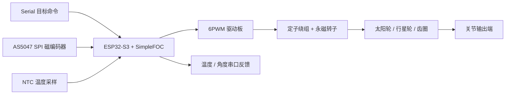
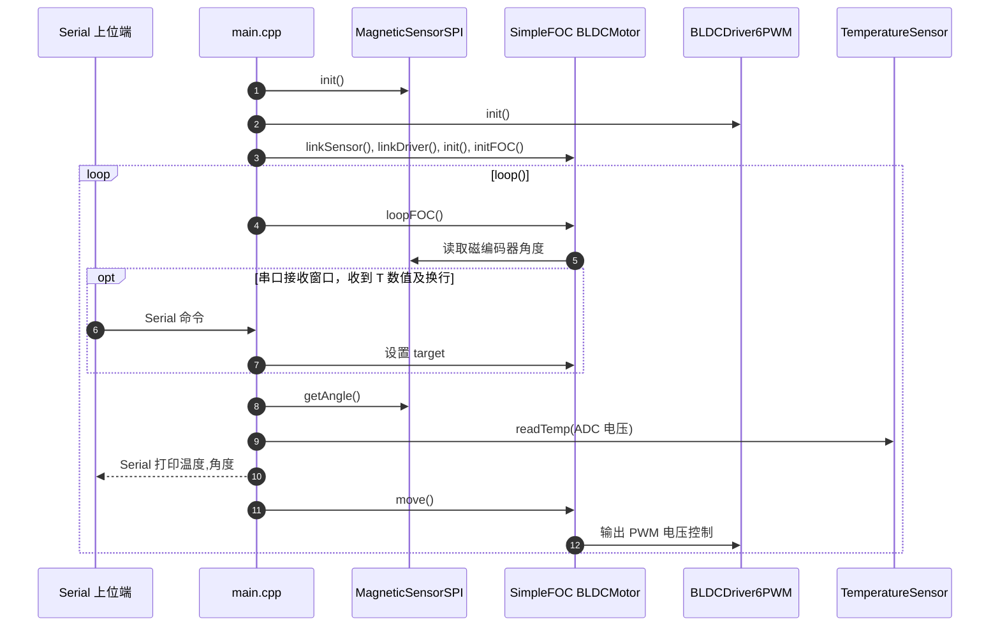

# Actuator 2.0（自研行星减速一体式机器人关节）

## 一句话定义

**Actuator 2.0** 是 [the5439workshop](https://github.com/the5439workshop/Actuator_2) 为自制行走机器人开发的关节执行器：将行星齿轮传动融入电机中空结构，搭配铝合金加工件、PETG 打印件、自研 PCB 和 ESP32-S3 / SimpleFOC 示例程序。项目公开设计文件，但作者明确说明**不是完整复刻教程**。

## 英文缩写速查

| 缩写 | 英文全称 | 简要说明 |
|------|----------|----------|
| CNC | Computer Numerical Control | 数控加工，影响齿轮及行星架的制造精度 |
| STL | Stereolithography | 已公开的机械网格模型格式 |
| PCB | Printed Circuit Board | 自制电机驱动板制造文件 |
| BOM | Bill of Materials | 公开的电子元件物料清单 |
| PETG | Polyethylene Terephthalate Glycol | 作者使用的部分 3D 打印结构材料 |
| FOC | Field-Oriented Control | SimpleFOC 的无刷电机控制方案 |
| SPI | Serial Peripheral Interface | 磁编码器与 ESP32-S3 之间的通信 |
| NTC | Negative Temperature Coefficient | 电机温度测量的热敏电阻 |
| PWM | Pulse-Width Modulation | 6 路功率级驱动控制信号 |

## 为什么重要

- 展示「**中空空间集成行星减速 + 自制电机/驱动板**」的个人工程实践，与 [OpenTorque 同步带传动](./opentorque-actuator.md)、[Internal Cycloidal 内嵌摆线](./internal-cycloidal-actuator.md) 构成可比较的实现路径。
- 开放的是 **STL + PCB/BOM + 示例固件**，有利于研究机械、电子、控制的系统集成；但缺少整机标定和可靠性数据。
- 来源视频描述了从 1.0 拉索/卷筒传动失效到 2.0 铝制行星减速结构的迭代。**视频暂仅得到结构化摘要，性能数值待原片复核**。

## 核心结构与流程总览

仓库 `actuator_v2_stl/` 包含太阳轮、行星轮、齿圈、行星架、定转子适配件和外壳模型；官方 README 称齿轮选用 7075 铝，其余使用 6061 铝或 PETG。下面按**仓库可确认的模块职责**归纳设计和信号链，不将未验证的装配细节当作定论。

**机械方案：** 视频摘要称 2.0 采用约 **6:1 行星减速**、样机约 **900 g**；这两个数值尚未由仓库 README 或独立测量报告确认，保留为待复核信息。

## 开源资产与控制实现

| 层 | 仓库路径 | 核对结论 |
|----|----------|----------|
| 结构/传动 | [actuator_v2_stl/](https://github.com/the5439workshop/Actuator_2/tree/main/actuator_v2_stl) | 太阳轮、行星轮、齿圈、载架等 STL 已发布，非公差合格证明 |
| PCB | [PCB/](https://github.com/the5439workshop/Actuator_2/tree/main/PCB) | Gerber、BOM、位置表和 PCB 预览可用 |
| 固件 | [code_driver/main.cpp](https://github.com/the5439workshop/Actuator_2/blob/main/code_driver/main.cpp) | SimpleFOC 控制逻辑及 Serial 交互已公开 |
| 构建 | [code_driver/platformio.ini](https://github.com/the5439workshop/Actuator_2/blob/main/code_driver/platformio.ini) | PlatformIO ESP32-S3 DevKitC，Arduino，Simple FOC 2.3.5 |
| 温度 | [TemperatureSensor.cpp](https://github.com/the5439workshop/Actuator_2/blob/main/code_driver/TemperatureSensor.cpp) | β 模型 NTC 温度换算 |

源码中 `motor.controller = MotionControlType::torque`，但 `motor.torque_controller = TorqueControlType::voltage`；这代表**电压型扭矩指令接口**，不是已核实的电流/输出扭矩闭环。`driver.voltage_power_supply = 20`、PWM 20 kHz、`motor.current_limit = 40` 为源码配置值，**不能代替实际供电、安全限流或动态力矩测试**。

## 源码运行时序图

以下逐项对应官方 `code_driver/main.cpp` 的 `setup()` 和 `loop()`，仅表达已见的程序调用与数据交互。

**代码实际边界：** `Serial1.begin()` 仍被注释；即使代码切换 `RS485_DIR_PIN`，收发仍调用 `Serial`。风扇相关 GPIO 在 `setup()` 设为 LOW，`loop()` 中未见主动启停，不能假定已实现完整的 RS485 通信或闭环温控。

## 工程实践：复现与验收建议

| 阶段 | 具体工作 |
|------|----------|
| 1. 审图 | 对照 STL、PCB BOM、机构装配关系及真实轴承规格；按设备加工能力重新确定齿轮/轴承公差 |
| 2. 电控 bring-up | 在限流台式电源下核验栅极、相序、编码器 SPI 与 NTC ADC；不得凭 `current_limit` 字段假设已有硬件保护 |
| 3. 控制验证 | 核验 SimpleFOC 电角度校准、命令输出与实际电流；必要时增加实际相电流测量 |
| 4. 台架 | 记录真实减速比、齿隙、输出扭矩—转速、连续温升、齿轮磨损和效率 |
| 5. 部署 | 补充超温/过流/失联保护、封闭防尘、风扇可靠性和总线实时性验证 |

## 视频补充：迭代与测试

[原视频：Why Walking Robots Are So Hard to Build](https://youtu.be/qKkivaZwqTo) 的结构化摘要将过程分为：1.0 拉索结构失效 → 2.0 铝制行星关节 → 手工加工与行星架改版 → 电机绕线与装配 → 初测不理想 → 绕组铜耗分析 → 再测试。

摘要最后报告 **约 20 N·m / 100 W**；**100 W 代表输入功率、铜耗或其他口径尚不明确**，亦无连续运行时长、转速及温度曲线。该数值不应进入额定 TN 曲线，直到原片/实验记录核对完成。

## 局限与风险

- **制造一致性：** 作者明确提示文件按现状公开、没有装配教程，CNC 加工公差需自行调整。
- **材料/寿命：** 7075 铝制齿轮是加工条件下的妥协，作者不保证达到商用执行器寿命。
- **环境：** 穿流式冷却可能带入水和粉尘，作者不建议用于潮湿/多尘环境。
- **电气安全：** 示例采用电压型力矩控制；未见完整电流反馈、失联降级、驱动温控等可靠性验收。
- **开源边界：** STL、Gerber、BOM、代码可下载，但未发现根级 LICENSE 文件；复用和再发布前需确认许可。
- **证据缺口：** 由于视频逐字稿获取受限，视频量化性能、绕组结论仅按摘要标为待核实；本页因此保持 draft。

## 关联页面

- [开源 QDD / 力矩关节执行器项目对比](../comparisons/open-source-qdd-actuator-projects.md) — 与皮带、摆线及其他一体式方案比较开源粒度。
- [Internal Cycloidal Actuator](./internal-cycloidal-actuator.md) — 定子内部集成减速的相邻机械方案。
- [Ironless QDD Actuator](./ironless-qdd-actuator.md) — 自制绕组/齿轮组合的另一技术路径。
- [SimpleFOC](./simplefoc.md) — 驱动器固件实际依赖。
- [关节执行器参数辨识](../methods/joint-actuator-parameter-identification.md) — 转矩、电流、摩擦与惯量需实测。
- [PID Control](../methods/pid-control.md) — 调节稳定性不能仅凭设定参数推断。
- [力矩电机设计纵深路线](../../roadmap/depth-torque-motor-design.md) — 本项目适合 Stage 4 的驱动板集成与 Stage 6 的验收讨论。

## 参考来源

- [Actuator_2 官方仓库核对归档](../../sources/repos/the5439workshop_actuator_2.md)
- [Why Walking Robots Are So Hard to Build 视频摘要归档（未完成逐字复核）](../../sources/videos/why_walking_robots_are_so_hard_to_build_qKkivaZwqTo.md)

## 推荐继续阅读

- [Actuator_2 官方仓库](https://github.com/the5439workshop/Actuator_2)
- [演示与制作过程视频](https://youtu.be/qKkivaZwqTo)
- [SimpleFOC 官方文档](https://docs.simplefoc.com/)
