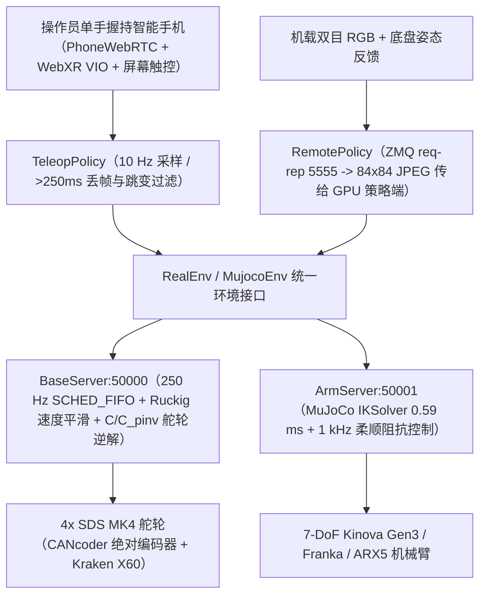
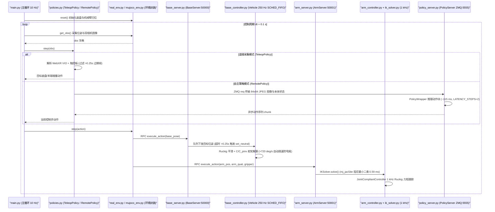

# TidyBot++（全向轮式移动操作开源平台与手机 WebXR 遥操体系）

## 一句话定义

**TidyBot++**（[arXiv:2412.10447](https://arxiv.org/abs/2412.10447)，CoRL 2024，Jimmy Wu 等 / Princeton、Stanford & Dexterity）是一套全开源家庭移动操作硬件与学习栈：将四组带 `CANcoder` 绝对编码器的改良 **Powered-Caster（SDS MK4）全向舵轮** 封装为紧凑高负载移动底座，并结合无外设成本的 **WebXR 手机单手全身遥操** 与 **Diffusion Policy** 训练推理管线，实现从数据采集到真实公寓长程任务落地的低门槛复现。

## 英文缩写速查

| 缩写 | 英文全称 | 简要说明 |
| --- | --- | --- |
| WebXR | Web Extended Reality Device API | 浏览器原生 AR/VR 空间追踪接口，直接利用手机 VIO 采集 6-DoF 遥操位姿 |
| VIO | Visual-Inertial Odometry | 视觉惯性里程计；手机 ARKit/ARCore 借此免外部动捕完成手臂末端控制 |
| IK | Inverse Kinematics | 逆运动学；源码 `IKSolver` 基于 MuJoCo 雅可比 `mj_jacSite` 阻尼最小二乘求解 |
| RPC | Remote Procedure Call | 远程过程调用；源码采用 `multiprocessing.managers.BaseManager` 隔离底层高频控制进程 |
| BOM | Bill of Materials | 物料清单；Kinova 参考版总成本约 5,400 USD（底盘件+电控+电池，不含机械臂） |

## 为什么重要

在家庭和实验室真实环境中，低成本移动操作长期卡在两大工程瓶颈上：首先，差速底盘（如 Stretch 或轮腿简化版）存在非完整约束，靠墙侧移、对齐洗碗机抽屉或狭窄过道避障需要频繁原地“揉库”，大幅拉长示范轨迹并引入大量无意义调头动作；其次，传统全身遥操依赖 VR 头显、主从异构机械臂或昂贵外骨骼，既难单人随处携带，也把移动与操作割裂在两套操纵杆之间。TidyBot++ 用现成 FRC 竞赛级舵轮与家用级 20 Ah/AC 锂电给出了紧凑稳定且可承载 **60 kg（实测 122 kg）** 的开源全向底座，同时用一台普通智能手机通过网页触控板同步映射“平面平移/旋转 + 空间末端 6-DoF + 夹爪”，把移动操作模仿学习的硬件与交互门槛降到了单台笔记本即可复现的水平。

## 核心原理

### 1. 偏置舵轮（Powered-Caster）全向运动学与绝对编码器构型

底座采用 4 组偏置舵轮模块（改良 **SDS MK4**）：驱动电机与转向电机均为带内部 FOC 驱动的 **Kraken X60**，车轮半径 `r = 0.0508 m`、转向减速比 `N_s = 12.8`，偏置距 `b_x = -0.014008 m`、`b_y = -0.003753 m` 产生瞬时全向力矩椭球。关键改造有三点：
- **免归零绝对感知**：每个舵轮主轴加装 `CANcoder` 磁编，通电即知精确转角无需撞限位归零（homing）。
- **低漂移全向里程计**：联合 `C_pinv` 与电机轮速解算底盘积分位姿，长距离平动漂移 `< 1 cm/m`、原地旋转漂移 `< 1 deg / 360 deg`。
- **机械可维护性与负载**：非反向驱动蜗杆/齿轮特性可在断电时锁定支撑 12 kg 机械臂；标准 Kinova 版三围 `50 x 54 x 37.5 cm`、底盘重 `34 kg`，支持模块化替换 **ARX5**（`40 x 44 x 37.5 cm / 26 kg / 288 Wh`）或 **Franka**（`50 x 54 x 44.5 cm / 45 kg / 2160 Wh`）。

### 2. 单手 WebXR 手机全身遥操映射

手机无需安装原生 App，只需连接局域网 HTTPS 网页（`PhoneWebRTC`）：
- **底盘控制**：屏幕触摸区域上半部按压滑动直接映射为底盘相对屏幕朝向的平面速度 `(vx, vy)` 与偏航角速度 `omega`，操作员可随机器人走动始终按“直观第一人称方向”推拉；底层 `TeleopPolicy` 自动滤除 `> 250 ms` 过期帧与 VIO 重定位跳变。
- **手臂 6-DoF 与夹爪**：手机内置 ARKit/ARCore（WebXR）追踪实时 3D 平移与朝向增量，经由当前机器人与人类朝向自适应投影矩阵重映射到 Kinova 末端目标位姿；拇指点按/滑动同步调节二指夹爪开合度。

### 3. 轻量化双机协同学习架构

整车以 **Mac mini** 充当机载控制主机（运行控制与相机抓取），策略推理通过 **ZeroMQ** 将 **84 x 84 JPEG** 压缩视觉观测传至外置单张 **RTX 4080 Laptop GPU** 运行 **Diffusion Policy**：单次采样闭环时延约 **115 ms**（配合 `LATENCY_STEPS = 2` 动作前缀对齐），无需昂贵机载工作站即可执行多步连续动作块。

## 实验与评测

根据 [TidyBot++ 论文与开源文档（arXiv:2412.10447）](../../sources/papers/tidybot2_arxiv_2412_10447.md) 公开实验与测试结果：

| 评测维度 / 任务 | 实验条件 | 核心指标 / 观察结论 | 对比 / 消融基线 |
| --- | --- | --- | --- |
| 真实公寓 Diffusion Policy | 6 项家庭日常任务（500 epochs，每项 10 轮） | 开冰箱 **10/10**（100 demos）、倒垃圾 **10/10**（50）、擦台面 **9/10**（50）、装洗碗机 **7/10**（50）、放洗衣篮 **7/10**（50）、浇花 **6/10**（50） | 全程单手手机遥操建库，无外部动捕与 VR 头显 |
| 全向 vs 差速底盘对比 | 擦拭厨房台面（各 50 条示范） | 全向模式路径 **2.03 m / 27.4 s / 成功率 9/10** | 模拟差速约束后路径暴增至 **4.03 m / 65.2 s / 成功率 4/10** |
| 底盘性能与负载极限 | Kinova 参考配置整车台架与室内实测 | 额定载荷 **60 kg**（极限实测 **122 kg**）、最大速度 **1 m/s**、768 Wh AC 电池续航 **8 小时** | 另加 6 kg 铅酸配重以防满伸手臂时倾覆 |
| 逆运动学计算耗时 | MuJoCo `IKSolver` 单步阻尼最小二乘 | 平均求解仅 **0.59 ms** | 为 1 kHz 机械臂柔顺跟踪与高频仿真留足冗余余量 |

## 源码运行时序图

以下调用链逐项核对自 [`jimmyyhwu/tidybot2`](../../sources/repos/jimmyyhwu_tidybot2.md) 实机与仿真核心源码（`constants.py`、`main.py`、`real_env.py`、`mujoco_env.py`、`base_server.py`、`base_controller.py`、`arm_server.py`、`arm_controller.py`、`ik_solver.py`、`policies.py`、`policy_server.py`）：

## 工程实践

1. **必须保留高层防卡死与高频通信看门狗**：`base_controller.py` 中底盘核心线程显式请求 Linux `SCHED_FIFO` 实时优先级并内建 `0.25 s` 无指令自动切回 `set_neutral`（同时对转角超 `720 deg/s` 触发平滑降速保护舵轮反转过冲）；若在普通笔记本或虚拟机降级调度，舵轮频繁原地“flip”会迅速损坏机械齿轮或加剧轮胎打滑。
2. **注意 AC 锂电逆变与铅酸配重协同**：Kinova 版采用常见 **768 Wh AC 电源站** 供电以规避复杂的自定义 BMS/高压直流降压板，但须匹配底盘内部 **6 kg SLA 铅酸电池配重** 抵消手臂前伸力矩，否则高负载抓取时容易发生前倾。
3. **利用 `convert_to_robomimic_hdf5.py` 无缝对接外部策略栈**：源码仓库自带从本地磁盘演示录包向标准 `robomimic` HDF5 转换的脚本与 MuJoCo 数字孪生 `MujocoEnv`（共用同一 `IKSolver`），建议先在仿真验证动作坐标方向与 `LATENCY_STEPS` 参数再切到 `RealEnv`。

## 常见误区与局限

- **误区 1：误以为 BOM 5,400 USD 包含全套机械臂**：5,400 USD 仅含自制全向底盘机械结构、4 组 MK4 舵轮模组、电控与机载 Mac mini/电源；7-DoF Kinova Gen3 或 Franka 机械臂需额外采购，或替换为低成本 ARX5 双/单臂变体压缩整机总价。
- **误区 2：低估手机 WebXR 室内漂移**：依赖弱纹理白墙或逆光玻璃时，手机单目 VIO 会短暂丢失尺度并引发末端目标跳变；虽有 `TeleopPolicy` 的帧超时剔除保护，但操作员仍应维持合理手臂运动半径并经常借助触控离合器重置相对锚点。
- **核心局限**：(1) 无升降立柱（fixed-height mast），仅靠机械臂 7-DoF 覆盖地面拾取到高处柜顶时可达空间受限；(2) `84 x 84` 低分辨率 JPEG 策略输入难以胜任需要极细小零件穿孔或高反光透明物体精抓取的作业；(3) 舵轮橡胶胎在长毛地毯或湿滑木地板上仍存在一定转向阻力与里程计偏差。

## 关联页面

- [Diffusion Policy](../methods/diffusion-policy.md) — TidyBot++ 自主策略端采用的核心多步动作块模仿学习方法
- [模仿学习（Imitation Learning）](../methods/imitation-learning.md) — 少量演示轨迹驱动家庭技能学习的方法体系
- [机器人操作（Manipulation）](../tasks/manipulation.md) — 桌面与家居抓取放置任务基础
- [移动操作（Loco-Manipulation）](../tasks/loco-manipulation.md) — 底盘运动与机械臂末端协同的核心任务领域
- [遥操作（Teleoperation）](../tasks/teleoperation.md) — WebXR 手机无外设遥操在全身数据采集中的位置
- [逆运动学（Inverse Kinematics）](../formalizations/inverse-kinematics.md) — 源码 `IKSolver` 雅可比阻尼最小二乘求解的数学基础
- [控制与推理频率解耦（Control-Inference Frequency Decoupling）](../concepts/control-inference-frequency-decoupling.md) — 10 Hz 远程 GPU 策略与 250 Hz/1 kHz 本地硬件实时环的协同机制
- [Sim2Real](../concepts/sim2real.md) — `MujocoEnv` 与 `RealEnv` 共享 IK 与控制框架的对齐设计
- [ALOHA](./aloha.md) / [ALOHA 2](./aloha-2.md) — 固定桌面主从双臂开源遥操生态对照
- [XLeRobot](./xlerobot.md) — 同类面向低成本消费级硬件的开源移动操作路线
- [OpenXR](./openxr.md) — 浏览器 WebXR 与空间追踪标准生态对比
- [RoboMimic](./robomimic.md) — 数据格式化脚本对接的模仿学习框架
- [ZeroMQ](./zeromq.md) — 底层远程策略通信所采用的异步消息队列协议
- [Sunday Robotics ACT2](./sunday-robotics-act2.md) / [机器人开源宝库（微信策展第02期）索引](../overview/robot-open-source-wechat-issue02-curator.md) — 同期社区家庭操作平台演进脉络

## 参考来源

- 论文与硬件文档归档：[TidyBot++ 论文与官方文档全文归档](../../sources/papers/tidybot2_arxiv_2412_10447.md)（arXiv:2412.10447 / CoRL 2024 & `tidybot2.github.io/docs` 全文核对）
- 仓库源码归档：[jimmyyhwu/tidybot2 源码结构核查](../../sources/repos/jimmyyhwu_tidybot2.md)
- 社区策展归档：[微信策展第02期开源机器人摘录](../../sources/blogs/wechat_jixie_robot_open_source_treasury_issue02_10_robots.md)
- 原始来源：https://arxiv.org/abs/2412.10447 | https://tidybot2.github.io/ | https://tidybot2.github.io/docs/ | https://github.com/jimmyyhwu/tidybot2

## 推荐继续阅读

- [移动操作（Loco-Manipulation）](../tasks/loco-manipulation.md) — 比较轮式全向平台、差速移动底座与足式全身移动操作各自的自由度约束与策略解耦设计。
- [控制与推理频率解耦](../concepts/control-inference-frequency-decoupling.md) — 深入拆解异步策略 chunk（115 ms）与实时阻抗控制环（1 kHz）的时间延迟补偿方法。
