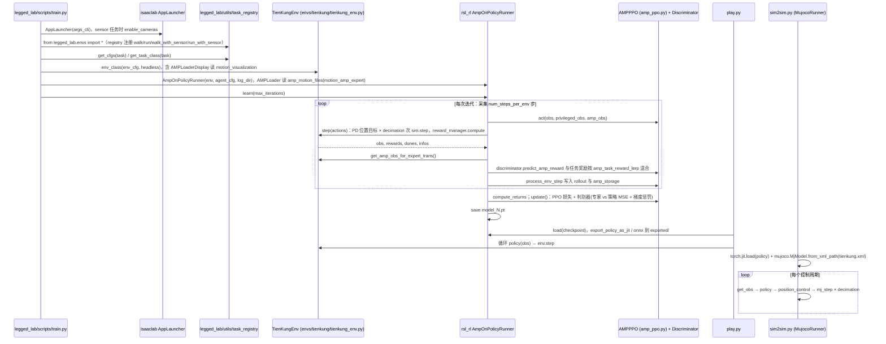

# TienKung-Lab

[**Open-X-Humanoid/TienKung-Lab**](https://github.com/Open-X-Humanoid/TienKung-Lab) 是 **北京人形机器人创新中心（X-Humanoid）** 开源的 **Isaac Lab 运控训练框架**：基于 **AMP** 与周期步态设计，面向天工系列人形的 **高速双足 / 全身平衡** 与 Sim2Sim→真机部署链。

## 一句话定义

**国产人形 Isaac Lab RL 基线** — 把 AMP 运动先验接到天工 URDF 上的官方训练脚本与部署入口（与本体 URDF 页分工）。

## 英文缩写速查

| 缩写 | 英文全称 | 简要说明 |
|------|----------|----------|
| AMP | Adversarial Motion Priors | 对抗运动先验奖励 |
| RL | Reinforcement Learning | 步态策略训练 |
| Isaac Lab | NVIDIA Isaac Lab | GPU 仿真 + RL 任务框架 |
| Sim2Sim | Simulation to Simulation | 训练仿真 → MuJoCo 等验证 |
| WBC | Whole-Body Control | 与全身技能扩展相关 |

## 为什么重要

- **与宇树 official gym 对照：** 文章将其与 [unitree_rl_gym](./unitree-rl-gym.md) 并列为国人形 **工程基线**。
- **机构官方栈：** 与 [X-Humanoid](./x-humanoid.md) 文档站、[Deploy_Tienkung](./cn-os-deploy-tienkung.md) 组成完整链。
- **本体页分离：** URDF/硬件见 [天工开源](./tienkung-humanoid-open-source.md)；本页只覆盖 **训练代码仓**。

## 工程实践

1. README 要求 Isaac Sim **4.5** / Isaac Lab **2.1** 矩阵（入库日 README 为准）。
2. 典型路径：`train.py --task=walk` → Sim2Sim → [Deploy_Tienkung](https://github.com/Open-X-Humanoid/Deploy_Tienkung)。
3. 与 [rsl-rl](./rsl-rl.md) 关系：若 Lab 栈使用 RSL PPO 后端，训练 API 仍以上游 Isaac Lab 文档为准。

## 局限与使用注意

- **算力门槛：** 高端 GPU + Isaac 版本钉扎；非轻量 pip demo。
- **「开源 ≠ 低成本复现」：** 真机部署依赖天工硬件与机构支持文档。

## 源码运行时序图

入口：训练 `python legged_lab/scripts/train.py --task=walk --headless --logger=tensorboard --num_envs=4096`；回放 `python legged_lab/scripts/play.py --task=walk --num_envs=1`；MuJoCo sim2sim `python legged_lab/scripts/sim2sim.py --task walk --policy Exported_policy/walk.pt --duration 100`。

图依据：Open-X-Humanoid/TienKung-Lab@e09a70b，读过 `README.md`、`legged_lab/scripts/train.py`、`play.py`、`sim2sim.py`、`play_amp_animation.py`（仅函数结构）、`legged_lab/envs/__init__.py`、`envs/tienkung/tienkung_env.py`（`step` 及方法清单）、`envs/tienkung/walk_cfg.py`（grep 到 `runner_class_name = "AmpOnPolicyRunner"`、`AMPPPO`、`amp_motion_files`）、`rsl_rl/rsl_rl/runners/amp_on_policy_runner.py`、`rsl_rl/rsl_rl/algorithms/amp_ppo.py`。奖励项（`mdp/rewards.py`）、观测构造、地形与传感器实现、`gmr_data_conversion.py` 未细读；实机部署在另一仓库 Deploy_Tienkung，未涉及。

## 关联页面

- [X-Humanoid（机构总览）](./x-humanoid.md)
- [天工 Lite/Pro 本体开源](./tienkung-humanoid-open-source.md)
- [unitree_rl_gym](./unitree-rl-gym.md)

## 参考来源

- [sources/repos/tienkung-lab.md](../../sources/repos/tienkung-lab.md)
- [wechat_robot_yanfa_opensource_algorithms_compendium.md](../../sources/blogs/wechat_robot_yanfa_opensource_algorithms_compendium.md)
- 源码核对（2026-11-02）：Open-X-Humanoid/TienKung-Lab@e09a70b，读过 README.md、legged_lab/scripts/train.py、play.py、sim2sim.py、legged_lab/envs/__init__.py、envs/tienkung/tienkung_env.py、walk_cfg.py、rsl_rl/rsl_rl/runners/amp_on_policy_runner.py、rsl_rl/rsl_rl/algorithms/amp_ppo.py；时序图依据以上文件，未运行代码。

## 推荐继续阅读

- GitHub：<https://github.com/Open-X-Humanoid/TienKung-Lab>
