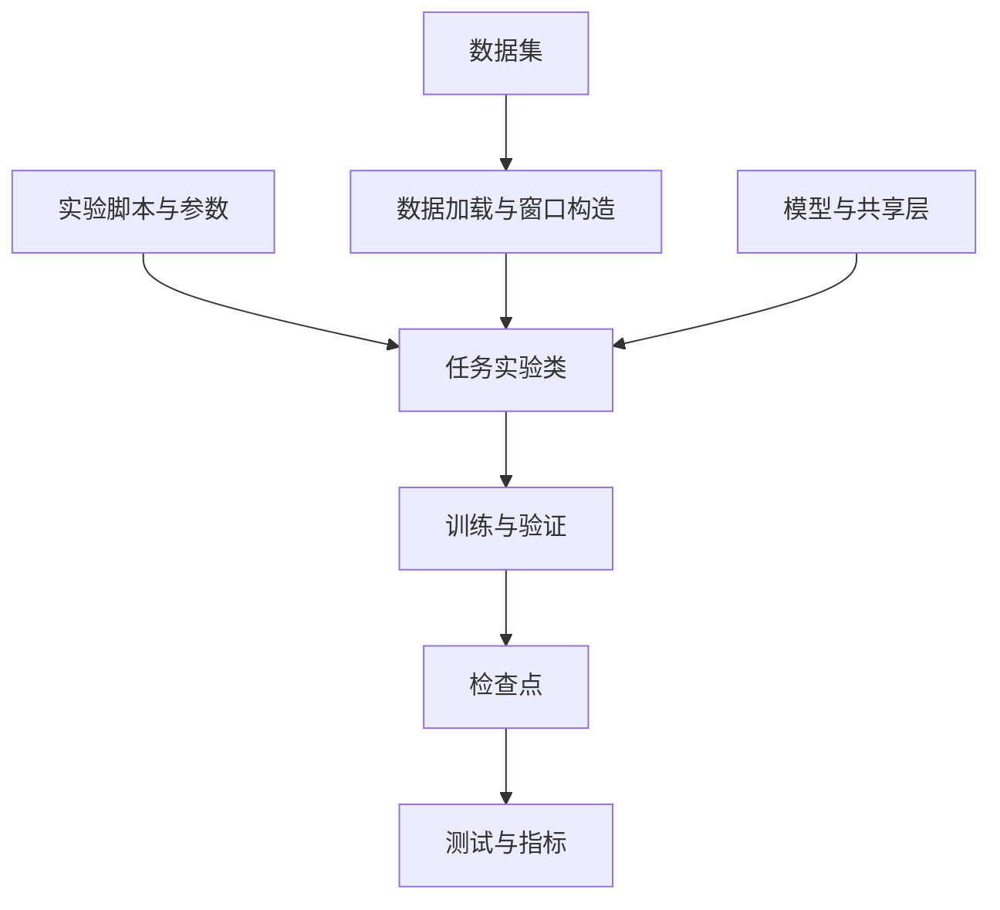
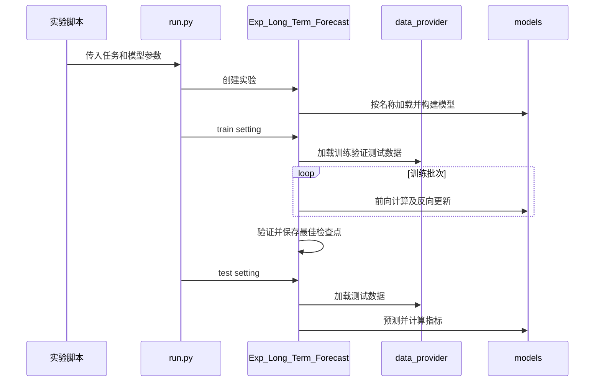

# Time-Series-Library（TSLib）

TSLib 是面向深度时间序列分析的开源实验库，可用于比较模型及开发模型，覆盖长短期预测、缺失值补全、异常检测和分类。

## 英文缩写速查

| 缩写 | 英文全称 | 简要说明 |
|------|----------|----------|
| TSLib | Time Series Library | 本项目的简称 |
| MSE | Mean Squared Error | 长期预测使用的均方误差 |
| MAE | Mean Absolute Error | 预测评测中的平均绝对误差 |
| DTW | Dynamic Time Warping | 可选的序列距离指标 |

## 流程总览

官方还提供部分大时间序列模型的零样本预测入口。选择模型并不保证所有模型兼容所有任务，需查看对应实验脚本及依赖。

## 源码运行时序图

以下限定为 `run.py` 的长期预测训练路径，依据官方 README、`exp_basic.py`、`exp_long_term_forecasting.py` 和 `data_factory.py`。

`is_training=0` 走测试分支并加载检查点；各任务的数据处理与指标不同，上图不代表全部任务的内部实现。

## 工程实践与局限

- 官方提供 MIT 许可源码、实验脚本及公开数据入口；README 要求先克隆、安装依赖并准备数据。Mamba 等模型还需额外依赖。
- 维护者在 2026 年 4 月表示不再积极添加新功能，部分基准可能不再适合衡量最新研究进展；比较时应选择更新的基准并统一数据划分、预测窗口和指标。
- 截图里的“41 个模型”“五大任务四项第一”及预测曲线不能证明当前版本或自有数据上的表现。机器人日志应用需自行验证数据质量、延迟和泛化，本库并非机器人控制部署框架。

## 关联页面

- [机器人数据格式对比](../comparisons/hdf5-mcap-lerobot-data-formats.md)：理解日志与训练数据的存储边界。
- [传感器融合](../concepts/sensor-fusion.md)：理解机器人状态估计背景。

## 参考来源

- [官方仓库资料归档](../../sources/repos/time-series-library.md)

## 推荐继续阅读

- [官方 README 与实验脚本](https://github.com/thuml/Time-Series-Library/tree/4e938a1767106324dd753b2a44832bf870a0252e)
