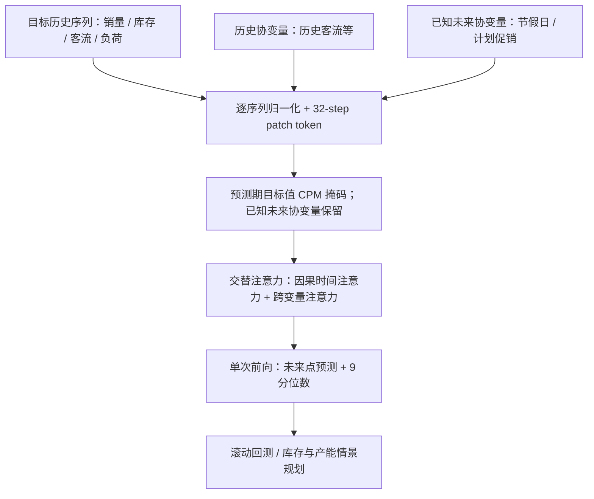
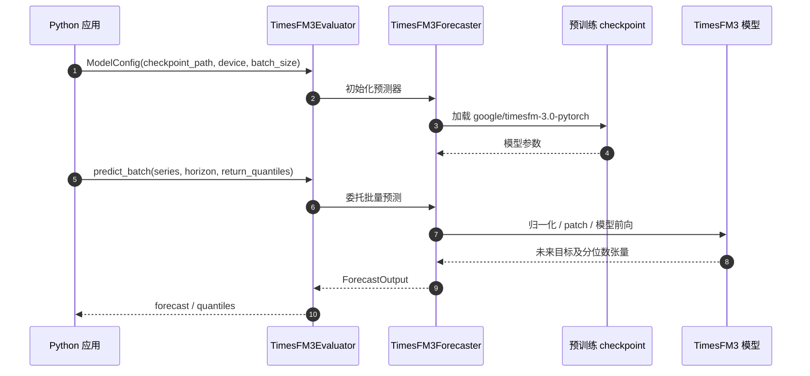

# TimesFM 3.0｜谷歌零样本时间序列预测基础模型（Time Series Foundation Model）

## 一句话定义

**TimesFM 3.0**（Google Research，2026-08-31）把历史数值序列和可用协变量输入一个 **330M 参数**的预训练 Transformer，不必针对新任务重新训练即可生成未来时段的**点预测与分位数预测**；它是业务/传感器数值预测模型，**不是动作控制策略或物理动力学仿真器**。

## 英文缩写速查

| 缩写 | 英文全称 | 简要说明 |
|------|----------|----------|
| TimesFM | Time Series Foundation Model | 时间序列预测基础模型家族 |
| ZS | Zero-Shot | 在目标任务上不经专用训练直接预测 |
| CPM | Contiguous Patch Masking | 掩码未来连续 patch，单次前向预测 horizon |
| HF | Hugging Face | 官方预训练权重托管平台 |
| MLX | Machine Learning eXtensions | Apple Silicon 原生推理后端 |
| BQML | BigQuery ML | Google Cloud SQL 时序预测服务 |

## 为什么重要

- **降低冷启动成本**：有足够历史数值序列即可先做零样本基线，再与统计模型、专用模型的滚动回测比较，而不是第一步就建立训练流水线。
- **多变量问题更贴近真实场景**：销量可受促销、客流和关联商品影响；3.0 将目标、仅过去可知的协变量、以及未来已知的动态协变量区分建模。
- **从单点结果升级为风险带**：同时给出 9 个分位数，支持库存/用电规划中的情景区间，但模型分位数与经过校准的业务置信区间不能混称。
- **多渠道部署**：代码仓、Python 包、Apple MLX、Google Cloud BigQuery ML 和 Connected Sheets 各有不同权限与使用边界。

## 核心信息与版本差异

| 项目 | 说明 |
|------|------|
| 机构 | 谷歌研究院（Google Research） |
| 3.0 发布时间 | 2026-08-31 |
| 模型规模 / 预训练 | **330M** 参数；官方称超过 **1 万亿时间点**（真实 + 合成） |
| TimesFM 2.0 / 2.5 | 2.0 为 500M；2.5 为 **200M**，上下文可达 **16,384**，协变量经 XReg 扩展 |
| TimesFM 3.0 | 原生多变量与动态协变量；**32 步 patch**；时间因果注意力与变量注意力交替；**非自回归预测** |
| 输出 | 预测 horizon 的点预测和 **0.1–0.9 九个分位数** |
| 官方评测口径 | Google Research 报告在 **GIFT-Eval、FEV-Bench、TIME** 三组基准的基础模型对照中均排名第一；不代表所有行业、所有序列均第一 |
| 官方权重 | [google/timesfm-3.0-pytorch](https://huggingface.co/google/timesfm-3.0-pytorch) |
| 版本源头论文 | [A decoder-only foundation model for time-series forecasting（ICML 2024）](https://arxiv.org/abs/2310.10688)；**非 3.0 专属论文** |

## 核心原理

1. **输入划分**：目标序列可为单条或多条；历史协变量只给历史；已知未来协变量（节假日、确定促销日程等）包含预测区间。
2. **patch 与归一化**：按变量分别归一化后切成 **32 时间点**的 patch，保留不同序列尺度。
3. **交替注意力**：时间维沿过去做因果注意力；同一时间位置的变量之间做全注意力，从而利用跨商品/跨传感器关系。
4. **CPM 一次性解码**：为目标 horizon 添加掩码 patch；模型在单次前向传播中输出整段预测，未来真实目标值保持不可见。
5. **点预测 + 分位数**：可用 0.1/0.9 分位数组成 80% 分位数区间；它不是未经回测校准的 95% 覆盖率保证。

## 流程总览



## 源码运行时序图

以下为官方 README 的 Python → `timesfm3` PyTorch 预测主线（据 `src/timesfm3/torch/evaluator.py`、`timesfm3_forecaster.py` 公开接口整理；非未经验证的训练流程）：



`TimesFM3Evaluator` 是官方对基准评估的包装；自定义服务可使用 `TimesFM3Forecaster`。图示中的 checkpoint 获取/加载属于初始化逻辑，不代表每一次预测都重新下载。

## 工程实践

### 本地 Python 快速试用

官方包安装命令为 `pip install 'timesfm[torch]'`（Apple Silicon 使用 `pip install 'timesfm[mlx]'`）。**必须额外获取兼容的 3.0 checkpoint**，并确认运行环境的 PyTorch/MLX 依赖和权重许可。

```python
import numpy as np
from timesfm3 import TimesFM3Evaluator, ModelConfig

forecaster = TimesFM3Evaluator(ModelConfig(
    checkpoint_path="google/timesfm-3.0-pytorch",
    per_core_batch_size=32,
    device="cuda",
))
history = np.sin(np.linspace(0, 24, 100)).astype(np.float32)
output = next(iter(forecaster.predict_batch(
    [history], horizon=12, return_quantiles=True,
    use_symmetric_averaging=False,
)))
print(output.forecast.shape)   # (12,)
print(output.quantiles.shape)  # (12, 9)
```

上例摘自官方接口范式，**不是本库的本地运行实测**。多变量输入 `(num_variates, context_length)`，以 `past_only_covariates` / `past_future_covariates` 提供附加输入；切勿让未来真实目标值进入协变量造成泄漏。

### Google Sheets 无代码试用

官方路线是 **Google Sheets → Connected Sheets（BigQuery 数据）→ Advanced analytics → Create a forecast**。用户可以选预测范围、分组和置信水平（产品文档默认 95%）并生成上下限列；这**不是**在普通独立 Sheets 单元格中直接运行本地 Python 模型，可能需要 BigQuery 权限、数据和计费环境。

### 业务与机器人系统定位

| 场景 | 合理输入/输出 | 关键检查 |
|------|--------------|----------|
| 销量 / 库存 | 历史销量 + 已知促销计划 → 未来需求量分位数 | 缺货、节假日、概念漂移时滚动回测 |
| 客流 / 电力负荷 | 采样周期一致的历史记录 + 可用外生变量 → 负荷区间 | 数据延迟与峰值误差、不确定性覆盖率 |
| 机器人产线运营 | 班次吞吐量 / 历史停机率 → 预测产能需求 | 可作上层排班先验；**不能代替**机器人控制动力学模型 |
| 机器人传感器 | 连续采样的数值流 → 趋势基线 | 未经验证不能用于硬实时安全控制闭环 |

评估建议：按时间先后切割 train/context/test，在不泄漏未来信息前提下比较 seasonal naive、ARIMA/ETS 与 TimesFM；同时记录 MAE/WAPE（视指标适用性）、峰值误差、p10–p90 覆盖率、推理时间与漂移。

## 局限与风险

- **授权不是“一套 Apache-2.0”**：仓库**代码** Apache-2.0，**2.5 及更早权重** Apache-2.0；**3.0 下载/自托管权重**采用 `timesfm-non-commercial-license-v1.0`，仅非商业、非生产。商业生产使用走 Google 授权的云服务（例如 BigQuery ML）及对应条款。
- **量化精度不是业务担保**：0.1 / 0.9 分位数对应模型估计分布的两端，不应宣称任意数据上都可靠达到 80% 覆盖，须用当地数据校准。
- **零样本 ≠ 数据无需处理**：缺失值、频率不齐、单位漂移、异常峰值、数据泄漏仍会损害预测。
- **榜单需带范围**：三项榜单第一均为 Google Research 发布时、指定对照与指标的报告，不代表所有现成预测模型或业务场景持续领先。
- **“本地很轻”要结合硬件**：`pip install` 只是安装依赖；330M 权重下载、内存和 GPU/CPU 速度仍需评估。官方 M4 Max MLX benchmark 不能外推到其他设备。
- **与机器人世界模型有本质区别**：TimesFM 预测一般数值时间序列，不直接学习动作条件的刚体状态转移、碰撞或可微物理。

## 关联页面

- [模型预测控制（MPC）](../methods/model-predictive-control.md) — TimesFM 可供产线排班/外生负荷情景参考，但不是 MPC 控制动力学模型。
- [Model-Based RL](../methods/model-based-rl.md) — 都涉及预测，但 MBRL 主要预测动作条件下的系统演化。
- [World Models（Ha & Schmidhuber）](./paper-ha-schmidhuber-world-models.md) — 比较数值预测与交互式世界建模的任务边界。
- [Manipulation](../tasks/manipulation.md) — 机器人操作任务与上层需求预测的边界，不是直接策略替换。

已检查本库纵深路线：TimesFM 面向通用运营时序预测，与现有 LIP/MPC/WAM/机器人运控纵深路线都不构成直接必修节点，故不强制挂入路线。

## 参考来源

- [Google Research：TimesFM-3 技术原文（2026-08-31）](../../sources/blogs/google-research-timesfm3-2026.md)
- [Google Research 官方源码与许可核查](../../sources/repos/google-research-timesfm.md)
- [Google Connected Sheets × TimesFM 官方文档](../../sources/sites/google-connected-sheets-timesfm.md)

## 推荐继续阅读

- [Google Research：TimesFM-3 原文](https://research.google/blog/timesfm-3-a-zero-shot-foundation-model-for-multivariate-forecasting/)
- [官方 GitHub：google-research/timesfm](https://github.com/google-research/timesfm)
- [TimesFM 3.0 官方模型权重和许可证](https://huggingface.co/google/timesfm-3.0-pytorch)
- [最早 TimesFM 论文（ICML 2024）](https://arxiv.org/abs/2310.10688)
