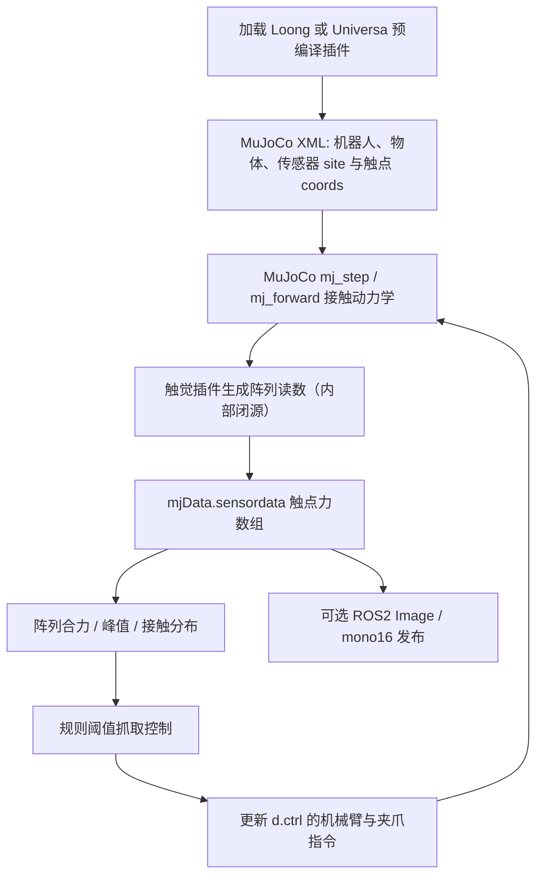
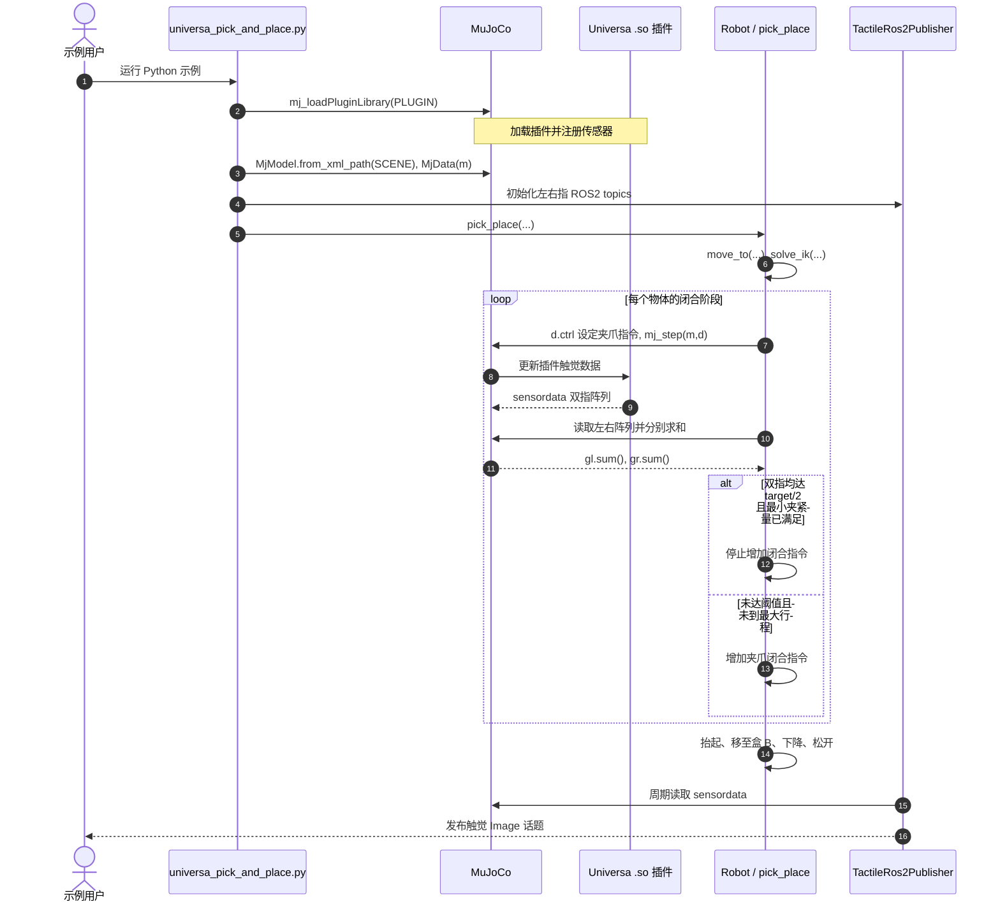

# TipSim：基于 MuJoCo 的触觉仿真与抓取反馈（Tactile Simulation for Robotic Grasping）

## 一句话定义

**TipSim** 是华威科 TIP 平台的 **MuJoCo 触觉仿真开放集成项目**：通过 Loong（龙鳞）和 Universa（万象）两个预编译插件，将接触响应输出为触点阵列力值，并利用标准 `mjData.sensordata` 让抓取控制程序读取和反馈。**示例代码与场景开放，核心传感器插件不是源码开源。**

## 英文缩写速查

| 缩写 | 英文全称 | 简要说明 |
|---|---|---|
| API | Application Programming Interface | MuJoCo 标准传感器读取接口 |
| XML | Extensible Markup Language | 机器人模型、插件与触点阵列配置 |
| ROS2 | Robot Operating System 2 | 示例将触觉阵列发布为消息 |
| SDK | Software Development Kit | 不需要额外专有触觉 SDK 头文件 |
| FS | Full Scale | `accuracy` 和 `repeatability` 的量程百分比基准 |
| Sim2Real | Simulation to Reality | 将仿真经验迁移到真机，TipSim 尚待独立验证 |

## 为什么重要

- **可复用传感器接口：** 插件先于模型加载，场景注册 `tip.tactile.loong` / `tip.tactile.universa`，下游只需使用 MuJoCo 的传感器索引与 `sensordata`，不必依赖私有读取 API。
- **接触分布而非单一合力：** 每个触点给出数值，可用阵列重构合力、峰值和激活点数，便于检查不同物体、接触位置与握紧过程。
- **将观测接入闭环：** 官方 UR5e + Universa 取放脚本使用左右指受力条件决定何时停止增大夹紧指令；属于可复现的**规则控制演示**，不是端到端学习成果。
- **传感器非理想特性可设置：** XML 中可设置量程、精度、重复度、触发力、迟滞、随机种子，为算法鲁棒性研究提供统一实验变量。

## 核心原理

| 模块 | 输入 | 输出 / 行为 |
|---|---|---|
| 模型与插件注册 | MuJoCo XML、Loong / Universa 的 `.so` | 在 `<sensor>` 中定义 `site`、阵列维度、各触点坐标 |
| 接触动力学与传感 | `mj_step` / `mj_forward` 更新后的仿真接触 | 插件产生每个 taxel 的力读数，存入 `mjData.sensordata` |
| 配置模型 | `size` / `npoints` / `coords` 和可选传感器参数 | 合力量程、阈值、精度/重复性误差与迟滞的模拟 |
| 触觉反馈 | 双指触觉阵列求和、夹爪闭合命令 | 分指达到目标力门槛时保持闭合，随后搬运并释放 |
| 数据发布 | `samples/common/tactile_ros2.py` | 后台线程以 ROS2 `sensor_msgs/Image` 的 `mono16` 编码发布触觉矩阵 |

### 典型配置

| 项目 | Loong（龙鳞） | Universa（万象） |
|---|---|---|
| 插件 | `tip.tactile.loong` | `tip.tactile.universa` |
| 阵列声明 | `size="rows cols"` | `npoints="N"` |
| 官方示例 | 12×8 Loong96；RH56E2 多表面触觉 | 10×8 / 指，UR5e 双指取放 |
| 默认整阵列 `full_scale` | 20 N | 30 N |

其他官方默认参数：`accuracy=1.0 %FS`、`repeatability=0.7 %FS`、`trigger_force=0.05 N`、`hysteresis_loop=0.5 %FS`、`hysteresis_asymmetry=1.2`。**这些是仿真参数默认值，而不是第三方标定出的真机精度。**

### 流程总览

流程仅绘制官方公开的**接口层**，未推断闭源插件内部算法。

## 源码运行时序图

基于官方 [`samples/tip/python/universa_pick_and_place.py`](https://github.com/tiplab/TipSim/blob/6a323daf4888ec3f0537ddc7d6d7675037c6e445/samples/tip/python/universa_pick_and_place.py) 的 `main()`、`pick_place()`、`Robot.force_close()`、`Robot.step()` 和 `samples/common/tactile_ros2.py` 的发布接口。

**精确停止条件：** 在 `grip >= MIN_GRIP` 时，须满足 **左指 ≥ target/2 且右指 ≥ target/2**，或 `grip >= GRIP_MAX` 才停止增加闭合指令。样例 `OBJECTS` 的每个 `target=10 N`，`MIN_GRIP=10`、`GRIP_MAX=255` 为夹爪控制量（不是牛顿）。与“总合力达到 10 N 必然停”不同；此外程序有最大迭代上限。

## 工程实践

1. **环境：** Linux x86_64；插件支持 MuJoCo **3.9.0–3.16.0**，官方 Python 示例推荐 `mujoco==3.12.0`、`numpy` 和 ROS2（`rclpy/sensor_msgs`）；C++ 需要 CMake、GLFW、TinyXML2 和 ROS2。
2. **加载：** 先调用 `mujoco.mj_loadPluginLibrary("lib/libtip_tactile_universa.so")`，再构造 `MjModel` 与 `MjData`；XML 声明 `<plugin plugin="tip.tactile.universa"/>` 及传感器 `npoints/coords`。
3. **读取：** `m.sensor_adr[sid]`、`m.sensor_dim[sid]` 定位 `d.sensordata[adr:adr+dim]`；以预期 rows×cols `reshape` 后统计 `sum/max`，不能将阵列总和直接当作六轴力矩。
4. **快速复现：** 官方 `python samples/tip/python/loong96.py`、`python samples/inspire/python/rh56e2_hold_cylinder.py` 和 `python samples/tip/python/universa_pick_and_place.py`；均须参照上游 Sample README 正确加载 ROS2 环境。
5. **对接控制策略：** 先做固定姿态接触、逐步加载/卸载与受力门槛实验，再研究触觉观测进入抓取策略；需自行做硬件标定与接触力分布对齐，不能从该演示直接推出真机稳定抓取。

## 局限与风险

- **部分开放，不是核心完全开源：** `lib/libtip_tactile_loong.so`、`lib/libtip_tactile_universa.so` 不提供源码，MIT 仅覆盖其他文件，二进制受单独分发与逆向限制；因而无法从公开源码核实触觉插件内部受力分配或数值近似细节。
- **“多模态”“行业首个”尚无独立证明：** 已核实的公开示例以触点**力值阵列**为主，不能自动推断含视觉、温度、剪切力等多种触觉模态，也没有独立行业先后比较。
- **Sim2Real 未实证：** 仿真读数可用于控制逻辑，不代表数据或策略能无缝迁移至华威科真机硬件；缺少统一硬件标定、独立基准与跨场景评估。
- **平台与规划边界：** 目前主要交付为 MuJoCo + Linux x86_64；Isaac Sim 支持、批量采集及 Benchmark 位于官方 Roadmap，尚不可写成现有能力。
- **示例证明范围有限：** 公开 GIF 和规则阈值抓取不能替代成功率统计、不同材质/摩擦条件的鲁棒性实验或插件内部算法审计。

## 关联页面

- [触觉感知（Tactile Sensing）](../concepts/tactile-sensing.md)：传感器机理、压力分布与滑移感知的通用背景；TipSim 专注力值阵列模拟。
- [接触丰富操作（Contact-Rich Manipulation）](../concepts/contact-rich-manipulation.md)：将阵列合力纳入操作控制的场景。
- [Sim2Real](../concepts/sim2real.md)：从仿真输出迁移到真实触觉硬件必须面对的误差与标定。
- [Manipulation（机器人操作）](../tasks/manipulation.md)：抓取与取放任务对应的上层研究主线。

## 参考来源

- [本站 TipSim 官方仓库通读归档](../../sources/repos/tiplab-tipsim.md)
- [官方中文 README（固定版本）](https://github.com/tiplab/TipSim/blob/6a323daf4888ec3f0537ddc7d6d7675037c6e445/README.zh-CN.md)
- [官方示例说明](https://github.com/tiplab/TipSim/blob/6a323daf4888ec3f0537ddc7d6d7675037c6e445/samples/README.zh-CN.md)
- [抓取源码入口](https://github.com/tiplab/TipSim/blob/6a323daf4888ec3f0537ddc7d6d7675037c6e445/samples/tip/python/universa_pick_and_place.py)
- [官方 LICENSE](https://github.com/tiplab/TipSim/blob/6a323daf4888ec3f0537ddc7d6d7675037c6e445/LICENSE)

## 推荐继续阅读

- [Loong96 阵列读取源码](https://github.com/tiplab/TipSim/blob/6a323daf4888ec3f0537ddc7d6d7675037c6e445/samples/tip/python/loong96.py) — 12×8 阵列与 ROS2 发布入口。
- [ROS2 触觉桥接实现](https://github.com/tiplab/TipSim/blob/6a323daf4888ec3f0537ddc7d6d7675037c6e445/samples/common/tactile_ros2.py) — 触觉阵列 `mono16` 消息。
- [官方 Roadmap](https://github.com/tiplab/TipSim/blob/6a323daf4888ec3f0537ddc7d6d7675037c6e445/ROADMAP.zh-CN.md) — 已实现功能与计划的边界。
