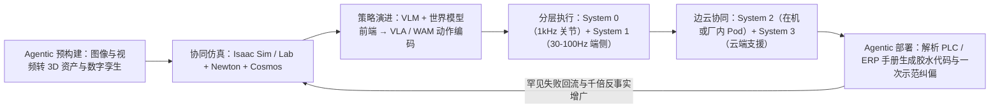

# TITV 深度访谈：NVIDIA 物理 AI 与机器人 ChatGPT 时刻路线图

2026-11-17，科技媒体 *The Information* 旗下栏目 *TITV’s AI Deep Dive*（主持人 Rocket Drew）发布对英伟达（NVIDIA）机器人与边缘 AI 副总裁 Deepu Talla 的 75 分钟深度专访。对谈紧随 GTC Berlin 2026 展开，系统拆解了物理智能（[Physical AI](../overview/physical-ai.md)）迈向「ChatGPT 时刻」的技术瓶颈、模型架构收敛趋势、边云算力层次以及工业与消费级本体的落地顺序。

## 一句话定义

以「数百至数千个任务无需逐场景专训即可跨过百米奥运 10 秒入场门槛」界定机器人 ChatGPT 时刻，依靠 Agentic 工具链打通「数字孪生合成数据 ↔ 仿真评测 ↔ WAM 大脑 ↔ System 0–3 边云推理 ↔ 现场零采数部署」的端到端工程闭环。

## 英文缩写速查

| 缩写 | 英文全称 | 简要说明 |
| --- | --- | --- |
| VLA | Vision-Language-Action | 视觉-语言-动作模型；机器人策略的起点范式，端侧部署常受限于 2B–4B 参数规模 |
| WFM | World Foundation Model | 世界基础模型（如 NVIDIA Cosmos）；预测动作引起的未来环境状态演化 |
| WAM | World Action Model | 世界-动作模型；将世界前向预测/仿真与可执行动作生成相融合的策略范式 |
| AMR | Autonomous Mobile Robot | 自主移动机器人；凭借机载传感器替代固定二维码路径 AGV/UGV，已近 10 秒门槛 |
| Cobot | Collaborative Robot | 协作机械臂（常见 5–20 kg 六轴臂）；面向中小企业高混流刚体操作的主力本体 |
| SME | Small and Medium-sized Enterprise | 中小型制造企业（如德国 Mittelstand）；高混流小批量场景要求零代码/零显式采数部署 |
| PLC | Programmable Logic Controller | 可编程逻辑控制器；工厂存量产线常服役 20–30 年，需智能体阅读手册生成对接胶水代码 |
| HIL / SIL | Hardware / Software-in-the-Loop | 硬件在环 / 软件在环仿真；在大规模上机前检验感知、策略与机电耦合的验证手段 |

## 为什么重要

1. **区分「单点演示可用」与「产业规模化夺金」**：行业讨论常把演示视频等同于可规模化部署，或因长尾可靠性不足而全盘否定进展。访谈提出的「百米奥运 10 秒资格线 vs 9.6 秒金牌线」给出了兼顾技术拐点与工程安全/法规/ROI 鸿沟的清晰坐标。
2. **揭示编码/多模态智能体对具身管线的非对称加速**：过去物理 AI 的隐性耗时大头在模型之外——前向花数月手工建 3D 数字孪生资产，后向花大量人力对接老旧 PLC/ERP/BMS。以 GPT-6 Astra 为代表的时空与工具调用智能体同时压缩了这两端瓶颈，使 GTC Berlin 的 Microduck 全流程验证缩短至一周以内。
3. **给出 NVIDIA 全栈组件的统一架构视图**：把 [Isaac Sim](./isaac-sim.md)、[Isaac Lab](./isaac-lab.md)、[Newton](./newton-physics.md)、[NVIDIA Cosmos](./nvidia-cosmos.md)、[GR00T N1.7](./paper-gr00t-n1-7.md) 与 [Jetson](./nvidia-jetson.md) 放进同一张「三台计算机 + System 0–3 算力分层 + VLA→WAM 演进」蓝图中，便于工程团队按延迟、功耗与精度要求做系统切分。

## 核心原理

### 端到端飞轮与架构总览

访谈将当前物理 AI 的研发与交付归纳为「智能体预构建资产 → 解析物理与世界模型协同仿真 → WAM 策略学习 → System 0–3 混合部署 → 智能体生成工业胶水代码与现场示范回流」的闭环：

### 「百米 10 秒门槛」与任务成熟度连续谱

数字消费级 AI 达到 90%–95% 准确率即可依靠人类闭环最后 5%–10%；物理世界执行通常无人类实时兜底，工业级任务普遍需要 99.99% 乃至 6–8 个 9（非结构化家庭安全甚至要求更高阶跃）。Talla 以男子百米短跑类比：**10.0 秒**是奥运参赛资格线（代表技术真正进入赛局），**9.6–9.7 秒**则是奥运金牌（代表安全、可靠性、法规、社区接受度与成本全部闭环的全量铺开）：

| 赛道与代表形态 | 当前相对 10 秒门槛位置 | 关键解锁要素或核心瓶颈 |
| --- | --- | --- |
| 自动驾驶（Waymo、Tesla FSD） | 已跨过 10 秒门槛，商业体量约 10× 扩张 | 端到端推理模型 + 仿真合成极端长尾边缘案例 |
| 移动导航（厂内 AMR、巡检、配送） | 已达到或极接近 10 秒门槛 | 机载多模态传感替代固定二维码轨迹 AGV，适配半结构化环境 |
| 刚体操作（工业臂 / Cobot 拆装箱、分拣） | 刚体场景已达 10 秒门槛 | 无需精确已知密度/形变，且工厂可通过围栏构建安全隔离区 |
| 软体/接触丰富灵巧操作 | 正在攻坚（仿真与数据飞轮加速期） | 依赖 [Newton](./newton-physics.md) 软体/可变形体求解与力/力矩传感对齐 |
| 通用人形（跨百千任务的 ChatGPT 时刻） | 右侧远期目标，预计约 1–3 年阶跃逼近 | 需百千任务零专训跨过 10 秒线；家庭无围栏场景受限于极高安全门槛 |

### 模型演进：从 [VLA](../methods/vla.md) 到 [WAM](../concepts/world-action-models.md)

对谈梳理了物理 AI 模型架构的四代递进：LLM（2022，纯语言）→ VLM（2023，视觉语言）→ **VLA**（叠加动作输出，必要但纯反应式映射难以覆盖复杂物理后果）→ **WFM + VLA 融合为 WAM**。其中：
- **[NVIDIA Cosmos](./nvidia-cosmos.md) 的三重角色**：给定候选动作预测未来状态演化，天然兼任**仿真器（Simulator）**、**预测器（Predictor）**与**策略评估器（Policy Evaluator）**；不仅能将罕见部署失败扩增为上千条微扰仿真轨迹，还能在动作执行前预判潜在倾倒或失稳（前瞻失败预测）。
- **[GR00T](./isaac-gr00t.md) 的前后端演进**：开源的 [GR00T N1.7](./paper-gr00t-n1-7.md) 采用「VLM 前端 + 动作模型后端」；下一阶段前端将同时融合世界模型与视觉语言推理，以联合完成语言意图解析、3D 几何定位、物理姿态判断与抓取落点生成。

### System 0–3 边云算力分层与「三台计算机」

针对机载质量、体积与散热将端侧 VLA 限制在 2B–4B 参数的物理刚性约束，访谈将双系统理论扩展为四层混合算力架构，并与 NVIDIA「三台计算机」（训练与合成数据生成机、Omniverse/Isaac 仿真机、[Jetson](./nvidia-jetson.md) 机载运行机）对齐：

| 层级 | 控制频率 / 时延量级 | 功能定位 | 典型部署位置与工程约束 |
| --- | --- | --- | --- |
| **System 0** | ~1000 Hz（1–2 ms） | 关节与执行器级本能反射（如触烫缩手、局部力控） | **必在机器人本体关节/驱动侧**（面向全身 100+ 执行器、单手 20–25 DoF） |
| **System 1** | 30–100 Hz | 实时多模态感知与闭环运动控制 | **机器人本体端侧**（保障低延迟、隐私及无 Wi-Fi 仓库/油气/野外断网自治） |
| **System 2** | 数百 ms 至数秒 | 语义理解、空间推理与子任务规划 | **本体或厂内本地算力 Pod / 工作站**（突破机载 2B–4B 功耗墙以换取精度） |
| **System 3** | 分钟级 / 夜间批处理 | 疑难长尾场外求助（phone-a-friend）与多机/数字智能体编排 | **云端 / 电信边缘 / 仿真集群**（如托管推理 API，以及换产前整夜百万次仿真推演） |

## 工程实践

1. **用 Agentic 管线替代手工建资产与手写胶水代码**：在推进工厂或仓储自动化 POC 时，优先用具备空间理解与工具调用能力的编码智能体从现场图像/视频/CAD 构建 [Isaac Sim](./isaac-sim.md) 数字孪生，并在 [Isaac Lab](./isaac-lab.md) 中闭环测试机电策略（复刻 GTC Berlin Microduck 一周内从概念到上机路径）；现场对接存量 20–30 年 PLC、ERP 与楼宇系统时，将设备手册交由智能体生成接口适配层。
2. **打破端侧参数教条，按场景配置混合推理与模型蒸馏**：在通用精度尚未封顶阶段，若机载 2B–4B 模型精度不足，可在车间部署本地工作站/Pod 或接入托管模型服务（如 [Physical Intelligence Pi API](./physical-intelligence-pi-api.md) 的场外求助模式）；待高参数教师模型跑通任务后，再利用模型蒸馏（访谈指出前沿 LLM 同等能力一年内已实现约 30× 参数压缩）与工种特化裁剪下放至边缘端。
3. **面向中小企业构建「零显式采数」纠偏闭环与异构本体选型**：
   - **数据策略**：单任务重复遥操作数据边际收益递减；应以第一视角（egocentric）人类作业数据与跨任务数据拓宽先验，并用世界模型围绕真机失败案例做千倍反事实合成增广。面向 SME 客户时，交互层必须做成「现场人员示范纠正一次、后台自动完成采数–仿真增广–重训」的隐式管线。
   - **本体选型**：不盲目在所有工位强上双足人形——高批量确定性搬运/重工优先用托盘车、AMR 或专用设备；高混流桌面/工位操作可将五指灵巧手挂载于固定工业臂或协作臂；仅在棕地（brownfield）非结构化跨区移动操作场景配置人形机器人，并严格执行人机物理/虚拟隔离。
4. **严格遵守通用机器人「五项有序基本功」验收序列**：按 **① 通用准确率 → ② 可靠性 → ③ 安全性 → ④ 经济性 → ⑤ 自然且无恐怖谷的人机交互（Non-creepy UX）** 顺序逐级过关；未满足前四项前，交互外观无法弥补底层闭环缺陷。

## 局限与风险

- **口播倍数与时间窗口属高管经验判断而非基准实测**：访谈中提及的「资产生成 100× 提速」「胶水代码 100× 提速」「LLM 同等能力一年 30× 参数压缩」及「1–3 年迎来机器人 ChatGPT 时刻」均为产业趋势判断，未附统一评测集、成本账单或可复现实验脚本（例如 NVIDIA 同期公开的 Astranomy 研究显示，GPT-6 Astra 直接作机器人策略时单次调用平均延迟仍达 18.56 秒，不能将离线建资产能力混同于高频实时控制能力）。
- **开源开放边界**：本页对应信源为公开媒体视频专访（无独立代码仓）；文中所涉 NVIDIA 栈中，[Newton](./newton-physics.md)（Apache-2.0）、[Isaac Lab](./isaac-lab.md) 与 [NVIDIA Cosmos](./nvidia-cosmos.md) / [GR00T N1.7](./paper-gr00t-n1-7.md) 权重及框架各有独立许可（如 OpenMDW / NVIDIA Open Model License）与门控条款，而受访中提及的 GPT-6 Astra 与 [Physical Intelligence Pi API](./physical-intelligence-pi-api.md) 服务端均为闭源商业系统。
- **演示级成功不可直接外推至产线与家庭安全**：GTC Berlin 的 Microduck 演示在 98%–99% 可靠性下即可成立，而工业重载高速场景要求多 9 可靠性与人机隔离，无围栏家庭养老/家务场景更面临绊倒、力矩失控等极高安全责任门槛。

## 关联页面

- [Physical AI（物理智能）](../overview/physical-ai.md) — 从感知、世界建模、控制与部署闭环梳理物理 AI 与数字 AI 的系统差异。
- [World Action Models（WAM，世界–动作模型）](../concepts/world-action-models.md) — 详解世界前向预测与动作生成联合建模的分类学及延迟/精度权衡。
- [NVIDIA Cosmos（世界基础模型平台）](./nvidia-cosmos.md) — 访谈核心提及的世界基础模型平台，承担仿真、预测与策略评估角色。
- [Isaac GR00T](./isaac-gr00t.md) 与 [GR00T N1.7](./paper-gr00t-n1-7.md) — 访谈中作为「VLM 前端 + 动作后端」向世界模型前端演进的代表基座。
- [Newton Physics（物理引擎）](./newton-physics.md) — NVIDIA、Google DeepMind 与 Disney Research 联合开源的 GPU 物理引擎，支撑可变形体与接触丰富灵巧操作仿真。
- [Isaac Sim](./isaac-sim.md) 与 [Isaac Lab](./isaac-lab.md) — 第二台计算机的核心虚拟环境与策略评测/强化学习框架。
- [NVIDIA Jetson](./nvidia-jetson.md) — 第三台计算机机载边缘推理计算平台，承载 System 0/1 低延迟闭环。
- [NVIDIA GTC 机器人主线索引](./nvidia-gtc.md) — 对照 GTC 大会历届 Physical AI 与人形开发主题脉络。
- [Physical Intelligence Pi API beta](./physical-intelligence-pi-api.md) — 对应访谈所析 phone-a-friend（System 3）云端托管微调与推理服务实例。
- [Sim2Real（仿真到真机迁移）](../concepts/sim2real.md) — 对应芯片流片式仿真验证落地真机时必须跨越的动力学与传感间隙。
- [VLA（视觉-语言-动作模型）](../methods/vla.md) 与 [生成式世界模型](../methods/generative-world-models.md) — WAM 融合前的两条核心方法支线。
- [强化学习](../methods/reinforcement-learning.md)、[机器人操作（Manipulation）](../tasks/manipulation.md)、[足式运动（Locomotion）](../tasks/locomotion.md) 与 [移动操作（Loco-Manipulation）](../tasks/loco-manipulation.md) — 访谈评估 10 秒门槛所覆盖的核心策略训练方法与三大任务域。

## 参考来源

- [TITV’s AI Deep Dive：Nvidia’s Plan for Robotics' ChatGPT Moment 全文通读归档](../../sources/videos/titv-nvidia-deepu-talla-physical-ai-2026.md)

## 推荐继续阅读

- [YouTube 原视频：Nvidia’s Plan for Robotics' ChatGPT Moment | TITV’s AI Deep Dive](https://www.youtube.com/watch?v=rarKwkLN-Bg) — Rocket Drew 对谈 Deepu Talla 完整录像（1:14:49）。
- [NVIDIA GTC Berlin 2026 官方发布汇总](https://blogs.nvidia.com/gtc-berlin-2026-news/) — 核对 GTC Berlin 主题演讲背景、RTX Spark 与欧洲工业生态动态。
- [Astranomy: An Empirical Study of GPT-6 Astra as a Native Robot Policy](https://research.nvidia.com/labs/srl/projects/astranomy/) — NVIDIA 研究团队对 GPT-6 Astra 直接作机器人策略时的成功率、token 成本与 18.56 秒延迟实证，可与本访谈的建资产与写胶水代码提速对照阅读。
