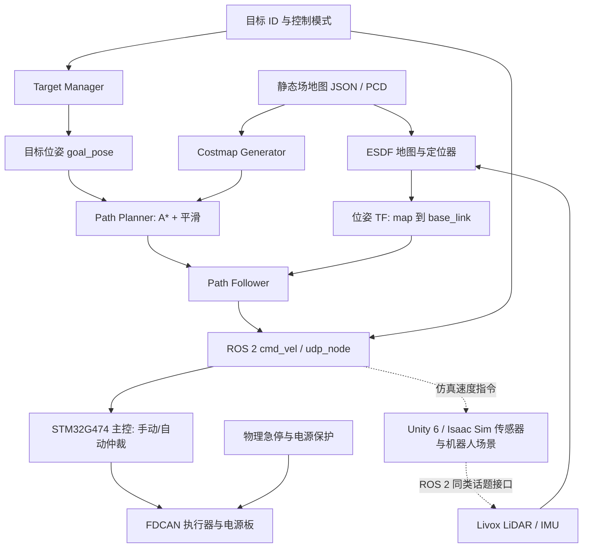
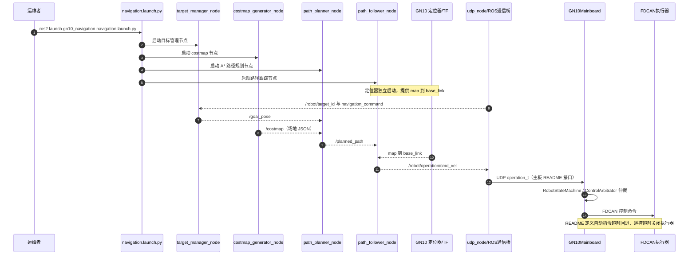

# GN10 Robot System｜日本高专机器人大赛 2026 荒川校区开源机器人系统

## 一句话定义

**GN10** 是东京都立产业技术高等专门学校荒川校区 2026 A 队面向「高专杯·抹布投掷锦标赛」开发的机器人系统；其团队公开了 ROS 2 定位与导航、仿真、STM32 主控固件及多块 CAN/电源板卡工程，但这**不是**「日本高专全国赛所有机体全部开源」的证据，也不能由此保证完整机械 BOM、CAD、线束与装配资料齐备。

## 英文缩写速查

| 缩写 | 英文全称 | 简要说明 |
|---|---|---|
| GN10 | GN10 (team robot identifier) | 荒川校区 2026 A 队对机器人系统使用的标识 |
| ROS 2 | Robot Operating System 2 | Jetson 侧感知、定位、规划与仿真节点通信 |
| ESDF | Euclidean Signed Distance Field | 静态场地三维距离场，供 LiDAR 匹配定位 |
| LiDAR | Light Detection and Ranging | Livox MID-360 等激光雷达数据来源 |
| UDP | User Datagram Protocol | 主控板与上位机之间的控制与反馈传输 |
| CAN / FDCAN | Controller Area Network / Flexible Data-rate CAN | 主板至执行器、电源和外设的实时现场总线 |
| IMU | Inertial Measurement Unit | 扫描去畸变与定位姿态预测 |
| PCB | Printed Circuit Board | 团队开放的部分控制与电源电路板设计 |

## 为什么重要

1. **跨层级真实工程案例**：从静态地图、激光/视觉传感器、ROS 2 规划，到 UDP 主控、FDCAN 电机外设与电源急停，提供比单一算法仓库更完整的系统接口线索。
2. **可分层学习**：已经单独入库的 [GN10 PointCloud Localization](gn10-pointcloud-localization.md) 负责 ESDF 地图定位；本页只描述与 `gn10-navigation`、STM32 和仿真联动的**系统整合层**，不重复算法详情。
3. **安全设计的实例**：自动/手动控制权切换、命令超时保护、驱动供电切断是学习竞赛机器人架构的实物入口。

## 核心原理

### 公开模块总览

| 层 | 仓库 | 公开内容与职责 |
|---|---|---|
| 工作区 | [ros2_ws](https://github.com/tmcit-ararobo-2026a/ros2_ws) | `setup.sh` / `update.sh` 统一拉取、维护 ROS 2 相关仓库 |
| 定位 | [gn10-pointcloud-localization](https://github.com/tmcit-ararobo-2026a/gn10-pointcloud-localization) | Livox 点云 + IMU 对齐静态 ESDF，输出 `map → base_link`，支持失锁后的全局搜索 |
| 导航 | [gn10-navigation](https://github.com/tmcit-ararobo-2026a/gn10-navigation) | 目标管理、JSON 场地 costmap、8 方向 A*、路径平滑、速度与航向跟踪、移动桶射速计算 |
| 主控 | [gn10-mainboard](https://github.com/tmcit-ararobo-2026a/gn10-mainboard) | STM32G474 + W5500，遥控/自主命令仲裁、UDP↔FDCAN 桥接与超时安全 |
| 电源 | [power-management-board](https://github.com/tmcit-ararobo-2026a/power-management-board) | STM32G431、电源预充、电流电压检测、物理及远程急停 |
| 电机外设 | [esc-control-hub](https://github.com/tmcit-ararobo-2026a/esc-control-hub) | 隔离 CAN、DJI C610/C620 指令转换、1 kHz PID 与限位保护 |
| 仿真 | [robot-sim-unity](https://github.com/tmcit-ararobo-2026a/robot-sim-unity)、[robot-sim](https://github.com/tmcit-ararobo-2026a/robot-sim) | Unity 6 + ROS 2 Humble 集成传感器/刚体布投掷；另有 Isaac Sim 仓库 |

### 流程总览

下图将官方 ROS 2 导航 README、主板接口说明和 Unity 仿真文档合成**系统架构视角**，不是比赛所有队伍的统一架构，也不是已经验收的硬实时性能图。



### 源码运行时序图

本图聚焦**已核对的导航 launch 入口**以及官方主板 README 记录的下游控制接口。不要把 README 的模块关系误认成已实机联调的时序测量。



依据：[导航 launch 源码](https://github.com/tmcit-ararobo-2026a/gn10-navigation/blob/main/launch/navigation.launch.py)、[导航 README 的 topic 表](https://github.com/tmcit-ararobo-2026a/gn10-navigation/blob/main/README.md)、[主板 README](https://github.com/tmcit-ararobo-2026a/gn10-mainboard/blob/main/README.md)。图中的 `udp_node` 仅据官方接口文档连线，**未逐行核对其实际源码或完成端到端编译运行**。

## 工程实践

### 1. 最短复现路径（官方入口，未在本知识库环境运行）

```bash
# Ubuntu 22.04 + ROS 2 Humble；按上游 README 配齐依赖
git clone https://github.com/tmcit-ararobo-2026a/ros2_ws.git
cd ros2_ws
./setup.sh
./update.sh

# 已构建并 source 工作区、准备场地图和相应消息包后
ros2 launch gn10_pointcloud_localization localization.launch.py
ros2 launch gn10_navigation navigation.launch.py
```

仿真替代：克隆 [robot-sim-unity](https://github.com/tmcit-ararobo-2026a/robot-sim-unity)，先安装 **Git LFS** 并执行 `git lfs pull`，Unity 6 打开 `Assets/Scenes/NHK2026_SimScene.unity` 后 Play；配合官方文档的 `ros2 launch robot_bringup unity_sim.launch.py use_sim_time:=true` 连接 ROS 2 节点。是否可在其他 GPU/机器上复现，应以实际环境实测。

### 2. 接口与安全关键项（均为源码/README 记载值）

| 位置 | 上游给出的约束 | 验证重点 |
|---|---|---|
| `gn10-navigation` | `/robot/navigation_command`：Sleep=0、Stanby=1、Move=2；跟踪输出 `/robot/operation/cmd_vel` | 命令枚举、TF 丢失时暂停/退出 |
| `gn10-mainboard` | `teleop_t` **100 ms** 超时安全停机；`operation_t` **200 ms** 超时退回手动 | 实际时钟、网络抖动、CAN 仲裁与急停 |
| `power-management-board` | **500 ms** 预充后主继电器闭合、**700 ms** 预充继电器断开 | 浪涌、再生制动、电池与驱动电源隔离 |
| `esc-control-hub` | 1 kHz PID、限位开关与控制命令超时关断 | 电机型号/协议、实际负载下的发热和故障路径 |
| `robot-sim-unity` | `/clock`、LiDAR、IMU、RealSense，`/cmd_vel` 与布射出话题 | 仿真参数标定、软布刚体近似、时钟同步 |

建议按层次先复现场地图与导航 topic，再单独测试主板超时/电源保护；**未经独立安全检查，不应直接将参考固件用于高功率真机**。

## 局限与风险

- **开源范围需严格限定**：可确认该队多个软件、板卡与固件仓库公开；不能从组织公开页面推论整机 CAD、BOM、完整线束/装配资料或全国其他队伍开源。45 个仓库也不代表 45 台机器人。
- **定位 ≠ 6DoF SLAM**：GN10 依靠预建静态 ESDF，主要估计平面 `x/y/yaw`；失锁全局搜索的适用条件和参数详见[定位独立节点](gn10-pointcloud-localization.md)。
- **ROS 2 导航 ≠ Nav2 原样部署**：`gn10-navigation` 是团队专用节点组合，使用自定义控制话题与状态；与 Nav2 的互换性需要适配验证。
- **仿真 ≠ 真实刚柔耦合**：Unity README 声明布、全向驱动、摩擦与部分道具质量采用近似或估算；不把仿真命中率外推真机。
- **许可须逐仓核对**：本页不将某一仓的 MIT / Apache-2.0 推广到整个组织所有仓库。本文未做端到端真机部署或安全认证。

## 关联页面

- [GN10 PointCloud Localization：ESDF 地图定位](gn10-pointcloud-localization.md) — 已有**独立**定位算法实体，本页是系统级集成补充。
- [Navigation2（Nav2）](navigation2.md) — 对照通用 ROS 2 导航栈与 GN10 专用 costmap/A*/follower。
- [导航·SLAM·自动驾驶栈总览](../overview/navigation-slam-autonomy-stack.md) — 对照定位、规划、控制解耦的工程结构。
- [导航纵深路线 Stage 2](../../roadmap/depth-navigation.md) — 作为经典路径规划与闭环控制的竞赛实战案例。
- [PCB 设计纵深路线](../../roadmap/depth-pcb-design.md) — 阅读主板、功率管理与 CAN 隔离设计。

## 参考来源

- [GN10 多仓源码与接口一手资料归档](../../sources/repos/tmcit-ararobo-2026a-gn10-system.md)
- [2026 高专机器人竞赛官方页面归档](../../sources/sites/kosen-robocon-2026.md)
- [GN10 点云定位既有原文归档](../../sources/repos/gn10-pointcloud-localization.md)

## 推荐继续阅读

- [TMCIT 荒川 2026A 官方代码组织](https://github.com/tmcit-ararobo-2026a)
- [gn10-navigation：README 与 launch](https://github.com/tmcit-ararobo-2026a/gn10-navigation)
- [gn10-mainboard：STM32 主板工程与状态机](https://github.com/tmcit-ararobo-2026a/gn10-mainboard)
- [robot-sim-unity：ROS 2 传感器与布投掷模拟](https://github.com/tmcit-ararobo-2026a/robot-sim-unity)
- [官方高专机器人竞赛 2026](https://official-robocon.com/kosen/)
