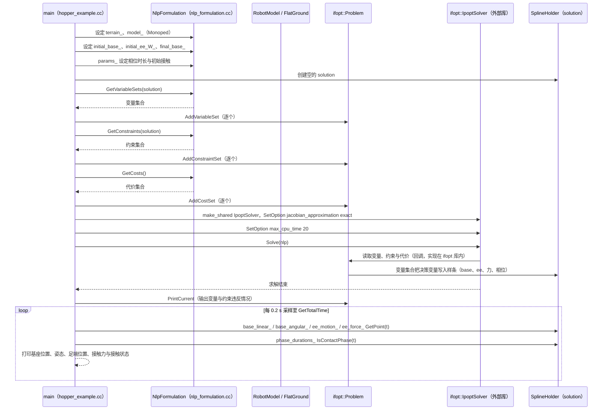

# TOWR

**TOWR**（[GitHub](https://github.com/ethz-adrl/towr)）来自 [古月居转载的四足机器人开源项目综述](https://mp.weixin.qq.com/s/pRGoPm41qYCNyHPWR6Dl6A)，属「优化控制（MPC / WBC）」组。

## 一句话定义

**TOWR（ETH ADRL）是轻量、可扩展的足式机器人轨迹优化 C++ 库：提供一套变量、代价与约束基础集合，可组合出单足跳、双足行走与完整四足小跑循环，并同时优化步态与步时长（论文称 100 ms 内）。**

## 英文缩写速查

| 缩写 | 英文全称 | 简要说明 |
|------|----------|----------|
| TOWR | Trajectory Optimization for Walking Robots | 步行机器人轨迹优化 |
| ifopt | Interface to Optimization Solvers | 优化求解器接口 |

## 为什么重要

- 综述把它放在「优化控制（MPC / WBC）」这条技术路线下，作为可读源码的参照项目；横向对比见 [四足机器人开源项目技术地图：从极简运动学到研究级硬件（36 个 GitHub 项目）](../overview/quadruped-open-source-projects-technology-map.md)。
- 文中星标：1049（文章表述，入库日未复核）。

## 核心信息

| 项 | 内容 |
|----|------|
| **仓库** | [ethz-adrl/towr](https://github.com/ethz-adrl/towr) |
| **最近提交** | 2021-03-29 |
| **可达性** | `git ls-remote` 可达（2026-11-01） |
| **文章归类** | 优化控制（MPC / WBC） |

## 文章说法核对

- **文章：** 文章仅在附录清单列出（1049 星）。
- **README / 核查：** README 称借助 ifopt 可用 Ipopt、Snopt 高性能求解器，已用于生成单足跳、双足行走和四足小跑；仓库带 BSD-3 许可徽章，最近提交 2021-03-29。
- **差异与保留：** 仓库近年无更新（最近提交 2021-03-29）。

## 关联页面

- [model-predictive-control](../methods/model-predictive-control.md)
- [locomotion](../tasks/locomotion.md)
- [quadruped-robot](../entities/quadruped-robot.md)
- [quadruped-open-source-projects-technology-map](../overview/quadruped-open-source-projects-technology-map.md)

## 源码运行时序图

入口：`towr/test/hopper_example.cc` 的 `main()`（CMake 构建后运行 `./towr-example`；ROS 入口为 `roslaunch towr_ros towr_ros.launch`，本图未展开）。下图为单足跳跃器示例中，源码实际的建模与求解调用顺序。

图依据：towr@d6c6787，`towr/test/hopper_example.cc`、`towr/include/towr/nlp_formulation.h`、`towr/src/nlp_formulation.cc`（GetVariableSets / GetConstraints / GetCosts 的定义）、`README.md`（构建与运行说明）。ifopt 与 Ipopt 的内部实现不在本仓库内，`S` 到 `P` 的回调细节为推断，未逐行核对。

## 参考来源

- [towr_trajectory_optimization.md](../../sources/repos/towr_trajectory_optimization.md)
- [wechat_guyueju_quadruped_opensource_deep_dive_2026-11-01.md](../../sources/blogs/wechat_guyueju_quadruped_opensource_deep_dive_2026-11-01.md)
- [原文（微信公众号）](https://mp.weixin.qq.com/s/pRGoPm41qYCNyHPWR6Dl6A)
- 源码核对（2026-11-02）：ethz-adrl/towr@d6c6787，读过 README.md、towr/test/hopper_example.cc、towr/include/towr/nlp_formulation.h、towr/src/nlp_formulation.cc（仅 GetVariableSets/GetConstraints/GetCosts 定义）；时序图依据以上文件，未运行代码。
