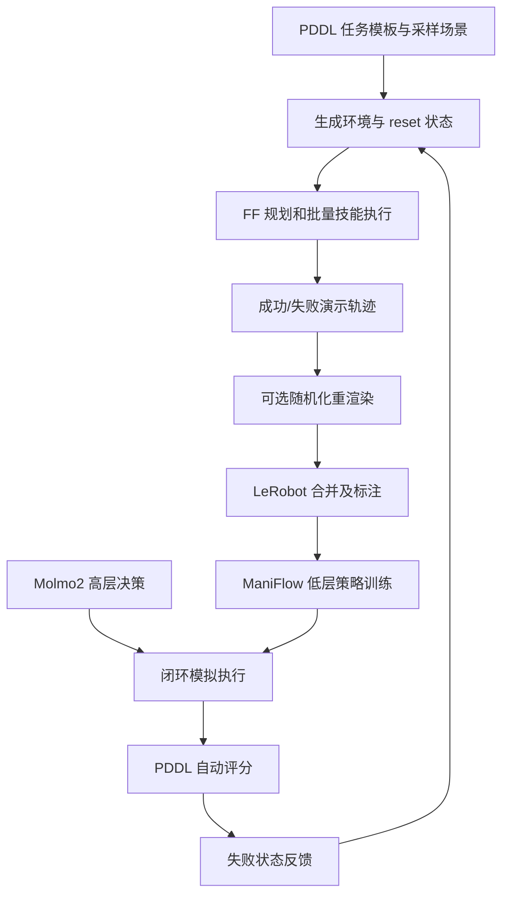
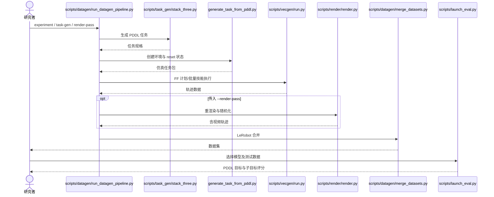
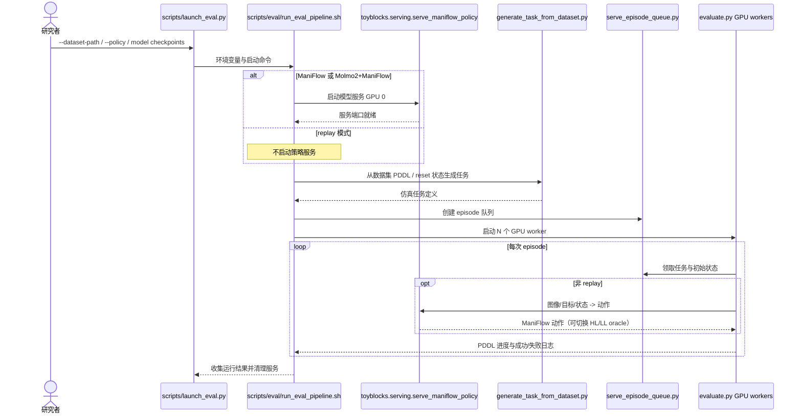

# ToyBlocks：可控的机器人学习与评测基础世界

## 一句话定义

Ai2 基于 Isaac Sim/Isaac Lab 的桌面积木仿真、PDDL 任务生成与大规模自动演示流水线，提供 LeRobot 数据与闭环策略评测。

## 英文缩写速查

| 缩写 | 英文全称 | 简要说明 |
|---|---|---|
| Ai2 | Allen Institute for AI | 项目发布机构 |
| PDDL | Planning Domain Definition Language | 声明任务目标及可规划操作 |
| TAMP | Task and Motion Planning | 任务/运动分层规划 |
| VLA | Vision-Language-Action | 利用图像语言进行动作决策 |
| RL | Reinforcement Learning | 与演示学习互补的训练方向 |
| FR3 | Franka Research 3 | 真机验证使用的机械臂 |
| WAM | World Action Model | 使用动作条件视觉预测辅助训练 |

## 为什么重要

- 高自由度开放操作难以归因训练与评测失败。积木提供受控但非平凡的堆叠、推移、翻转操作。
- 自动生成可改变任务分布、场景状态、视觉域随机化，并将失败状态反馈到下一轮数据生成。

## 核心原理（方法）

1. **环境：** 以 Isaac Sim/Isaac Lab 为核心，任务目标用 PDDL 表达，桌面积木搭建可参数化场景。
2. **演示生成：** 先生成任务与 reset 状态，用 FF 计划和技能/运动规划批量执行；执行结果可离线重渲染，最终合并为 LeRobot 数据。
3. **模型层级：** 低层 ManiFlow 面向图像、语言与目标热图产出动作；高层 Molmo2 等模型选择当前子任务，可引入 oracle 排除上下游混淆。
4. **闭环评测：** 在未见任务或数据集中精确初始状态下重置，借助 PDDL 目标自动判断进度，并支持将失败状态反馈到专家生成。

## 项目流程图

## 工程实践

- 源码快速入口：`scripts/datagen/run_datagen_pipeline.py`，参数可设 `--task-gen-script scripts/task_gen/stack_three.py --task-gen-count 2`，渲染必须显式提供 `--render-pass`；安装与资产请按官方 README。
- 该管线分 task-gen / env / execution / render / merge / annotate，实际执行由 `scripts/vecgen/run.py` 使用批量 FF 规划与技能，输出 `data/datasets/merged/train/<experiment>`。
- 评测入口 `scripts/launch_eval.py` 调用策略服务与 episode queue，在多个 GPU worker 上测量；可切换高层或低层 oracle 归因。
- 主仓 Apache-2.0，但多个子模块及下载素材拥有各自许可；训练已开放程度需按 README TODO 逐项核对。

## 实验与评测

- 官方博文报告约 85,336 条长时程演示、近 1,600 小时、约 1.44 亿帧，均为作者公开数据规模。
- 公开演示和报告的仿真/真机结果属于不同评测，不能把数据集轨迹数误作真机成功率或证明 sim-to-real 完全解决。

## 深入实验：VLA 泛化、智能体与世界模型

### VLA 空间泛化（发布方实验）

官方对 **ManiFlow、π0.5、MolmoAct 2** 做 Stack / Unstack / Flip / Rotate 四类任务对比：每任务 1,000 条训练演示、30,000 步微调，每 10,000 步评测并取最佳 checkpoint，每次运行 500 个评测 episode。原训练区域内的平均成功率为 72%–90%，但将测试位置移至训练区域外或更换堆叠高度时明显下降；这是**空间分布外泛化**问题，并不等于所有新积木都失败。

| 干预方法 | 改变什么 | 官方结果与限定口径 |
|---|---|---|
| Co-training（联合训练） | 微调 batch 的一半来自其他 3 个任务，覆盖完整工作区 | 桌面右半区测试平均 **+45 个百分点**（最大单项） |
| Mid-training（中间训练） | 微调前先用跨工作区、但不含目标任务的数据训练 | 同一测试设置 **+14 个百分点** |
| Delta actions（增量关节动作） | 预测相对当前关节位置的增量，而非绝对目标 | 新堆叠高度 **+26 个百分点**；对 π0.5/MolmoAct 2 有帮助 |
| WAM（世界动作模型） | 用无动作标签视频辅助训练预测头，推理时不运行预测头 | 右半区 **+3**、新堆叠高度 **+23 个百分点**；WAM+Co-training 的一项 MolmoAct 2 实验 **29%→80%** |
| LoRA | 冻结原模型，只微调低秩适配器 | 官方作为单项干预评估，**不在文字中虚构具体增益** |

上表是作者在受控 ToyBlocks 配置下的结果，不应解读为跨机器人通用收益。研究同时包含超过 200 次训练运行、100,000 个评测 episode；训练/微调统计见[官方 Experiments 页面](https://allenai.github.io/ToyBlocks/experiments.html)。

### 高层决策与智能体

- **Molmo 2（高层）+ ManiFlow（低层）**：任务是用积木拼出三个字符；Easy 为字母可见且正立，Medium 需要翻转，Hard 需搜寻隐藏字面。通过低层运动规划 oracle 替换 ManiFlow，可将高层错误与低层执行错误分离。官方图表每组 200 次 episode，不能与真机 30 次试验混作同一分母。
- **MCP 工具智能体**：前沿模型观察相机图像，再调用 pick / flip / rotate 等技能；Claude Opus 5.5 的经典积木规划文本任务 **30/30**，闭环视觉任务也 **30/30**；“找字母并拼写 / 正确宣布无法完成”的成功率 **63%**（50% 场景缺少必要字母），其失败有 **13%** 混淆相似字母、**15%** 朝向错误。
- **技能自检描述**：官方实验中，默认技能描述成功率 24%，人写技能描述 36%，智能体自行试验并改写描述 63%；这些比例仅适用于报告中的 search-and-spell 设置。

### 动作条件世界模型诊断

四类任务各 900 条轨迹（一半成功、一半轻微扰动后失败）作为比较基准；以动作序列为条件生成结果，再用仿真真值训练的 probe 读取方块/夹爪位姿和任务结果。

- 视频世界模型 **Wan 2.2** 的最佳结果约 **1 cm** 积木位置误差、**99%** 结果判别准确率。
- 智能体式仿真器 **Astra**：夹爪轨迹误差约 1.1 cm，但积木接触位置误差约 6 cm、结果判断仅 67%（即使给真实初始积木位姿）。
- **LeWM / V-JEPA 2.1** 长轨迹积木位置误差可增长到 **24–25 cm**；短互动与完整长轨迹必须分开比较。
- 补充 **100 条 Wan 2.2 生成的离线轨迹**，官方报告 ManiFlow 在未见区域的成功率 **19%→78%**；属于特定数据条件下的实验，非真实机器人提升证明。

## 真机 Sim2Real 与开放边界

| 测试对象 | 仿真 | 真机 | 分母与限制 |
|---|---:|---:|---|
| ManiFlow 原子技能（pick/place/flip/rotate） | 80.0% | 81.1% | 按**技能命令**计，非长任务 |
| Molmo 2 + ManiFlow 三字母拼写 | 55.5%（111/200） | 50.0%（15/30） | 按**整段任务 episode**计；真机 30 种 4–10 积木场景，使用训练见过的积木、Easy 可见且正立配置 |

作者强调样本量尚不足以对所有任务建立统计信心。实验使用 **Franka FR3 + Robotiq 夹爪**：先通过 system identification 调整关节摩擦/等效转动惯量，再对物理参数（积木尺寸、摩擦、桌高）及视觉参数（光照、材质、相机）做域随机化；实机前方 ZED + 腕部 ZED Mini 采集 RGB，需深度时用 **FastFoundationStereo** 从 RGB 双目生成深度，而非直接相信噪声较大的传感器深度。

**2026-11-11 开源核查：** 主仓已有 Isaac 环境、数据生成、训练/评测入口及 Molmo2/ManiFlow 子模块，并公开数据与模型。官方仍将 **真机执行工具包、真机策略运行代码、system identification 指南**写为 *Coming soon*；完整版一体化 RL 训练也属于未来计划；独立技术报告仍为 *coming soon*。不可将以上视为已公开可直接复现的真机软件。

## 与其他工作对比

- 相对以视觉模型吞吐为主的 Benchmark，ToyBlocks 的重点是可控数据分布和可归因的学习/评测闭环。
- 相对遥操作数据采集，ToyBlocks 使用可规划任务与自动技能产生训练演示，但仍受 simulator reality gap 限制。

- [GPWM](paper-gpwm.md) 通过学习粒子动态预测物理演化；ToyBlocks 通过 Isaac 仿真产生可控数据，两者适合比较学习的世界模型与显式模拟器之不同用途。

## 结论

1. 区分演示规模、策略评测结果和模型/代码的开放状态。
2. 使用 oracle 逐层排查高层策略与低层控制失败。
3. 支持从失败状态再规划生成演示，不代表任意真实事故自动恢复。

## 局限与风险

- 桌面积木构成受限物理世界，真实材质、感知、接触与机械夹持具有分布差。
- 文章称完整集成 RL 训练管线将继续开放，不能把后续计划视作当前已发布功能。
- 复现实验要固定 ISAAC 依赖、视觉渲染标志、数据源许可和并行 GPU 设置。

## 源码运行时序图

下图按公开官方 README 与执行入口源码的职责组织；未进行实际 GPU 环境复现。

### 评测运行时序（官方 shell 启动链）

来自 `scripts/launch_eval.py` 与 `scripts/eval/run_eval_pipeline.sh`；这是**仿真评测链**，不是尚未发布的 FR3 实机部署实现。

## 关联页面

- [manipulation ](../tasks/manipulation.md)
- [vla ](../methods/vla.md)
- [paper-roboarcade ](./paper-roboarcade.md)

## 参考来源

- [原始官方博文资料核验归档](../../sources/sites/ai2-toyblocks.md)
- [官方源码入口核查](../../sources/repos/allenai_toyblocks.md)
- [Ai2 官方原文](https://huggingface.co/blog/allenai/toyblocks)
- [官方实验与统计协议](https://allenai.github.io/ToyBlocks/experiments.html)
- [官方 Sim-to-real 开放状态](https://allenai.github.io/ToyBlocks/sim2real.html)

## 推荐继续阅读

- [官方项目主页](https://allenai.github.io/ToyBlocks)
- [官方开源代码](https://github.com/allenai/ToyBlocks)

