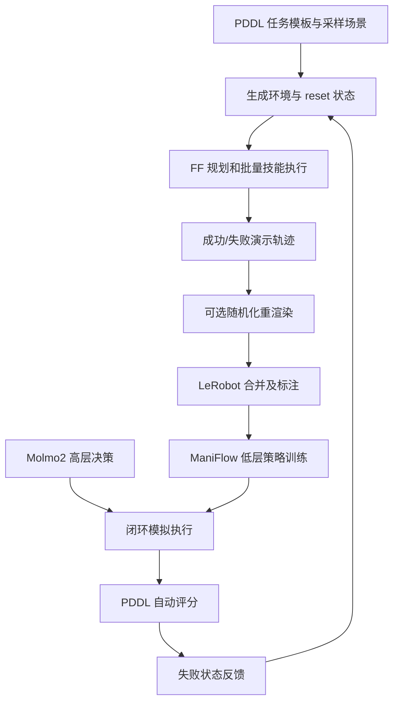
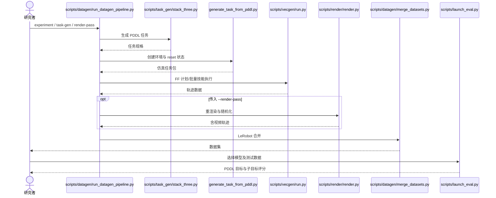

# ToyBlocks：可控的机器人学习与评测基础世界

## 一句话定义

Ai2 基于 Isaac Sim/Isaac Lab 的桌面积木仿真、PDDL 任务生成与大规模自动演示流水线，提供 LeRobot 数据与闭环策略评测。

## 英文缩写速查

| 缩写 | 英文全称 | 简要说明 |
|---|---|---|
| Ai2 | Allen Institute for AI | 项目发布机构 |
| PDDL | Planning Domain Definition Language | 声明任务目标及可规划操作 |
| TAMP | Task and Motion Planning | 任务/运动分层规划 |
| VLA | Vision-Language-Action | 利用图像语言进行动作决策 |
| RL | Reinforcement Learning | 与演示学习互补的训练方向 |

## 为什么重要

- 高自由度开放操作难以归因训练与评测失败。积木提供受控但非平凡的堆叠、推移、翻转操作。
- 自动生成可改变任务分布、场景状态、视觉域随机化，并将失败状态反馈到下一轮数据生成。

## 核心原理（方法）

1. **环境：** 以 Isaac Sim/Isaac Lab 为核心，任务目标用 PDDL 表达，桌面积木搭建可参数化场景。
2. **演示生成：** 先生成任务与 reset 状态，用 FF 计划和技能/运动规划批量执行；执行结果可离线重渲染，最终合并为 LeRobot 数据。
3. **模型层级：** 低层 ManiFlow 面向图像、语言与目标热图产出动作；高层 Molmo2 等模型选择当前子任务，可引入 oracle 排除上下游混淆。
4. **闭环评测：** 在未见任务或数据集中精确初始状态下重置，借助 PDDL 目标自动判断进度，并支持将失败状态反馈到专家生成。

## 项目流程图

## 工程实践

- 源码快速入口：`scripts/datagen/run_datagen_pipeline.py`，参数可设 `--task-gen-script scripts/task_gen/stack_three.py --task-gen-count 2`，渲染必须显式提供 `--render-pass`；安装与资产请按官方 README。
- 该管线分 task-gen / env / execution / render / merge / annotate，实际执行由 `scripts/vecgen/run.py` 使用批量 FF 规划与技能，输出 `data/datasets/merged/train/<experiment>`。
- 评测入口 `scripts/launch_eval.py` 调用策略服务与 episode queue，在多个 GPU worker 上测量；可切换高层或低层 oracle 归因。
- 主仓 Apache-2.0，但多个子模块及下载素材拥有各自许可；训练已开放程度需按 README TODO 逐项核对。

## 实验与评测

- 官方博文报告约 85,336 条长时程演示、近 1,600 小时、约 1.44 亿帧，均为作者公开数据规模。
- 公开演示和报告的仿真/真机结果属于不同评测，不能把数据集轨迹数误作真机成功率或证明 sim-to-real 完全解决。

## 与其他工作对比

- 相对以视觉模型吞吐为主的 Benchmark，ToyBlocks 的重点是可控数据分布和可归因的学习/评测闭环。
- 相对遥操作数据采集，ToyBlocks 使用可规划任务与自动技能产生训练演示，但仍受 simulator reality gap 限制。

- [GPWM](paper-gpwm.md) 通过学习粒子动态预测物理演化；ToyBlocks 通过 Isaac 仿真产生可控数据，两者适合比较学习的世界模型与显式模拟器之不同用途。

## 结论

1. 区分演示规模、策略评测结果和模型/代码的开放状态。
2. 使用 oracle 逐层排查高层策略与低层控制失败。
3. 支持从失败状态再规划生成演示，不代表任意真实事故自动恢复。

## 局限与风险

- 桌面积木构成受限物理世界，真实材质、感知、接触与机械夹持具有分布差。
- 文章称完整集成 RL 训练管线将继续开放，不能把后续计划视作当前已发布功能。
- 复现实验要固定 ISAAC 依赖、视觉渲染标志、数据源许可和并行 GPU 设置。

## 源码运行时序图

下图按公开官方 README 与执行入口源码的职责组织；未进行实际 GPU 环境复现。

## 关联页面

- [manipulation ](../tasks/manipulation.md)
- [vla ](../methods/vla.md)
- [paper-roboarcade ](./paper-roboarcade.md)

## 参考来源

- [原始官方博文资料核验归档](../../sources/sites/ai2-toyblocks.md)
- [官方源码入口核查](../../sources/repos/allenai_toyblocks.md)
- [Ai2 官方原文](https://huggingface.co/blog/allenai/toyblocks)

## 推荐继续阅读

- [官方项目主页](https://allenai.github.io/ToyBlocks)
- [官方开源代码](https://github.com/allenai/ToyBlocks)

