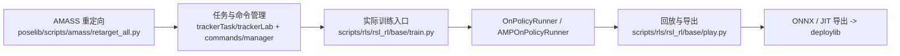
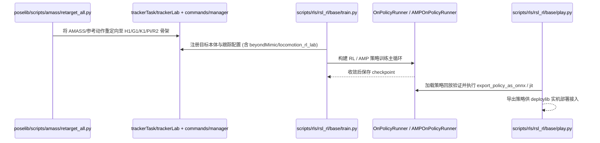

# TrackerLab

[TrackerLab](https://github.com/Renforce-Dynamics/trackerLab) 收录于具身智能研究室 [开源项目主表](https://github.com/RealXiaoze/humanoid-motion-intelligence/blob/main/%E8%AE%BA%E6%96%87%E4%B8%8E%E9%A1%B9%E7%9B%AE/%E5%BC%80%E6%BA%90%E9%A1%B9%E7%9B%AE%E4%B8%BB%E8%A1%A8.md) 的「动作跟踪与全身控制」分组，是本库为该入口建立的独立详情节点。

## 一句话定义

多种本体、动作数据和跟踪配置共享实验接口，可把参考表示、奖励与机器人模型的影响分开比较。已有Tracker迁移到新本体后若突然退化，这个统一基线有助于先排除环境差异。

## 英文缩写速查

| 缩写 | 英文全称 | 简要说明 |
|------|----------|----------|
| WBT | Whole-Body Tracking | 全身跟踪参考动作 |
| RL | Reinforcement Learning | 学习跟踪与恢复策略 |
| DoF | Degrees of Freedom | 机器人可控关节自由度 |
| Sim2Sim | Simulation to Simulation | 跨引擎验证策略鲁棒性 |

## 为什么重要

- **主表工程定位清晰**：该条目被放在「动作跟踪与全身控制」下，说明它服务的是这条人形运动智能问题链上的具体环节，而不是泛泛的链接收藏。
- **可对照开源边界**：主表已概括其可复现范围（训练/推理/部署或仅方法页）；选型时应先读本页「开源状态」，再回官方 README / 项目页核对许可证与平台支持。
- **便于知识库交叉引用**：独立节点让路线图、对比页与 ingest 日志可以稳定链接，避免只在策展列表里「点名」却无法下钻。

## 核心原理

### 在技术路线中的位置

| 字段 | 内容 |
|------|------|
| 主表分组 | 动作跟踪与全身控制 |
| 官方入口 | https://github.com/Renforce-Dynamics/trackerLab |
| 开源状态（据主表） | 已开源（以官方仓库 README 为准） |

主表给出的技术定位可压缩为：

> 多种本体、动作数据和跟踪配置共享实验接口，可把参考表示、奖励与机器人模型的影响分开比较。已有Tracker迁移到新本体后若突然退化，这个统一基线有助于先排除环境差异。

阅读时建议抓住三点：**(1) 输入是什么数据或观测；(2) 输出是参考轨迹、策略、数据还是中间件能力；(3) 公开材料能否支撑训练/部署复现。**

### 流程总览与真实代码架构

说明：官方仓支持 `H1TrackingWalk` / `G1` / `K1` / `Pi` / `R2` 本体及 `beyondMimic`、`locomotion_rl_lab` 等配置（详见 `docs/data_flow.md`）；README 中曾提及的 `scripts/rsl_rl/base/` 已在仓库重构中迁移为 `scripts/rls/rsl_rl/base/`。

## 工程实践

1. **对齐真实脚本入口与环境栈**：运行训练与策略导出须使用 **`scripts/rls/rsl_rl/base/train.py`** 与 **`play.py`**，不要沿用 README 中尚未更新的 `scripts/rsl_rl/base/` 路径。
2. **分本体与参考动作消融**：借助 `poselib/scripts/amass/retarget_all.py`、`trackerLab/commands/manager/` 与 `trackerTask/trackerLab/` 解耦设计，可保持奖励/RL 器不变而单独替换机器人模型或 AMASS 动作源。
3. **打通导出与实机接入**：`play.py` 内置 `export_policy_as_onnx` 与 JIT 导出功能并对接 `deploylib`，可在真机前先核对关节顺序、控制频率与观测归一化约定。

| 检查项 | 说明 |
|--------|------|
| 支持本体与配置 | H1 / G1 / K1 / Pi / R2、`beyondMimic`、`locomotion_rl_lab` |
| 核心数据流文档 | 见仓内 `docs/data_flow.md` |
| 真机导出链路 | `play.py` 内置 ONNX/JIT 导出 + `deploylib` |

## 局限与风险

- **目录文档存在滞后**：仓库部分说明文档（如 README 路径指引）未随 `scripts/rls/rsl_rl/` 重构同步刷新，复现前应直接对照实际脚本目录核验。
- **聚焦工程底座而非单一论文指标**：TrackerLab 主仓承担多配置对比平台角色，不同具体算法/奖励消融表现应回溯对应子配置或上游论文页。
- **跨本体迁仍依赖精调底层约束**：共享高层命令管理器接口并不自动消除执行器惯量、极限扭矩或接触弹性差异，部署前需按实体机器人重调域随机化与 PD 增益。

## 源码运行时序图

以下时序基于 `Renforce-Dynamics/trackerLab`（`master` 分支）实际源码目录（注意 README 中提及的 `scripts/rsl_rl/` 路径已调整为 **`scripts/rls/rsl_rl/`**）：

## 结论

**TrackerLab 是人形动作跟踪（Whole-Body Motion Tracking）研究中用于隔离“本体模型—参考动作表示—奖励与 RL 器”变量的统一基线工程平台。**

1. **多本体与多基线收敛在同一接口**：同一套参考动作与命令管理器框架同时承载 `H1TrackingWalk`、`G1`、`K1`、`Pi`、`R2` 以及 `beyondMimic`、`locomotion_rl_lab` 等配置。
2. **务必核对真实运行脚本入口**：训练与回放/导出应调用 **`scripts/rls/rsl_rl/base/train.py`** 与 **`play.py`**，避免误用 README 中尚未同步更新的 `scripts/rsl_rl/base/` 失效路径。
3. **打通 Sim-to-Deploy 导出链路**：回放脚本内置 `export_policy_as_onnx` 与 JIT 导出逻辑并衔接 `deploylib`，适合先排除环境配置偏差后再推进实机迁移。

## 关联页面

- [whole-body-control](../concepts/whole-body-control.md)
- [beyondmimic](../methods/beyondmimic.md)
- [Humanoid Motion Intelligence](./humanoid-motion-intelligence.md)
- [开源主表覆盖索引](../queries/hmi-opensource-projects-coverage.md)
- [Whole-Body Motion Tracking · 人形全身动作跟踪](../methods/whole-body-motion-tracking.md)：深入人形全身动作跟踪的核心方法要求，对照 TrackerLab 在多本体与多参考表示下的统一实验基线设计。

## 参考来源

- [TrackerLab 来源归档](../../sources/repos/trackerlab.md)
- [Humanoid Motion Intelligence 仓库归档](../../sources/repos/humanoid-motion-intelligence.md)
- [开源项目主表（上游）](https://github.com/RealXiaoze/humanoid-motion-intelligence/blob/main/%E8%AE%BA%E6%96%87%E4%B8%8E%E9%A1%B9%E7%9B%AE/%E5%BC%80%E6%BA%90%E9%A1%B9%E7%9B%AE%E4%B8%BB%E8%A1%A8.md)

## 推荐继续阅读

- [官方入口](https://github.com/Renforce-Dynamics/trackerLab)
- [Humanoid Motion Intelligence 知识库实体页](./humanoid-motion-intelligence.md)
