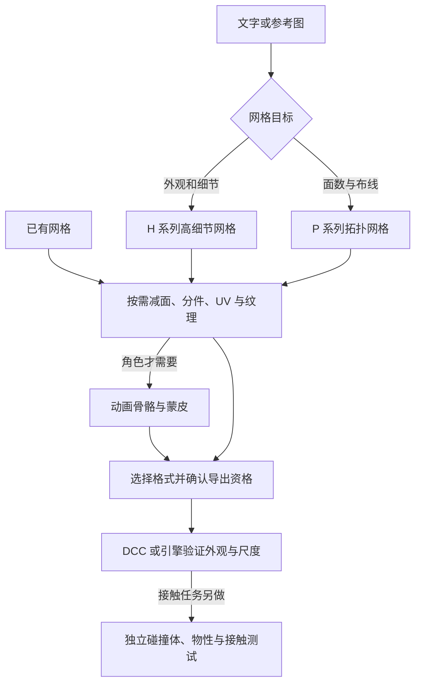
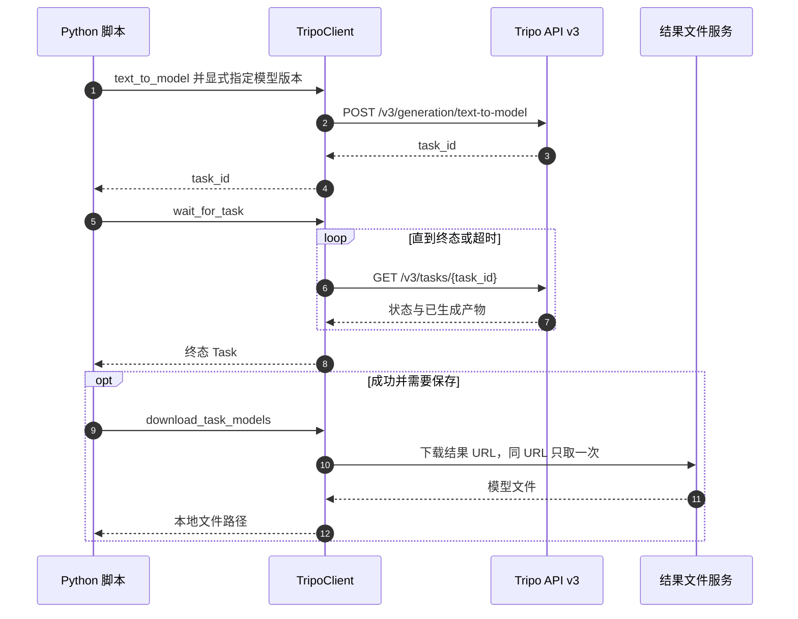

# Tripo Studio: AI 3D Asset Workspace｜AI 3D 网格资产工作台

## 一句话定义

Tripo Studio 是三启万物（VAST）的浏览器 3D 工作台，可从文字或参考图生成网格，也能对既有网格做重拓扑、贴图和角色绑定；Creator Hub 可浏览作品，不等于可无条件下载或商用的素材库。

## 英文缩写速查

| 缩写 | 英文全称 | 简要说明 |
|---|---|---|
| DCC | Digital Content Creation | Blender 等数字内容工具，用于精修与导入检查 |
| UV | UV Texture Coordinates | 网格表面的二维纹理坐标 |
| PBR | Physically Based Rendering | 用基础色、法线、粗糙度和金属度描述视觉材质，不是碰撞摩擦 |
| GLB | Binary glTF | 网格及相关资源的二进制封装 |
| API | Application Programming Interface | 独立于 Studio 网页的程序化接口 |

## 为什么重要

机器人仿真需要可快速替换的视觉道具。参考图转网格能缩短外观占位与视觉多样化的制作时间。但例如用生成马克杯做抓取场景时，杯柄开口与杯底尺寸仍要实测，碰撞体应单独构建后做静置和抓取检查。参见 [机器人仿真场景生成](../methods/robot-simulation-scene-generation.md) 与 [CRISP 的接触几何路线](../methods/crisp-real2sim.md)。

## 核心机制

| 环节 | 工作流及取舍 |
|---|---|
| 生成 | H 系列优先细节，H3.5 Preview 最高 500 万三角面；P2.0 优先可控拓扑，最高 5 万三角面或 2.5 万四边面，网格之后另做纹理。面数是产品上限，不是测量精度。 |
| 编辑 | Retopo 重建布线或减面，Smart UV 展开纹理坐标，Texture 生成贴图，Segment 拆分部件。重展 UV 会清除旧纹理，按需重贴。 |
| 绑定 | 可为角色选骨骼预设、自动生成蒙皮权重并加动画。实际应试转关节看变形，不将动画骨骼当作机械关节。 |
| 交付 | FBX 优先保留四边面、骨架和动画；GLB 用于轻量渲染；STL/3MF 可进入打印切片。软件检查可发现孔洞等网格问题，但不证明尺寸公差或零件强度。 |
| 编排 | Agentic Canvas Beta 将上传、生成、后处理连接为可复用节点链；共享项目不会自动公开其中的私有资产。 |

### 流程总览

## 源码运行时序图

Studio 网页和生成后端未发现公开可运行实现。下图仅对应 [官方 Python SDK 1.0.0](../../sources/repos/tripo-python-sdk.md) 的独立 API 入口，不代表 Web UI 内部架构。

## 工程实践

1. **视觉道具先做小样。** 用有权处理的正面与侧面参考图，记录输入和版本。导入检查轴向、尺度、薄结构、UV 和材质；接触相关道具另配质量、摩擦、质心和惯量，先做静置、接触和抓取检查。
2. **免费生成、导出、授权分开。** H3.5 Preview 能消耗积分生成并查看，免费档不能导出该版本。H2.5 是公开文档列出的免费导出例外，但月额度表不一致，查看当前账号。社区素材应按来源区分免费产物、公开付费产物与活动共享，记录资产链接与适用条款。
3. **区分 Web 与批处理。** 官方 Python SDK 是 API 客户端，需要独立凭证和计费。其示例仍会使用默认旧模型；按官方模型表显式指定新版，例如 v3.1-20260211，并自行归档下载文件。
4. **分开动画与物理装配。** 角色蒙皮先在 [Blender](./blender.md) 验证变形；机械装配须另测轴线、行程、自碰撞与约束，不能将动画剪辑直接当成控制轨迹或训练真值。

## 局限与风险

- **公开并不等于可商用。** 2026-11-13 条款 §5.2.1 对有权处置的免费产物规定默认公开及广泛再利用许可；§5.2.3 对公开付费产物授予其他用户的通常仅限个人非商用。活动规则、第三方权利和素材来源须逐项核对；宣传和帮助页面不等于授权。
- **不是测量或制造 CAD。** 未见区域可能被补错；网格不随附可审验的尺寸、惯量或接触标定。
- **本次未做登录后的生成、下载、打印或仿真。** 不把页面标题中的素材规模或厂商演示当成独立质量证据。

## 关联页面

- [机器人仿真场景生成](../methods/robot-simulation-scene-generation.md) — 从视觉网格到可加载、可接触的场景。
- [CRISP：接触引导 Real2Sim](../methods/crisp-real2sim.md) — 接触优先几何与视觉保真的对照。
- [3D Gen Studio](./3dgenstudio.md) — 本地优先、可接外部 API 的另一款编排器。
- [UniRig](./paper-unirig-2504-12451.md) — 骨骼和蒙皮的独立资料，不据此判定当前 Studio 后端实现。
- [Real2Sim 纵深路线](../../roadmap/depth-real2sim.md) — Stage 1 视觉资产候选，Stage 2 才做物理参数和关节。

## 参考来源

- [Studio 官方产品文档、发布说明与条款归档](../../sources/sites/tripo-studio.md)
- [Tripo API v3 官方 Python SDK 源码归档](../../sources/repos/tripo-python-sdk.md)

## 推荐继续阅读

- [H3.5 Preview 官方发布说明](https://www.tripo3d.ai/blog/tripo-h3-5)
- [导出与 DCC 官方手册](https://www.tripo3d.ai/product-doc/export-and-integration/export-dcc)
- [Tripo 用户协议 §5.2–5.4](https://www.tripo3d.ai/terms)
