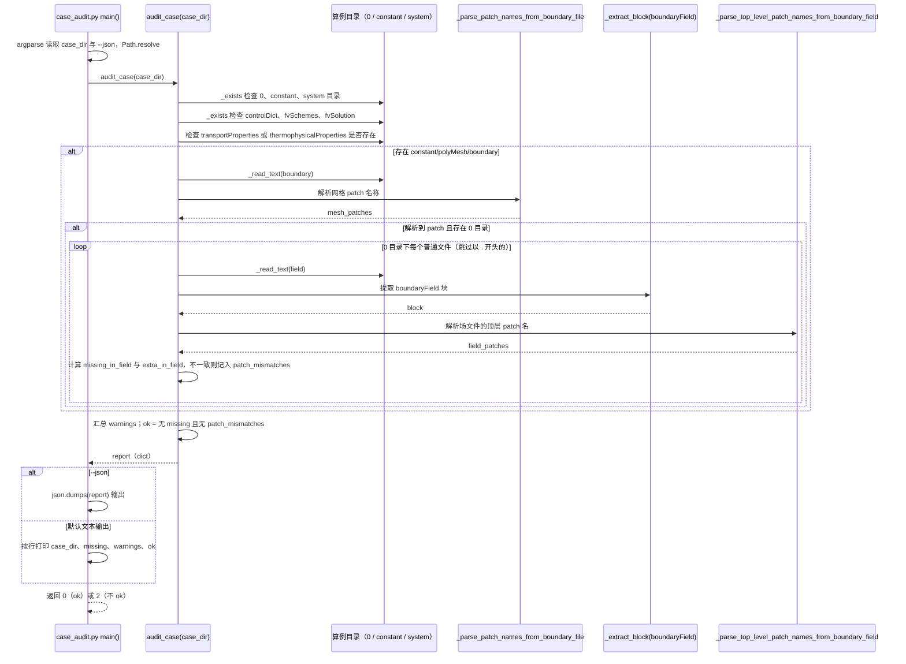

# OpenFOAM Agent Skills（twj011/openfoam-agent-skills）

## 一句话定义

OpenFOAM Agent Skills（twj011/openfoam-agent-skills）是作为小型 OpenFOAM Skill 集合被文章提及，与完整仿真套件或 MCP 执行服务不同，主要适合对比不同仓库如何组织代理指引。

## 英文缩写速查

| 缩写 | 英文全称 | 简要说明 |
|------|----------|----------|
| CFD | Computational Fluid Dynamics | 计算流体力学计算流程 |
| MCP | Model Context Protocol | 让代理发现并调用外部工具的协议 |
| y+ | Dimensionless Wall Distance | 壁面网格分辨率相关的无量纲距离 |

## 为什么重要

对 CAE 自动化而言，代理能否稳定完成任务，取决于工程步骤是否清楚、工具边界是否明确、结果是否保留可审查证据。作为小型 OpenFOAM Skill 集合被文章提及，与完整仿真套件或 MCP 执行服务不同，主要适合对比不同仓库如何组织代理指引。

## 核心原理

**项目自身范围：** OpenFOAM-related skills for coding agents.

**工作流：** 让代理按仓库中的技能说明处理 OpenFOAM 任务；使用前从 SKILL 文件识别所需的命令、输入和预期产物。

## 工程实践

1. 从目标问题识别所需的 Skill、MCP、CLI 或软件接口，不把指导文件当成求解器。
2. 依照仓库 README 检查安装前提、软件/许可证、输入文件和输出证据。
3. 小规模运行并逐项核对几何、网格、边界、求解状态和物理量，再决定是否扩大任务。

文章所述的项目特征：作为小型 OpenFOAM Skill 集合被文章提及，与完整仿真套件或 MCP 执行服务不同，主要适合对比不同仓库如何组织代理指引。

## 局限与风险

文章未列出具体流程和验证闸门，不能仅凭“技能集合”名称推断它可自动完成求解。

源码状态核验：该 GitHub 仓库于 2026-10-07 可公开访问。仓库 API 未报告 SPDX 许可证，应检查仓库内 LICENSE 与依赖许可。 

## 关联页面

- [CAE / CFD 代理工具项目总览](../overview/cae-cfd-agent-skills-landscape.md)
- [OpenFOAM CFD Codex Skill](./hnuvv-openfoam-cfd-codexskill.md)

## 源码运行时序图

入口：`python3 skills/openfoam-agent/scripts/case_audit.py <case_dir> [--json]`（仓库内唯一被 `main()` 驱动的可运行脚本；`skill_quality_check.py` 未在本图中展开）。该仓库主体是供编码代理读取的 Markdown 技能文档，本图只描述该脚本对算例目录的检查顺序。

图依据：twj011/openfoam-agent-skills@10e991d，`skills/openfoam-agent/scripts/case_audit.py`（`audit_case`、`main` 及各辅助函数的调用关系）、`README.md`。未运行脚本，也未用真实算例验证。

## 参考来源

- [公众号文章原始资料归档](../../sources/blogs/wechat_cae_cfd_agent_skills_2026-10-07.md)
- [GitHub 仓库资料归档](../../sources/repos/twj011-openfoam-agent-skills.md)
- [twj011/openfoam-agent-skills 官方仓库](<https://github.com/twj011/openfoam-agent-skills>)
- 源码核对（2026-11-02）：twj011/openfoam-agent-skills@10e991d，读过 README.md、skills/openfoam-agent/scripts/case_audit.py；时序图依据以上文件，未运行代码。

## 推荐继续阅读

- [项目 README](<https://github.com/twj011/openfoam-agent-skills/blob/main/README.md>)