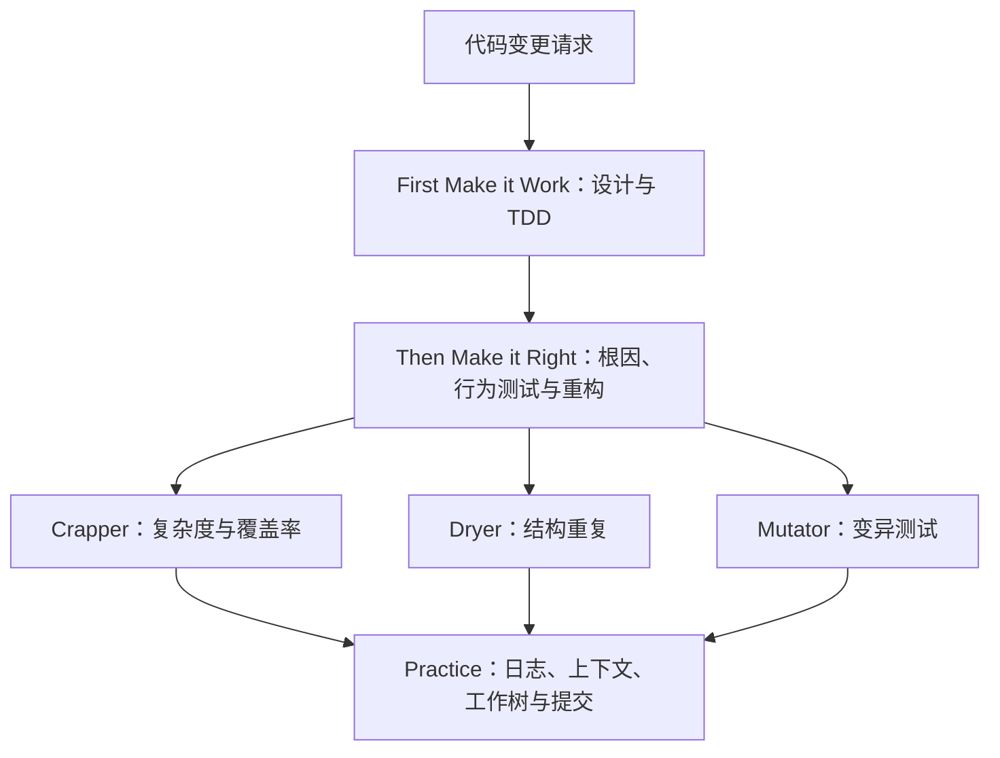

# ub-mode（编码代理的软件工程规范）

**ub-mode** 是公开的编码代理技能，把软件修改的设计、测试和交付原则写在 `SKILL.md` 中。

## 一句话定义

它以「先实现、再改进、遵循实践」组织代理行为，并要求借助独立工具检查复杂度、重复和测试质量。

## 英文缩写速查

| 缩写 | 英文全称 | 简要说明 |
|------|----------|----------|
| TDD | Test-Driven Development | 测试驱动开发，先观察测试按预期失败 |
| CRAP | Change Risk Anti-Patterns | 结合复杂度与覆盖率的函数级指标 |
| UML | Unified Modeling Language | 配套查看器使用的建模语言 |

## 核心机制

该图概括原文的阶段与工具关系，并非强制执行引擎的调用图。

- **先实现：** 尽量缩小变更，先处理数据形状；TDD 要求先写失败测试，若诚实的测试不可行则不写无效测试。架构部分涉及边界校验、类型、幂等与隔离共享状态。
- **再改进：** 重现并修复根因，按可验证的小单元推进，测试用户可见行为。原文提出函数 CRAP 分数低于 10，消除相似度达到或超过 0.8 的结构重复，并用变异测试处理未覆盖代码和存活变异体。
- **实践：** 记录操作与原因、维护上下文、谨慎清理工作树，并以小而有序的提交推进。

## 使用与边界

README 给出的安装方式是将 `SKILL.md` 复制到代理技能目录下的 `ub-mode/SKILL.md`，然后调用 `/ub-mode`；技能加载方式仍需以实际代理环境为准。Crapper、Dryer、Mutator 和 UML Viewer 分属独立仓库，需要单独获取；技能文本提出质量门槛，本身不保证代理或工具一定执行成功。阈值是项目提出的规则，是否适用于特定机器人软件需要结合语言、测试环境和项目约束判断。

### 源码运行时序图

不适用：本仓库公开的是 README 和技能指令文本，没有可运行实现或运行入口；各配套工具的实现位于独立仓库。流程图表示指令意图，不假定工具调用次序或自动执行。

## 关联页面

- [Agent Skills（Addy Osmani）](agent-skills-addyosmani.md) — 对比另一套编码代理技能。
- [Agentic Coding 时代的软件工程基础](../concepts/agentic-coding-software-fundamentals.md) — 理解代理编码中的工程取舍。

## 参考来源

- [ub-mode 仓库归档](../../sources/repos/unclebob-ub-mode.md)
- [README](https://github.com/unclebob/ub-mode/blob/master/README.md) · [SKILL.md](https://github.com/unclebob/ub-mode/blob/master/SKILL.md)；核对的 blob 版本见仓库归档。
