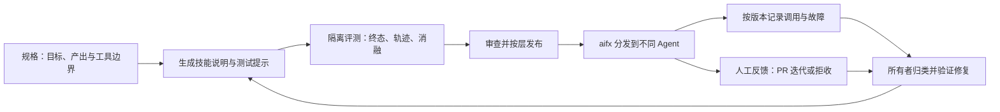

# Uber 的 Agent 技能分发与评测 / Evaluating Agent Skills at Uber Scale

## 一句话定义

Uber 用版本化技能目录和跨运行器的配置工具统一分发，再用隔离评测、真实调用遥测和缺陷报告决定技能是否需要改写、提级或下线。

## 英文缩写速查

| 缩写 | 英文全称 | 简要说明 |
| --- | --- | --- |
| CLI | Command-Line Interface | aifx 为多种 Agent 运行器生成对应配置 |
| CI | Continuous Integration | 技能发布的自动检查入口 |
| MCP | Model Context Protocol | 工具接入协议；固定调用可由脚本通过网关完成 |
| LLM | Large Language Model | 可担任盲评裁判，需用人工标注校准 |

## 为什么重要

百万次调用说明分发规模，不说明任务做对了多少。文章的价值在于把三个问题分开：技能有没有被使用、用了能否提高任务成功率、发生真实故障后能否重现并防止回归。

## 核心原理

| 组件 | 做法 | 要验证的问题 |
| --- | --- | --- |
| 技能目录和分发 | Git 负责所有者、版本和审查；从团队自管 Domain 到平台审查 Core，再到默认启用的 Always-on；aifx 为不同客户端生成配置 | 技能是否能在不同运行器加载，默认启用范围是否合适 |
| Skill Workshop | 用规格记录预期产出、必需和禁止的工具动作、目标模型及运行器，由规格派生技能说明和测试提示 | 换模型后，是目标变了，还是原来的实现失效了 |
| 评测 | 隔离环境里评估轨迹和终态；对同一批真实提示回放有无技能的两组运行，再盲评对比 | 是技能带来了收益，还是两次运行本来就会不同 |
| 线上反馈 | OpenTelemetry 记录技能版本与触发来源，不记录提示正文或文件内容；重复问题归类并由所有者处理 | 是评测漏掉了失败，还是只在特定环境出现 |

### 流程总览

## 工程实践

- **先建可判定的回归。** 原文建议评测集约 5% 固定输入与模拟工具的金样例、80% 按轨迹判分的真实提示、15% 由作者判断。这是套件设计建议，不是线上流量或通过率。对等价执行路径，不把工具顺序判得比任务终态更严；只有权限、安全或真实先后依赖才设顺序硬门禁。
- **对 Robotics Notebooks 的借鉴：** 在隔离分支给同一份 ingest 输入做配对回放：比较原文归档是否完整、是否匹配已有节点、PR 是否指向正确 head，以及 Wiki Lint 能否产出可查证的健康度。把共享临时文件串写、无 CI 时无限重试等故障转成独立回归。只比较 PR 交付证据，不用技能调用次数代替成功率。
- **把成本记到账，但不要把估算当因果。** Uber 以技能调用前后相邻的累积会话成本快照取差，窗口会包含跟随的模型轮次与其他调用；要评估优化，仍应在相同任务、模型及运行器上做配对。

## 局限与风险

- 原文报告约一年从 1 项增长到 5,000+ 项技能，并在一个月内记录 100 万+ 次技能调用。这是 Uber 内部使用量，不是 100 万个 eval，也不能推出用户数或生产力增幅。
- 仓库查询技能的单项消融中，有技能组赢得 87% 的盲评对比；无技能组的工具调用多 13%、工具错误约为六倍、用时长 31%。不能把这一组结果外推给整个目录。高通过率既可能是可靠，也可能是评测没有覆盖重要差异。
- **源码运行时序图：不适用。** 官方文章没有公开内部 aifx、Skill Workshop 或评测代码的运行入口；上图是按文章重建的流程，不是源码调用图。文章把大规模技能 A/B 测试列为后续工作。

## 关联页面

- [AI Agent 评测](../concepts/ai-agent-evaluation.md)：终态、轨迹与独立裁判。
- [Coding Agent 验证闭环](../methods/coding-agent-verification-loops.md)：将线上故障转成能阻止回归的测试。
- [Claude Code 动态工作流](../methods/claude-code-dynamic-workflows.md)：具体任务的运行编排，与技能目录治理分层。
- [Agent-first 软件工厂](../concepts/agentic-software-factory-harness.md)：将技能质量纳入交付门禁。

## 参考来源

- [Uber Engineering 原文核对归档](../../sources/blogs/uber_agent_skills_evals_2026-11-23.md)

## 推荐继续阅读

- [Agent Skills 开放规范](https://agentskills.io/)：技能包格式与按需加载。
- [Uber Engineering：软件工厂的整体架构](https://www.uber.com/us/en/blog/efficient-software-factory/)：技能平台所在的上层交付系统。
