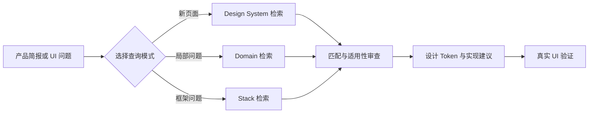
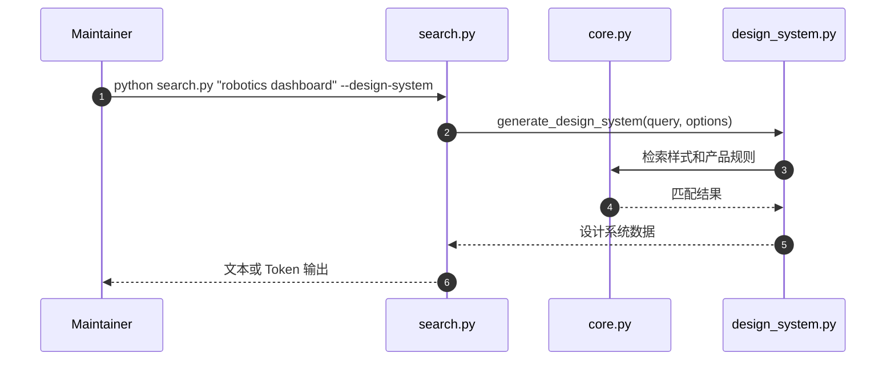

# UI/UX Pro Max｜设计规则检索与 Design System

## 一句话定义

将设计风格、字体配色、图表、交互及技术栈规则转成**可搜索的设计决策数据库**；比凭空生成一个配色方案更可复查，也仍需回到真实产品做验证。

## 英文缩写速查

| 缩写 | 英文全称 | 简要说明 |
|---|---|---|
| UI | User Interface | 界面与组件视觉 |
| UX | User Experience | 交互、可访问性与内容体验 |
| CLI | Command-Line Interface | 执行 `search.py` 等入口 |
| DTCG | Design Tokens Community Group | 可导出的设计 Token JSON 格式 |
| GSAP | GreenSock Animation Platform | 动效 preset 检索域 |

## 为什么重要

- 机器人知识库的图谱、Paper 详情和硬件参数面板常需选字体、图表、数据密度及小屏布局；此项目可做**设计决策的检索层**，而非仅凭审美猜选。
- 它与 [frontend-design](anthropic-frontend-design-skill.md) 的独特设计方向、[Impeccable](impeccable.md) 的交付检测和 [Emil Skills](emil-kowalski-skills.md) 的微交互规则分工不同。
- 官方 `SKILL.md` 自述有 80 个可检索风格（51 active）、194 类产品配色/推理配置、74 对字体组合、141 条 UX 指南、22 种技术栈；这些是**上游自述快照**，非本站复验数量。

## 核心原理

1. 将「新站/页面」映射到 `--design-system`，单项样式或可访问性问题映射到 `--domain`，具体实现栈映射到 `--stack`。
2. 精炼 2–5 个词的主题查询，检查返回的 domain、最匹配条目和项目适用性。无结果收紧重试一次，不能把空结果描述成推荐。
3. 汇总结果形成颜色、字体、布局、图表、动效规则；可导出 DTCG JSON 或 CSS tokens，并按需持久化到 `design-system/<project>/MASTER.md`。
4. 用页面截图与键盘、触控、对比度、长文案等真实测试检验，不把数据库建议当通过证明。

## 流程总览

## 源码运行时序图

官方 `src/ui-ux-pro-max/scripts/search.py` 是可运行入口（通常以已安装的 `.claude/skills/ui-ux-pro-max/scripts/search.py` 路径调用）；以下是**CLI 代码级**的已核对分派，不是虚构 Web 服务器。

## 工程实践

- Claude Code：`/plugin marketplace add nextlevelbuilder/ui-ux-pro-max-skill`，再安装相应插件；或 `npx ui-ux-pro-max-cli init --ai claude`。
- 示例：`python3 .claude/skills/ui-ux-pro-max/scripts/search.py "robotics data dashboard" --design-system --tokens css`；路径需依安装位置调整。
- 已开源的是 SKILL 文本、CSV 规则及 Python 检索代码；没有独立的设计质量保证模型。

## 局限与风险

- 数据库覆盖面不等于设计效果；过多套用结果会造成「数据库式模版设计」。
- 官方检索与导出**不替代** WCAG、跨端/可访问性或用户可用性验证；应用产品品牌和真实数据优先。
- 不应误将上游数量说明当实际执行得到的检索指标。

## 关联页面

- [Anthropic frontend-design](anthropic-frontend-design-skill.md) — 风格方向
- [Impeccable](impeccable.md) — detector 与审查
- [Emil Kowalski Skills](emil-kowalski-skills.md) — 微交互
- [Claude Code Frontend Skills](claude-code-frontend-skills.md) — 组合与去冲突

## 参考来源

- [UI/UX Pro Max 原文与源码归档](../../sources/repos/nextlevelbuilder-ui-ux-pro-max-skill.md)

## 推荐继续阅读

- [官方 README 与安装说明](https://github.com/nextlevelbuilder/ui-ux-pro-max-skill)
- [官方 Skill 规则](https://github.com/nextlevelbuilder/ui-ux-pro-max-skill/blob/main/.claude/skills/ui-ux-pro-max/SKILL.md)
