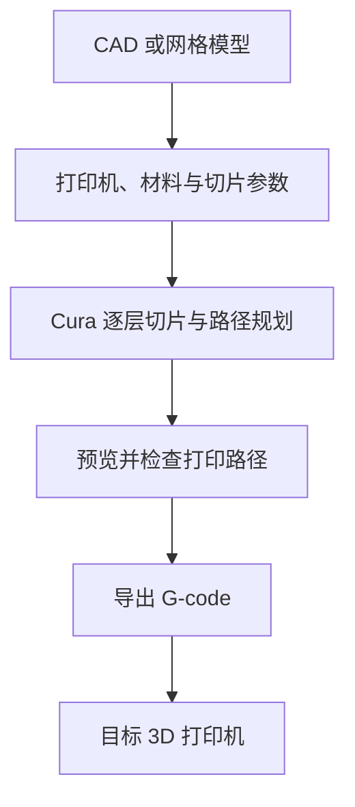

# Ultimaker Cura（3D 打印切片软件）

**一句话定义**：Ultimaker Cura 是开源桌面切片软件，将三维模型按指定打印机、材料和参数规划为逐层打印路径，并输出 G-code。

## 英文缩写速查

| 缩写 | 英文全称 | 简要说明 |
|------|----------|----------|
| CAD | Computer-Aided Design | 计算机辅助设计；模型通常先在 CAD 或网格建模工具中准备 |
| FDM | Fused Deposition Modeling | 熔融沉积成型，常见的逐层挤出式打印工艺 |
| NC | Numerical Control | 数控指令；G-code 属于数控代码 |
| STL | Standard Tessellation Language | 常见三角网格模型格式，可作为切片输入之一 |

## 为什么重要

3D 模型还不是打印任务：打印机需要逐层路径、挤出量、速度和温度等执行指令。切片器把几何模型与打印机、材料及参数配置结合，生成可预览、可检查的 G-code。对机器人原型制作而言，支架、外壳、夹具等零件也因此能从 CAD 几何进入实体制造。

Cura 官方 README 列出数百项切片设置和社区维护的打印配置文件，帮助用户按打印机和打印需求设置工作流。它与 [OpenSCAD](./openscad.md) 或 [FreeCAD](./freecad.md) 的分工清楚：CAD 工具设计几何，Cura 为目标打印设备准备切片任务。

## 核心原理

切片器读取三维模型，按层高将模型截成截面，再根据参数规划外壁、填充、支撑、移动和挤出路径，并把路径及设备动作编码为 G-code。Cura 的桌面界面把模型摆放、配置选择、参数编辑、切片预览和任务导出集中在同一工作流中。

常见流程如下：

## 工程实践

| 环节 | 检查内容 | 常见影响 |
|------|----------|----------|
| 选打印机 | 核对机型、运动范围、喷嘴直径和挤出配置 | 配置不匹配会让路径超出成形空间或挤出异常 |
| 选材料 | 按耗材类型和品牌核对喷嘴/热床温度、冷却与速度 | 不同材料的热收缩、粘附和冷却要求不同 |
| 摆放与支撑 | 检查方向、悬垂、支撑、首层接触面积 | 摆放影响强度方向、支撑需求和表面质量 |
| 切片预览 | 检查逐层外壁、填充、支撑和空移路径 | 预览可发现漏打、薄壁、支撑或路径异常 |
| 导出与打印 | 保存 G-code，确认目标打印机与固件兼容 | 错机型或错误后处理可能造成打印失败或设备异常 |

社区配置文件是可复用的参数起点，实际结果仍受打印机状态、喷嘴、材料批次、环境与参数影响；开始正式打印前应检查切片预览，并用小样验证关键尺寸与材料设置。使用第三方模型或配置文件时，先核实其许可、来源和适用设备。

## 局限与风险

- Cura 负责切片与任务准备，不会自动保证模型结构强度、尺寸公差或打印成功率。
- 相同配置在不同打印机、喷嘴、耗材、固件和环境下可能产生不同结果；不能把社区配置当作免校验的标准答案。
- 模型几何即使能导入，也可能有非流形面、过薄结构或不适合目标工艺的悬垂；需回到建模环节修复或调整。
- G-code 通常面向特定打印机与配置，打印前应确认目标设备，并遵守设备的安全操作要求。
- 主程序仓库为 LGPL-3.0；单独的 [CuraEngine](https://github.com/Ultimaker/CuraEngine) 仓库使用 AGPL-3.0。第三方模型的授权也需独立核对。

## 关联页面

- [OpenSCAD（脚本化参数 CAD）](./openscad.md) — 以脚本生成参数化几何，再交给切片器准备打印。
- [FreeCAD](./freecad.md) — 面向机械设计的参数化 CAD，可导出零件几何进入打印链路。
- [人形结构拓扑优化工具链](../concepts/humanoid-topology-optimization-toolchain.md) — 增材制造端的设计约束与可制造性验证。

## 参考来源

- [Ultimaker Cura 官方源码仓库归档](../../sources/repos/ultimaker-cura.md)
- [Ultimaker Cura 官方 README](https://github.com/Ultimaker/Cura/blob/main/README.md)
- [Cura 官方设置与配置文件说明](https://github.com/Ultimaker/Cura/wiki/Profiles-&-Settings)
- [CuraEngine 官方源码仓库](https://github.com/Ultimaker/CuraEngine)

## 推荐继续阅读

- [Cura Profiles & Settings](https://github.com/Ultimaker/Cura/wiki/Profiles-&-Settings) — 了解配置文件、打印机和切片参数入口。
- [Cura Releases](https://github.com/Ultimaker/Cura/releases/latest) — 获取官方发布版本。
