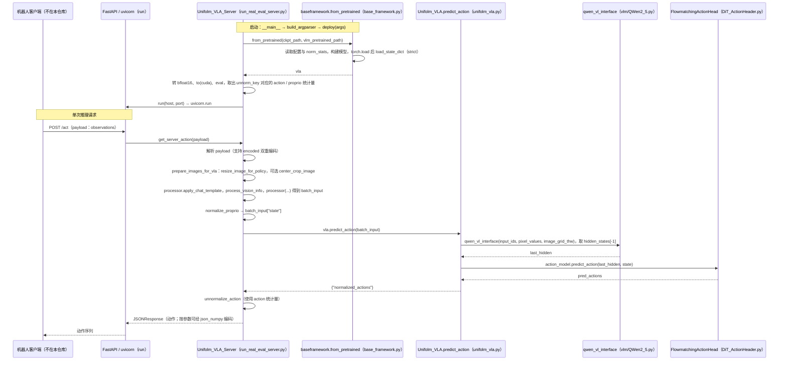

# UnifoLM-VLA-0（unifolm-vla）

**UnifoLM-VLA-0** 是 UnifoLM 系列中的 **Vision–Language–Action** 大模型，强调在机器人操作数据上的持续预训练，使模型从视觉–语言理解走向带物理常识的具身决策。

## 一句话定义

官方开源的人形操作 VLA：指令 + 空间感知 → 动作；单策略号称覆盖多类复杂操作（以上游表述与评测为准）。

## 英文缩写速查

| 缩写 | 英文全称 | 简要说明 |
|------|----------|----------|
| VLA | Vision-Language-Action | 视觉–语言–动作模型 |
| VLM | Vision-Language Model | 视觉语言模型；本系列有 VLM-Base |
| VQA | Visual Question Answering | VLM 基座常见预训练形态 |
| CUDA | Compute Unified Device Architecture | 推荐 12.4 |
| IL | Imitation Learning | 数据与微调范式 |
| HF | Hugging Face | 权重与数据集托管 |

## 为什么重要

- 宇树官方「基础模型」产品线的操作侧落点，可与自研 IL/VLA 对照。
- **训练 / 推理 / Checkpoints 均已开源**（Open-Source Plan 全勾）。
- 与 [`unitree_lerobot`](./unitree-lerobot.md) 数据生态、HF Unitree 数据集直接相关。

## 核心原理

| 能力叙事（上游） | 含义 |
|------------------|------|
| Spatial Semantic Enhancement | 指令与 2D/3D 空间细节联合，强化几何理解 |
| Manipulation Generalization | 全动力学预测数据支撑跨任务泛化 |

**Checkpoints（HF）**：`UnifoLM-VLM-Base`、`UnifoLM-VLA-Base`（Unitree 开源数据微调）、`UnifoLM-VLA-LIBERO` 等。

## 工程实践

```bash
conda create -n unifolm-vla python==3.10.18 && conda activate unifolm-vla
git clone https://github.com/unitreerobotics/unifolm-vla.git && cd unifolm-vla
pip install --no-deps "lerobot @ git+https://github.com/huggingface/lerobot.git@0878c68"
pip install -e .
pip install "flash-attn==2.5.6" --no-build-isolation
```

强烈建议 **CUDA 12.4**。项目页：<https://unigen-x.github.io/unifolm-vla.github.io>。

## 局限与风险

- FlashAttention / CUDA / 钉扎 LeRobot commit 使环境脆弱，勿随意升级。
- 「12 类任务单策略」等声明需对照官方评测设定，不能直接外推到任意现场。
- 与 WMA / [WLA-1.0](./unifolm-wla.md) 是**并行家族成员**，不是互相替代的同一仓库；WLA 为更新一代 6B 全身模型，本仓仍是 **可端到端训练** 的 VLA-0 落点。

## 关联页面

- [UnifoLM-WMA](./unifolm-world-model-action.md)
- [UnifoLM-WLA-1.0](./unifolm-wla.md)
- [unitree_lerobot](./unitree-lerobot.md)
- [World-Action Models](../concepts/world-action-models.md)
- [Manipulation](../tasks/manipulation.md)
- [Unitree](./unitree.md)

## 源码运行时序图

入口：`bash scripts/eval_scripts/run_real_eval_server.sh`，其中调用 `python deployment/model_server/run_real_eval_server.py --ckpt_path ... --port 8777 --unnorm_key ... --vlm_pretrained_path ...`。下图为真机推理服务端的启动与单次 `/act` 请求处理顺序；机器人端客户端（`unitree_deploy/robot_client.py`）不在本仓库内，仅以 Client 表示。



图依据：unifolm-vla@ff6c39a，`scripts/eval_scripts/run_real_eval_server.sh`、`deployment/model_server/run_real_eval_server.py`（`Unifolm_VLA_Server.__init__`、`get_server_action`、`run`、`deploy`）、`src/unifolm_vla/model/framework/base_framework.py`（`from_pretrained`）、`src/unifolm_vla/model/framework/unifolm_vla.py`（`__init__`、`predict_action`）、`src/unifolm_vla/model/modules/vlm/QWen2_5.py`、`src/unifolm_vla/model/modules/action_model/DiT_ActionHeader.py`（`predict_action`）、`README.md`。未运行服务，未做真机验证。

## 参考来源

- [sources/repos/unifolm-vla.md](../../sources/repos/unifolm-vla.md)
- 上游：<https://github.com/unitreerobotics/unifolm-vla>
- 源码核对（2026-11-02）：unitreerobotics/unifolm-vla@ff6c39a，读过 README.md、scripts/eval_scripts/run_real_eval_server.sh、deployment/model_server/run_real_eval_server.py、src/unifolm_vla/model/framework/base_framework.py、src/unifolm_vla/model/framework/unifolm_vla.py；时序图依据以上文件，未运行代码。

## 推荐继续阅读

- 项目页：<https://unigen-x.github.io/unifolm-vla.github.io>

