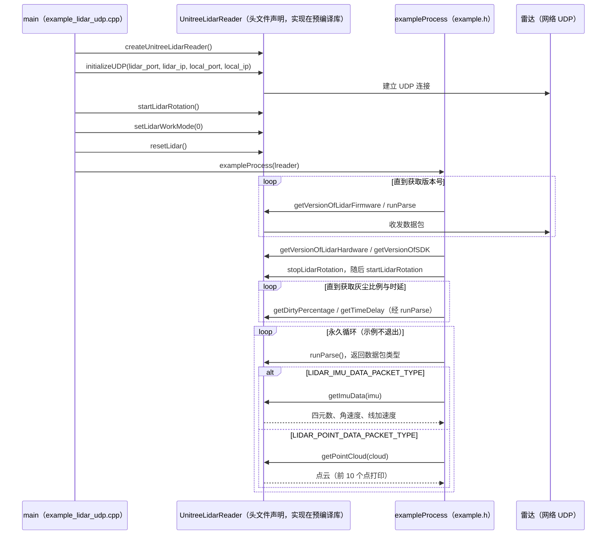

# UniLidar SDK（L1 / L2）

宇树激光雷达产品线 SDK：**L2 用 `unilidar_sdk2`**，**L1 用 `unilidar_sdk`**。本页合并为一个知识节点，按代际对照，避免两个几乎同构的 stub。

## 一句话定义

从 Unitree L1/L2 雷达获取点云与 IMU、配置 FOV/2D·3D/接口模式，并接到 ROS1/ROS2 发布包。

## 英文缩写速查

| 缩写 | 英文全称 | 简要说明 |
|------|----------|----------|
| LiDAR | Light Detection and Ranging | 激光雷达 |
| IMU | Inertial Measurement Unit | 惯性测量单元 |
| FOV | Field of View | 视场；支持标准/广角等模式 |
| ROS | Robot Operating System | `unitree_lidar_ros` 包 |
| ROS 2 | Robot Operating System 2 | `unitree_lidar_ros2` 包 |
| SLAM | Simultaneous Localization and Mapping | 常见下游 |

## 为什么重要

- L1/L2 主打大视场（约 360°×90°）、非重复扫描、低成本，适低速移动机器人。
- [`point_lio_unilidar`](./point-lio-unilidar.md) 直接依赖正确的雷达 SDK 与坐标约定。
- 外参（雷达系 L 与 IMU 系 I）在 L2 README 中给出平移量，建图前必须对齐。

## 核心原理

**L2（`unilidar_sdk2`）接口形态**：

| 组件 | 路径 |
|------|------|
| 原生 C++ SDK | `unitree_lidar_sdk` |
| ROS1 | `unitree_lidar_ros` |
| ROS2 | `unitree_lidar_ros2` |

工作模式可通过上位机或 `setLidarWorkMode` 配置（标准/广角 FOV、3D/2D、IMU 开关、以太网/串口等）。

**坐标（L2 README）**：点云系原点在底座安装面中心；IMU 原点相对点云系平移约 `[-0.007698, -0.014655, 0.00667]` m，轴向平行。

**L1（`unilidar_sdk`）**：独立旧仓，功能同类；新项目优先确认硬件是 L1 还是 L2 再选仓。

## 工程实践

```bash
cd unitree_lidar_sdk && mkdir build && cd build
cmake .. && make -j2
```

然后按 ROS/ROS2 子包 README 启动发布节点，再用 Point-LIO 或其它 LIO 订阅。

## 局限与风险

- 工作模式错误会导致点云密度/覆盖与算法假设不符。
- 以太网与串口模式的接线、IP 与权限问题是高频坑。
- L1/L2 SDK **不要混用二进制**。

## 关联页面

- [point_lio_unilidar](./point-lio-unilidar.md)
- [Locomotion](../tasks/locomotion.md)
- [Unitree](./unitree.md)

## 源码运行时序图

入口：在 `unitree_lidar_sdk` 目录按 `CMakeLists.txt` 构建后运行 `./example_lidar_udp`（源码为 `unitree_lidar_sdk/examples/example_lidar_udp.cpp`，`main()`；`exampleProcess` 定义于 `unitree_lidar_sdk/include/example.h`）。下图为 UDP 示例的实际调用顺序。注意：`createUnitreeLidarReader` 与 `UnitreeLidarReader` 的实现以预编译库 `lib/<arch>/libunilidar_sdk2.a` 提供，仓库内只有头文件声明，故其内部（UDP 收发与解析）不展开。



图依据：unilidar_sdk2@0e3c51f，`unitree_lidar_sdk/examples/example_lidar_udp.cpp`、`unitree_lidar_sdk/include/example.h`、`unitree_lidar_sdk/include/unitree_lidar_sdk.h`（接口声明）、`unitree_lidar_sdk/CMakeLists.txt`（`example_lidar_udp` 目标）。`createUnitreeLidarReader`、`initializeUDP` 的内部实现与 `runParse` 的收发细节不在源码内，未展开；与雷达的数据包收发以“UDP 连接”表示，属基于接口命名的推断。未编译或运行示例。

## 参考来源

- [sources/repos/unilidar_sdk2.md](../../sources/repos/unilidar_sdk2.md)
- [sources/repos/unilidar_sdk.md](../../sources/repos/unilidar_sdk.md)
- 产品页：<https://www.unitree.com/LiDAR>
- 上游：<https://github.com/unitreerobotics/unilidar_sdk2>
- 源码核对（2026-11-02）：unitreerobotics/unilidar_sdk2@0e3c51f，读过 unitree_lidar_sdk/examples/example_lidar_udp.cpp、unitree_lidar_sdk/include/example.h、unitree_lidar_sdk/include/unitree_lidar_sdk.h、unitree_lidar_sdk/CMakeLists.txt；时序图依据以上文件，未运行代码。

## 推荐继续阅读

- L2 中文 README：`README_CN.md`

