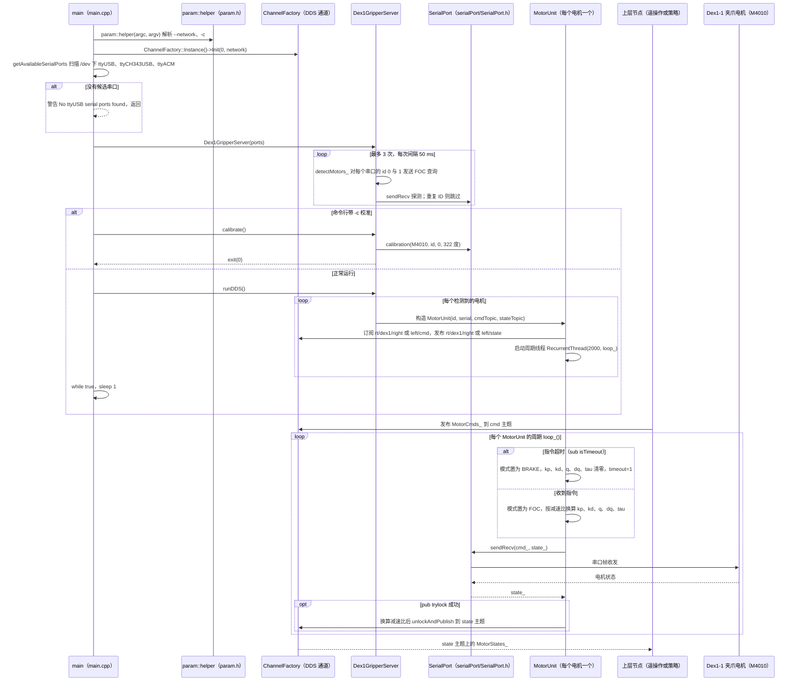

# Unitree 灵巧手 Serial↔DDS 服务

人形双臂操作常需把厂家手部串口协议桥到 Unitree **DDS** 主题。组织下按手型拆仓；本页合并为**一个节点**，按手型索引。

## 一句话定义

在计算单元（常为 G1 的 PC2 / Jetson）上运行的 Serial→DDS 守护进程，让遥操作与策略节点用统一主题控制不同品牌灵巧手/夹爪。

## 英文缩写速查

| 缩写 | 英文全称 | 简要说明 |
|------|----------|----------|
| DDS | Data Distribution Service | 机载通信总线 |
| Serial | UART/Serial port | 手部厂家常用链路 |
| IL | Imitation Learning | 下游 lerobot 训练 |
| XR | Extended Reality | 遥操作前端 |
| G1 | Unitree G1 Humanoid | 常见承载平台 |
| API | Application Programming Interface | cmd/state 主题约定 |

## 为什么重要

- [`unitree_lerobot`](./unitree-lerobot.md) / [`xr_teleoperate`](./xr-teleoperate.md) 的数据与部署都假设手部主题可用。
- 多手型并存时，最大坑是 **跑错 service 或 motor_id**，导致左右手镜像错误。
- 合并叙述避免图谱出现四个几乎相同的「serial2dds」空节点。

## 核心原理

| 仓库 | 手型 | 备注 |
|------|------|------|
| [`dex1_1_service`](https://github.com/unitreerobotics/dex1_1_service) | Unitree Dex1-1 平行夹爪（单 M4010） | 主题示例：`rt/dex1/left|right/cmd|state` |
| [`dfx_inspire_service`](https://github.com/unitreerobotics/dfx_inspire_service) | Inspire RH56DFX | 多指手 |
| [`brainco_hand_service`](https://github.com/unitreerobotics/brainco_hand_service) | Brainco Revo2 | lerobot v0.2+ 转换支持 |
| [`linker_hand_service`](https://github.com/unitreerobotics/linker_hand_service) | Linker Hand | Serial↔DDS |

**Dex3 不在本表**：Unitree Dex3 是 **原生 DDS** 灵巧手（7 电机 + 压感），走 `unitree_hg` 的 `HandCmd` / `HandState`，主题形如 `/dex3/{left|right}/cmd` 与 `/lf/dex3/{left|right}/state`。官方 ROS 2 入口是 [`unitree_ros2` v0.3.0](./unitree-ros2.md) 的 `g1_dex3_example`，**不要**再套一层 Serial 服务。v0.3.0 手部 msg 已对齐 SDK2（字段重排，旧节点会静默错位）。

**Dex1-1 典型数据流**：用户节点发布 `rt/dex1/right/cmd` → service（motor_id=0）→ 电机；状态经 `rt/dex1/right/state` 回传（左手 motor_id=1）。

## 工程实践

以 Dex1-1 为例（在 PC2 / Orin 上）：

```bash
sudo apt install libserialport-dev libspdlog-dev libboost-all-dev libyaml-cpp-dev libfmt-dev
git clone https://github.com/unitreerobotics/dex1_1_service && cd dex1_1_service
mkdir build && cd build && cmake .. && make -j6
sudo ./dex1_1_gripper_server --network eth0
# 可选 --calibration 做夹爪标定
```

其它手型按各仓 README 安装串口依赖并指定 DDS 网卡。采数前在 XR/仿真中确认左右手方向。

## 局限与风险

- **串口权限与接线**错误时 service 可能静默无状态。
- 手型固件与 `unitree_lerobot` 转换脚本版本必须匹配。
- 同机多 service 时注意 motor_id / 主题命名空间冲突。

## 关联页面

- [xr_teleoperate](./xr-teleoperate.md)
- [unitree_ros2](./unitree-ros2.md) — Dex3 原生 DDS 示例（v0.3.0）
- [unitree_lerobot](./unitree-lerobot.md)
- [unitree_sim_isaaclab](./unitree-sim-isaaclab.md)
- [Unitree G1](./unitree-g1.md)
- [Manipulation](../tasks/manipulation.md)
- [Unitree](./unitree.md)

## 源码运行时序图

本图只针对 `dex1_1_service`（Dex1-1 平行夹爪的 Serial↔DDS 服务），不代表页面中其它手型仓库。入口：`sudo ./dex1_1_gripper_server --network eth0`（源码 `main.cpp` 的 `main()`；校准入口为 `sudo ./dex1_1_gripper_server -c`）。下图为源码中的实际调用顺序。



图依据：dex1_1_service@ced3216，`main.cpp`（`main`、`Dex1GripperServer`、`MotorUnit::loop_`、`detectMotors_`、`runDDS`、`calibrate`）、`README.md`。未运行。`SerialPort`（`include/serialPort/SerialPort.h`）与 `unitreeMotor`（`include/unitreeMotor/unitreeMotor.h`）未打开阅读，图中仅依据 `main.cpp` 的调用关系表示；`RecurrentThread` 的周期单位未核对。

## 参考来源

- [sources/repos/dex1_1_service.md](../../sources/repos/dex1_1_service.md)
- [sources/repos/dfx_inspire_service.md](../../sources/repos/dfx_inspire_service.md)
- [sources/repos/brainco_hand_service.md](../../sources/repos/brainco_hand_service.md)
- [sources/repos/linker_hand_service.md](../../sources/repos/linker_hand_service.md)
- [sources/repos/unitree_ros2.md](../../sources/repos/unitree_ros2.md) — v0.3.0 Dex3 原生 DDS 与手部 msg 对齐
- 源码核对（2026-11-02）：unitreerobotics/dex1_1_service@ced3216，读过 main.cpp、README.md；时序图依据以上文件，未运行代码。

## 推荐继续阅读

- Dex1-1 产品页：<https://www.unitree.com/Dex1-1>

