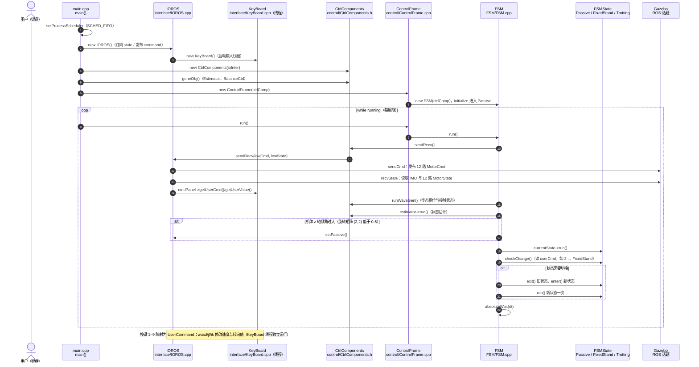

# unitree_guide

**unitree_guide** 是宇树公开的四足控制教学项目，亦是图书《四足机器人控制算法——建模、控制与实践》的配套软件。

## 一句话定义

在 ROS1 + Gazebo 里跑通一套入门级 FSM 四足控制器（Passive / FixedStand / Trotting + 键盘速度），建立经典控制直觉。

## 英文缩写速查

| 缩写 | 英文全称 | 简要说明 |
|------|----------|----------|
| FSM | Finite State Machine | 有限状态机；本仓控制器骨架 |
| ROS | Robot Operating System | 推荐 Melodic + Ubuntu 18.04 |
| Gazebo | Gazebo Simulator | 仿真后端 |
| MPC | Model Predictive Control | 上游提示进阶方向之一 |
| RL | Reinforcement Learning | 并行现代路线；非本仓重点 |
| SDK | Software Development Kit | 真机侧常对照旧 SDK |

## 为什么重要

- 补齐「只有 RL、没有经典控制手感」的缺口：状态机、站立、对角小跑步态切换。
- 依赖关系清晰：`unitree_guide` + [`unitree_ros`](./unitree-ros.md) + `unitree_legged_msgs`（来自 `unitree_ros_to_real`，**不要**把整个 `unitree_legged_real` 当依赖）。
- 与官方 RL 仓并行存在：教学/建模用本仓，策略学习用 gym/lab/mjlab。

## 核心原理

键盘切换 FSM：`2` Passive→FixedStand；`4` → Trotting；`wasd` 平移、`jl` 旋转；空格停止站立。细节见开发者站点算法实践文档（目前偏中文）。

## 工程实践

```bash
# 三包放入同一 catkin 工作空间 src/ 后
catkin_make && source devel/setup.bash
roslaunch unitree_guide gazeboSim.launch
# 另一终端
./devel/lib/unitree_guide/junior_ctrl
```

环境建议：Ubuntu 18.04 + ROS Melodic。

## 局限与风险

- **入门性能**：上游写明需调参或 MPC 等才能更好；不要当 SOTA locomotion。
- 发行版老旧，与 SDK2/ROS2 新栈隔离使用。
- 若终端无响应，需先点击控制器终端再按键。

## 源码运行时序图

官方实现 [unitreerobotics/unitree_guide](https://github.com/unitreerobotics/unitree_guide)（短 SHA `fdf4d23`）：C++ 控制器 `junior_ctrl`，入口 `unitree_guide/src/main.cpp`。仿真路径下 `IOROS` 经 ROS 话题与 Gazebo 交换数据，键盘输入由 `KeyBoard` 线程读取；每个控制周期（`dt = 0.002`，500 Hz）在 `FSM::run()` 内完成「收发 → 估计 → 状态机 → 等待」。

入口：`roslaunch unitree_guide gazeboSim.launch`（仿真）；另一终端 `./devel/lib/unitree_guide/junior_ctrl`



图依据：unitree_guide@fdf4d23，读过 `README.md`、`CMakeLists.txt`（入口与 `COMPILE_WITH_SIMULATION` 等宏）、`unitree_guide/src/main.cpp`、`src/control/ControlFrame.cpp`、`src/FSM/FSM.cpp`、`src/interface/IOROS.cpp`、`src/interface/KeyBoard.cpp`、`src/FSM/State_Passive.cpp`、`src/FSM/State_FixedStand.cpp`、`src/FSM/State_Trotting.cpp`（部分）、`include/control/CtrlComponents.h`（grep 片段）、`include/interface/IOInterface.h`（grep 片段）。`Estimator`、`WaveGenerator` 内部实现未读，图中只画调用关系。

## 关联页面

- [unitree_ros](./unitree-ros.md)
- [Locomotion](../tasks/locomotion.md)
- [MPC](../methods/model-predictive-control.md)
- [Unitree](./unitree.md)

## 参考来源

- [sources/repos/unitree_guide.md](../../sources/repos/unitree_guide.md)
- 上游：<https://github.com/unitreerobotics/unitree_guide>
- 源码核对（2026-11-02）：unitree_guide@fdf4d23，读过 README.md、CMakeLists.txt、src/main.cpp、src/control/ControlFrame.cpp、src/FSM/FSM.cpp、src/interface/IOROS.cpp、src/interface/KeyBoard.cpp、src/FSM/State_Passive.cpp、State_FixedStand.cpp、State_Trotting.cpp（部分）；时序图依据以上文件，未运行代码。

## 推荐继续阅读

- 开发者站点算法实践：<https://support.unitree.com/home/zh/Algorithm_Practice>

