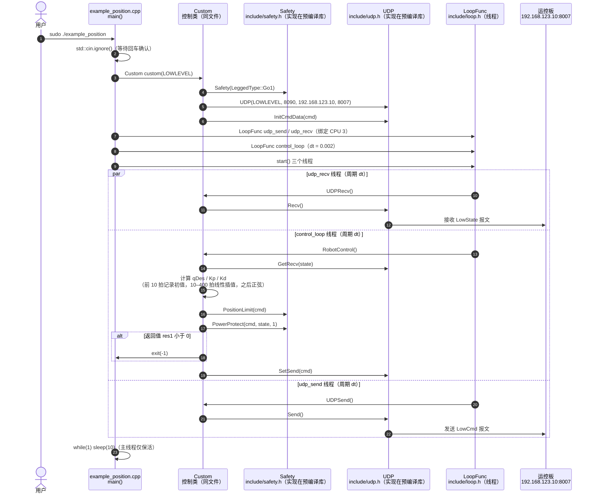

# unitree_legged_sdk

**unitree_legged_sdk** 主要用于 PC 与运控板之间的通信（亦可在其它机器上经 UDP 使用）。现行 tag（如 v3.8.x）文档写明主支持 **Go1**；Laikago/B1/Aliengo/A1 等需回退历史 release（如 v3.3.1）。

## 一句话定义

SDK1 时代的 UDP 真机通信库——理解 ROS1 `unitree_ros_to_real` 链路时必需，新项目应改走 SDK2。

## 英文缩写速查

| 缩写 | 英文全称 | 简要说明 |
|------|----------|----------|
| SDK | Software Development Kit | 本仓为旧代 |
| SDK2 | Unitree SDK version 2 | 新机型默认 |
| UDP | User Datagram Protocol | 本仓通信方式 |
| ROS | Robot Operating System | 常与 ros_to_real 联用 |
| API | Application Programming Interface | C++/可选 Python 封装 |
| Go1 | Unitree Go1 | 当前文档主支持机型 |

## 为什么重要

- 大量 2020–2023 论文与教程仍引用本仓；复现时不能误装 SDK2。
- 与 [`unitree_ros`](./unitree-ros.md) / `unitree_ros_to_real` 组成 ROS1 真机故事线。
- 作为对照，帮助理解为何新栈改 DDS。

## 核心原理

依赖 Boost、CMake、g++；可选 `-DPYTHON_BUILD=TRUE` 编 Python 封装。运行 C++ 示例常需 `sudo` 以锁定内存。固件与 `Legged_sport` 版本需满足 README 下限。

## 工程实践

```bash
mkdir build && cd build && cmake .. && make
# 或
cmake -DPYTHON_BUILD=TRUE ..
```

缺 `msgpack.hpp` 时安装 `libmsgpack*`；Python 在 arm 上需改 `sys.path` 到 `arm64` 库目录。

## 局限与风险

- **机型支持窄**；错用版本会连不上。
- 与 SDK2 **协议不兼容**，禁止在同一控制器里混用。
- 安全：低层示例同样需要吊装与急停流程。

## 源码运行时序图

官方实现 [unitreerobotics/unitree_legged_sdk](https://github.com/unitreerobotics/unitree_legged_sdk)（短 SHA `4539a6c`）：C++ 头文件 + 预编译静态库，示例 `example/example_position.cpp` 通过 UDP 与运控板交换 `LowCmd` / `LowState`，并用 `LoopFunc` 起三个周期线程（接收、控制、发送）。收发与安全限幅的底层实现位于预编译库 `lib/cpp/<arch>/libunitree_legged_sdk.a`，本仓无该部分源码，图中只画头文件暴露的调用关系。

入口：`sudo ./example_position`（由 CMake 目标 `example_position` 编译，C++ 示例需 sudo 以锁内存；运行前按提示确认机器人已挂起并切到低层模式）



图依据：unitree_legged_sdk@4539a6c，读过 `README.md`、`CMakeLists.txt`（`example_position` 目标与库链接）、`example/example_position.cpp`、`include/unitree_legged_sdk/loop.h`、`include/unitree_legged_sdk/udp.h`（grep 声明）、`include/unitree_legged_sdk/safety.h`（grep 声明）、`include/unitree_legged_sdk/comm.h`（grep 片段）、`include/unitree_legged_sdk/unitree_legged_sdk.h`。`UDP` 收发与 `Safety` 限幅的内部实现未读（预编译库，本仓无源码）。

## 关联页面

- [unitree_sdk2](./unitree-sdk2.md)
- [unitree_ros](./unitree-ros.md)
- [unitree_guide](./unitree-guide.md)
- [Unitree](./unitree.md)

## 参考来源

- [sources/repos/unitree_legged_sdk.md](../../sources/repos/unitree_legged_sdk.md)
- 上游：<https://github.com/unitreerobotics/unitree_legged_sdk>
- 源码核对（2026-11-02）：unitreerobotics/unitree_legged_sdk@4539a6c，读过 README.md、CMakeLists.txt、example/example_position.cpp、include/unitree_legged_sdk/loop.h、udp.h（grep）、safety.h（grep）、comm.h（grep）、unitree_legged_sdk.h；时序图依据以上文件，未运行代码。

## 推荐继续阅读

- 开发者文档中 SDK 代际说明：<https://support.unitree.com/home/zh/developer>

