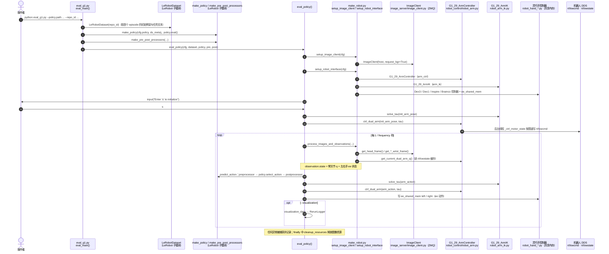

# unitree_lerobot

**unitree_lerobot** 把 [LeRobot](./lerobot.md) 训练栈接到 Unitree **G1 + 灵巧手** 数据流：数据转换、策略训练验证、仿真回放与真机推理。

## 一句话定义

官方模仿学习「训练与部署」胶水仓——输入遥操作/仿真采集的数据，输出可在 G1 上验证的 LeRobot 策略。

## 英文缩写速查

| 缩写 | 英文全称 | 简要说明 |
|------|----------|----------|
| IL | Imitation Learning | 模仿学习 |
| LeRobot | Hugging Face LeRobot | 开源机器人学习框架与数据集格式 |
| VLA | Vision-Language-Action | 视觉–语言–动作；可与 UnifoLM 衔接 |
| G1 | Unitree G1 Humanoid | 目标人形平台 |
| DDS | Data Distribution Service | 真机/仿真通信 |
| XR | Extended Reality | 采数常用前端 |

## 项目时间边界

官方仓库在 **2024-10-18** 的代码提交已包含实现，本路线将其标为「代码历史起点」；这不证明正式首发或首次公开日，也不表示当日已具备本页介绍的全部现有功能。提交证据见 [原始仓库时间核对](../../sources/repos/unitree_lerobot.md)。

## 为什么重要

- 打通 **采数 → 数据集格式 → 训练 → 真机** 的官方叙述，避免每人自写一份 LeRobot 适配。
- v0.3 起对齐 **LeRobot dataset v3.0**，并扩展 `pi05` / `groot` 等策略支持（以上游 Release Note 为准）。
- 与 [`xr_teleoperate`](./xr-teleoperate.md)、[`unitree_sim_isaaclab`](./unitree-sim-isaaclab.md) 组成人形 IL 闭环。

## 核心原理

| 目录 | 职责 |
|------|------|
| `lerobot/` | 内嵌/固定 commit 的训练代码（README 标注对应上游 commit） |
| `utils/` | Unitree 数据转换与处理 |
| `eval_robot/` | 真机推理验证 |

**版本能力摘要**：

- v0.1：G1 + Dex1 + Dex3 的转换 / 部署 / 真机测试
- v0.2：Brainco / Inspire 手、数据集回放、仿真验证
- v0.3：dataset v3.0、更多 policy

## 工程实践

```bash
git clone --recurse-submodules https://github.com/unitreerobotics/unitree_lerobot.git
# 先按 LeRobot 官方指南装依赖，再跟本仓文档做 Unitree 数据转换与训练
```

关联资源：Hugging Face [`unitreerobotics`](https://huggingface.co/unitreerobotics) 数据集；仿真侧用 `unitree_sim_isaaclab`；灵巧手桥接见 [灵巧手 Serial↔DDS 服务](./unitree-dexterous-hand-services.md)。

## 局限与风险

- **子模块与 commit 钉扎**：勿随意升级内嵌 lerobot 而不跑转换回归。
- 真机推理依赖正确的手部服务与 DDS 配置；手型（Dex1/Dex3/Inspire/Brainco）与数据转换脚本必须一致。
- 本仓是训练/验证改版，不等价于 UnifoLM 基础模型权重仓。

## 源码运行时序图

官方实现 [unitreerobotics/unitree_lerobot](https://github.com/unitreerobotics/unitree_lerobot)（短 SHA `41c2805`）：Python 包 `unitree_lerobot`，真机推理验证入口 `unitree_lerobot/eval_robot/eval_g1.py`。该脚本复用 LeRobot 的 `make_policy` 与前后处理器，用 `make_robot.py` 组装图像客户端（ZMQ）、双臂控制器（`unitree_sdk2py` DDS 的 `rt/lowcmd` / `rt/lowstate`）与灵巧手共享内存，按 `--frequency`（默认 30 Hz）循环「观测 → 策略 → IK → 下发」。LeRobot 训练栈为 git 子模块 `unitree_lerobot/lerobot`，本次未检出，图中策略加载仅画调用关系。

入口：`python unitree_lerobot/eval_robot/eval_g1.py --policy.path=<pretrained_model> --repo_id=<dataset> --arm G1_29 --ee dex3 ...`（真机，需先按提示输入 `s` 启动）



图依据：unitree_lerobot@41c2805，读过 `README.md`（运行命令与参数说明）、`pyproject.toml`（入口与依赖）、`.gitmodules`、`unitree_lerobot/eval_robot/eval_g1.py`、`unitree_lerobot/eval_robot/make_robot.py`（部分）、`unitree_lerobot/eval_robot/robot_control/robot_arm.py`（部分）、`unitree_lerobot/eval_robot/utils/utils.py`（`predict_action`、`EvalRealConfig`）、`unitree_lerobot/eval_robot/image_server/image_client.py`（grep 片段）。未运行代码；`robot_arm_ik.py`、灵巧手控制器与 LeRobot 子模块内部实现未读。

## 关联页面

- [LeRobot](./lerobot.md)
- [LeTools](./letools.md) — 乐聚 Kuavo 侧官方 LeRobot 胶水（对照本仓）
- [xr_teleoperate](./xr-teleoperate.md)
- [unitree_sim_isaaclab](./unitree-sim-isaaclab.md)
- [UnifoLM-VLA](./unifolm-vla.md)
- [Imitation Learning](../methods/imitation-learning.md)
- [Unitree](./unitree.md)

## 参考来源

- [sources/repos/unitree_lerobot.md](../../sources/repos/unitree_lerobot.md)
- 上游：<https://github.com/unitreerobotics/unitree_lerobot>
- 源码核对（2026-11-02）：unitree_lerobot@41c2805，读过 README.md、pyproject.toml、.gitmodules、unitree_lerobot/eval_robot/eval_g1.py、make_robot.py（部分）、robot_control/robot_arm.py（部分）、utils/utils.py、image_server/image_client.py（grep）；时序图依据以上文件，未运行代码。

## 推荐继续阅读

- 仓内 `docs/README_zh.md`

